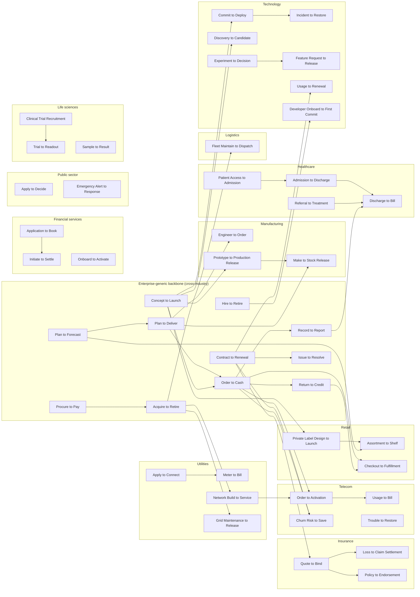
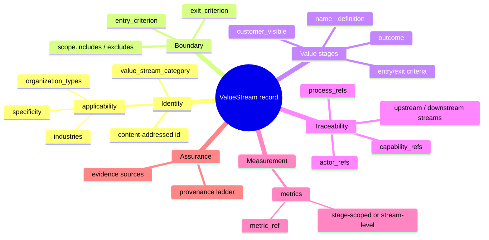
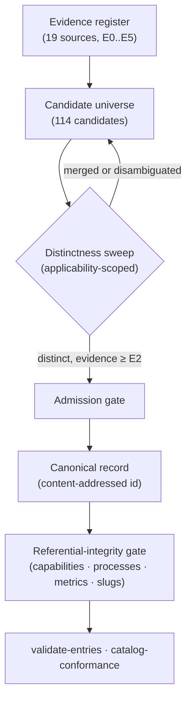

# OpenDEA Value Stream Catalog (dea-catalog-value-streams)

> A multi-sector/multi-industry collection of value-creating activities that deliver value to a consumer.

**Layer:** L3 · **Entity:** `VS` (`dea:ValueStream`) · **Building block:** `L3-value-delivery`

[](https://technehub-labs.github.io/metamodel/?entity=VS)
[](./LICENSE)
[](./CATALOG.yaml)
[](./classifications/industry-vocabulary.yaml)

This is the canonical catalog of **Value Stream (`VS`) records** for the TechNeHub Labs DEA ecosystem: 111 admitted streams — 11 enterprise-generic and 100 industry-specific — each defined as an ordered chain of value stages with entry/exit criteria, linked under referential integrity to the business capabilities that enable them, the business processes that realize them, the metrics that measure them, and the streams they connect to.

## The catalog on one page

| | |
|---|---|
| **Streams** | 111 (11 cross-industry · 100 industry-specific across 14 industries) |
| **Value stages** | 396, each with entry/exit criteria and outcome |
| **Categories** | 67 operational · 25 governance · 15 support · 4 development |
| **Cross-catalog links** | capabilities · processes · metrics — every reference resolves, gated in CI |
| **Shape** | [`schemas/entity.schema.json`](./schemas/entity.schema.json) · [`CATALOG.yaml`](./CATALOG.yaml) (generated index) |

## Cross-stream flow map

Every stream declares its upstream and downstream neighbours (slug-based, so links survive sibling id churn). The 11 enterprise-generic streams form the backbone; industry-specific chains attach to it at the points where they generalize it, and run as industry-internal chains otherwise.



*Full graph (all 46 cross-linked streams, including industry-internal chains for every industry) is derivable from each record's `upstream_refs` / `downstream_refs`; a per-industry rendering appears in each stream's directory README.*

## Value streams on the ECF matrix

Each stream's stage capabilities carry ECF coordinates (7 Domains × 7 Stages, per the
[metaframework](https://github.com/technehub-labs/dea-metaframework)) in the capabilities catalog. Projecting every stream's aggregated capabilities onto their primary ECF cells shows where the 111 streams concentrate — the overlay is derived from record data, not asserted:

| Domain \ Stage | conceive | design | build | activate | operate | improve | retire |
|---|---|---:|---:|---:|---:|---:|---:|
| **strategy-direction** | 3 | · | 16 | · | 20 | · | · |
| **party-relationship** | 21 | · | · | · | 64 | · | · |
| **product-value** | 17 | · | · | · | · | · | · |
| **finance-accounting** | 21 | · | · | · | 31 | · | · |
| **agency-organization** | · | 7 | 10 | · | · | · | · |
| **enablement-operations** | · | · | · | · | 186 | · | · |
| **governance-existence** | 92 | 9 | · | 14 | · | · | · |

*Each cell counts the streams whose stage capabilities have their primary ECF coordinate in that cell. Concentration in `enablement-operations/operate` and `party-relationship/operate` is expected: value streams are where enterprise work becomes externally visible value. The `governance-existence/conceive` cluster reflects the 25 governance streams (regulatory, quality, financial-crime, safety).*

## What a record captures



Every block is schema-enforced ([`schemas/entity.schema.json`](./schemas/entity.schema.json)) and referentially gated ([`scripts/check_referential_integrity.py`](./scripts/check_referential_integrity.py)): `capabilities:` refs resolve in [business-capabilities](https://github.com/technehub-labs/dea-catalog-business-capabilities), `processes:` refs in [business-processes](https://github.com/technehub-labs/dea-catalog-business-processes), `metric_ref`s in [metrics](https://github.com/technehub-labs/dea-catalog-metrics), and cross-stream slugs against this catalog — with a vendored offline snapshot under [`tools/id-sets/`](./tools/id-sets/).

## Ongoing Catalogued value streams

111 admitted streams across 15 applicability classes (the [`applicability`](./classifications/industry-vocabulary.yaml) dimension):

| Industry | Streams | Examples |
|---|---|---|
| cross-industry | 11 | Order to Cash, Procure to Pay, Hire to Retire, Record to Report |
| retail-commerce | 11 | Assortment to Shelf, Checkout to Fulfillment, Private Label Design to Launch |
| manufacturing | 9 | Engineer to Order, Make to Stock Release, Recall to Remediation |
| technology | 10 | Commit to Deploy, Incident to Restore, Model to Deployment |
| healthcare | 7 | Patient Access to Admission, Admission to Discharge, Discharge to Bill |
| financial-services | 8 | Application to Book, Onboard to Activate, Initiate to Settle |
| insurance | 7 | Quote to Bind, Loss to Claim Settlement, Policy to Endorsement |
| telecommunications | 7 | Order to Activation, Trouble to Restore, Usage to Bill |
| utilities-energy | 8 | Meter to Bill, Apply to Connect, Outage to Restore |
| logistics-transportation | 8 | Ship to Consignee, Customs Clearance to Release, Last-Mile Route to Proof |
| public-sector | 8 | Apply to Decide, Grant Award to Closeout, Request to Disclose |
| education | 6 | Admit to Graduate, Course Design to Delivery, Research Grant to Publication |
| hospitality-travel | 5 | Book to Stay, Event Book to Execute, Disruption to Reaccommodation |
| construction-real-estate | 7 | Tender to Award, Build to Handover, List to Close |
| life-sciences | 8 | Trial to Readout, Batch to Release, Adverse Event to Signal |

Each stream's directory under `entities/v1-alpha/value-stream-<slug>-<hash6>/` holds the authoritative record and a comprehensive README rendering every aspect of it.

## Method: how streams enter and evolve



Admission follows the org-wide catalog research pattern; the applicability dimension (CR-VS-11) scopes the pairwise distinctness test, which is what makes a 111-record catalog methodologically tractable.

## Repository structure

```
dea-catalog-value-streams/
├── metamodel-pointer.yaml   ← entity mapping (auto-generated from OpenDEAM; do not edit)
├── CATALOG.yaml             ← machine-generated catalog index (do not edit; regenerate)
├── schemas/entity.schema.json   ← entry schema + fixtures
├── entities/v1-alpha/       ← 111 records: value-stream-<slug>-<hash6>/{record.yaml, README.md}
├── catalog-research/        ← evidence register, candidate universe, admission register
├── change-requests/         ← CR-VS-* governance ledger
├── classifications/         ← industry-vocabulary.yaml (the applicability vocabulary)
├── scripts/                 ← regenerator, index gate, referential-integrity gate, hash6
├── tools/id-sets/           ← vendored sibling-catalog id snapshots (offline gate)
└── .github/workflows/       ← allocation · entries+integrity · conformance
```

## CI gates (what a PR must pass)

| Workflow | What it checks |
|---|---|
| `validate-allocation` | [`metamodel-pointer.yaml`](./metamodel-pointer.yaml) against the OpenDEAM allocation |
| `validate-entries` | every record (and the fixture) against [`schemas/entity.schema.json`](./schemas/entity.schema.json); cross-catalog referential integrity |
| `catalog-conformance` | [`CATALOG.yaml`](./CATALOG.yaml) matches regenerator output (freshness) and validates against the index schema |

## Ecosystem

| Artifact | Where |
|---|---|
| DEA Metamodel (canonical entity definitions) | [dea-metamodel](https://github.com/technehub-labs/dea-metamodel) |
| Root model / OpenDEAM (allocation source) | [dea-architecture-framework](https://github.com/technehub-labs/dea-architecture-framework) |
| Business capabilities (stage enablement) | [dea-catalog-business-capabilities](https://github.com/technehub-labs/dea-catalog-business-capabilities) |
| Business processes (stage realization) | [dea-catalog-business-processes](https://github.com/technehub-labs/dea-catalog-business-processes) |
| Metrics (stream measures) | [dea-catalog-metrics](https://github.com/technehub-labs/dea-catalog-metrics) |
| Org-wide catalog standards | [dea-metaframework](https://github.com/technehub-labs/dea-metaframework) |
| Metamodel Explorer | [technehub-labs.github.io/metamodel/?entity=VS](https://technehub-labs.github.io/metamodel/?entity=VS) |

## Governance

Every substantive change lands under a numbered change request — the full ledger lives in [`change-requests/`](./change-requests/README.md) (CR-VS-01..12) with delivery history in [CHANGELOG.md](./CHANGELOG.md). Record ids are content-addressed at canonicalization and stable thereafter; enrichment happens in place under a CR. See [CONTRIBUTING.md](./CONTRIBUTING.md) for the authorship rule, pointer discipline, and branch/PR flow.

## License

Apache License 2.0 — see [LICENSE](./LICENSE) and [NOTICE](./NOTICE).
