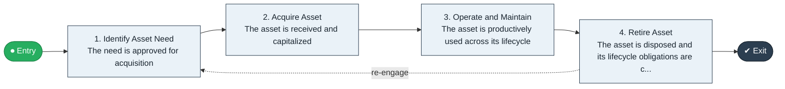

# Acquire to Retire

`value-streams:value-stream-acquire-to-retire-g5x89g` · **support** · cross-industry · generic

> The end-to-end asset-lifecycle stream from identification of an internal asset need through acquisition, use, and disposal.

**Outcome:** Assets productively used across their lifecycle and cleanly retired.

**Machine-readable:** this page is generated from — and must stay in sync with — the authoritative record [`value-streams-value-stream-acquire-to-retire-g5x89g.yaml`](./value-streams-value-stream-acquire-to-retire-g5x89g.yaml). The front matter above is YAML-extractable metadata.

## Stage flow

## Value stages

| # | Stage | Entry criterion | Exit criterion | Enabling capabilities (count) | Realizing processes (count) | Visible |
|---|---|---|---|---|---|---|
| 1 | **Identify Asset Need** | An asset need is identified for the enterprise's own use. | The need is approved for acquisition. | 2 | 1 | no |
| 2 | **Acquire Asset** | An acquisition case is approved. | The asset is received and capitalized. | 2 | 2 | no |
| 3 | **Operate and Maintain** | The asset is in service. | The asset is productively used across its lifecycle. | 2 | 2 | no |
| 4 | **Retire Asset** | The asset reaches end of useful life. | The asset is disposed and its lifecycle obligations are closed. | 2 | 1 | no |

### 1. Identify Asset Need

Identify the internal asset need.

| Aspect | Value |
|---|---|
| Entry criterion | An asset need is identified for the enterprise's own use. |
| Exit criterion | The need is approved for acquisition. |
| Outcome | An approved asset acquisition case. |
| Customer visible | False |
| Enabling capabilities | `capabilities:capability-asset-management-judtwr` · `capabilities:capability-enterprise-performance-management-5fxren` |
| Realizing processes | `processes:process-fa-conceive-4uqqvg` |

### 2. Acquire Asset

Acquire the asset.

| Aspect | Value |
|---|---|
| Entry criterion | An acquisition case is approved. |
| Exit criterion | The asset is received and capitalized. |
| Outcome | A capitalized asset in service. |
| Customer visible | False |
| Enabling capabilities | `capabilities:capability-asset-management-judtwr` · `capabilities:capability-sourcing-and-procurement-esucp4` |
| Realizing processes | `processes:process-eo-operate-vzcxx7` · `processes:process-eo-operate-j9cjzz` |

### 3. Operate and Maintain

Operate and maintain the asset productively.

| Aspect | Value |
|---|---|
| Entry criterion | The asset is in service. |
| Exit criterion | The asset is productively used across its lifecycle. |
| Outcome | Productive asset use. |
| Customer visible | False |
| Enabling capabilities | `capabilities:capability-asset-management-judtwr` · `capabilities:capability-operations-management-pm3w8k` |
| Realizing processes | `processes:process-eo-operate-j9cjzz` · `processes:process-eo-operate-xud3hs` |

### 4. Retire Asset

Dispose the asset and close lifecycle obligations.

| Aspect | Value |
|---|---|
| Entry criterion | The asset reaches end of useful life. |
| Exit criterion | The asset is disposed and its lifecycle obligations are closed. |
| Outcome | Cleanly retired assets. |
| Customer visible | False |
| Enabling capabilities | `capabilities:capability-asset-management-judtwr` · `capabilities:capability-financial-stewardship-c7xtfk` |
| Realizing processes | `processes:process-eo-retire-rpg6d4` |

## Scope boundary

**Entry:** An asset need is identified for the enterprise's own use.

**Exit:** The asset is disposed and its lifecycle obligations are closed.

**In scope**

- Internal asset need identification
- Asset acquisition
- Asset operation and maintenance
- Disposal and obligation closure

**Out of scope** (owned by the named neighbour)

- Supplier settlement (Procure to Pay)
- People lifecycle (Hire to Retire)
- Production execution as such (Plan to Deliver)

## Traceability

**Capabilities** (`aggregated_capability_refs`, resolving in [business-capabilities](https://github.com/technehub-labs/dea-catalog-business-capabilities)):

- `capabilities:capability-asset-management-judtwr`
- `capabilities:capability-sourcing-and-procurement-esucp4`
- `capabilities:capability-operations-management-pm3w8k`
- `capabilities:capability-enterprise-performance-management-5fxren`
- `capabilities:capability-financial-stewardship-c7xtfk`

**Processes** (`process_refs`, resolving in [business-processes](https://github.com/technehub-labs/dea-catalog-business-processes)):

- `processes:process-fa-conceive-4uqqvg`
- `processes:process-eo-operate-vzcxx7`
- `processes:process-eo-operate-j9cjzz`
- `processes:process-eo-operate-xud3hs`
- `processes:process-eo-retire-rpg6d4`

## Cross-stream links

**Upstream** (their exit feeds this stream's entry):

- [procure to pay](../value-stream-procure-to-pay-utma5c/README.md) — Procured assets enter the asset lifecycle at receipt.

**Downstream** (this stream's exit feeds their entry):

- [record to report](../value-stream-record-to-report-zw9z2r/README.md) — Asset depreciation and disposal are recorded as transactions.

## Measurement

- **Asset utilization rate** (stage: Operate and Maintain) — Productive use as a share of available asset capacity. → [`dea:metric-asset-utilization-rate`](https://github.com/technehub-labs/dea-catalog-metrics)
- **Time to retire** (stage: Retire Asset) — Elapsed time from retirement decision to obligation closure.

## Evidence

| Source | Class | Reference |
|---|---|---|
| SRC-006 | commercial-process-models | Hammer & Hurdle-style enterprise process-chain literature (public summaries) |

**Rationale:** Admitted from candidate VSC-013 under CR-VS-05 (third tranche; evidence at E3/high from the SRC-006 chain-inventory observation, distinctness closed per the CR-VS-05 sweep). Asset-lifecycle chain; served party is the internal asset custodian. Boundary vs. Procure to Pay: supplier settlement vs. asset disposal (CR-VS-05 boundary statement). Boundary vs. Hire to Retire: assets vs. people as the lifecycle object.

See [research/evidence.md](./research/evidence.md) for the source-backed notes.

## Provenance ladder

| Stage | Date | Actor |
|---|---|---|
| candidate | 2026-10-27 | Emmanuel A. Otchere, candidate universe v0.4 (CR-VS-05, register v0.3) |
| admitted | 2026-10-27 | Emmanuel A. Otchere, admission CR-VS-05 |
| active | 2026-10-27 | Emmanuel A. Otchere, CR-VS-07 enrichment (value stages, process links, scope, metrics) |
| active | 2026-10-28 | Emmanuel A. Otchere, CR-VS-08 metric backfill (metric_ref links to dea-catalog-metrics) |
| active | 2026-10-28 | Emmanuel A. Otchere, CR-VS-11 applicability backfill (cross-industry, generic) |

---

*Generated by [`scripts/generate_entity_docs.py`](../../../scripts/generate_entity_docs.py) (CR-VS-13) from the authoritative record. Do not edit by hand; regenerate.*
