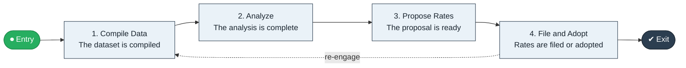

# Actuarial Data to Price

`value-streams:value-stream-actuarial-data-to-price-t5vjcj` · **governance** · insurance · industry-specific

> The pricing-governance stream from experience-data compilation through actuarial analysis to filed/adopted rates.

**Outcome:** Filed or adopted, defensible rates.

**Machine-readable:** this page is generated from — and must stay in sync with — the authoritative record [`value-streams-value-stream-actuarial-data-to-price-t5vjcj.yaml`](./value-streams-value-stream-actuarial-data-to-price-t5vjcj.yaml). The front matter above is YAML-extractable metadata.

## Stage flow

## Value stages

| # | Stage | Entry criterion | Exit criterion | Enabling capabilities (count) | Realizing processes (count) | Visible |
|---|---|---|---|---|---|---|
| 1 | **Compile Data** | A pricing cycle opens. | The dataset is compiled. | 2 | 1 | no |
| 2 | **Analyze** | The dataset is compiled. | The analysis is complete. | 2 | 1 | no |
| 3 | **Propose Rates** | The analysis is complete. | The proposal is ready. | 1 | 1 | no |
| 4 | **File and Adopt** | The proposal is ready. | Rates are filed or adopted. | 2 | 1 | no |

### 1. Compile Data

Compile claims and exposure experience data.

| Aspect | Value |
|---|---|
| Entry criterion | A pricing cycle opens. |
| Exit criterion | The dataset is compiled. |
| Outcome | A compiled dataset. |
| Customer visible | False |
| Enabling capabilities | `capabilities:capability-information-management-6vjgdh` · `capabilities:capability-insight-management-ms4n9d` |
| Realizing processes | `processes:process-sd-operate-ucxpz4` |

### 2. Analyze

Perform the actuarial analysis.

| Aspect | Value |
|---|---|
| Entry criterion | The dataset is compiled. |
| Exit criterion | The analysis is complete. |
| Outcome | A completed analysis. |
| Customer visible | False |
| Enabling capabilities | `capabilities:capability-insight-management-ms4n9d` · `capabilities:capability-risk-management-h9uxdw` |
| Realizing processes | `processes:process-fa-conceive-4uqqvg` |

### 3. Propose Rates

Propose the rate changes.

| Aspect | Value |
|---|---|
| Entry criterion | The analysis is complete. |
| Exit criterion | The proposal is ready. |
| Outcome | A rate proposal. |
| Customer visible | False |
| Enabling capabilities | `capabilities:capability-financial-resource-management-cd3c7c` |
| Realizing processes | `processes:process-fa-conceive-4uqqvg` |

### 4. File and Adopt

File or adopt the rates.

| Aspect | Value |
|---|---|
| Entry criterion | The proposal is ready. |
| Exit criterion | Rates are filed or adopted. |
| Outcome | Adopted rates. |
| Customer visible | False |
| Enabling capabilities | `capabilities:capability-regulation-management-gya4d8` · `capabilities:capability-legal-matter-management-zzbd2u` |
| Realizing processes | `processes:process-fa-operate-8vqvkk` |

## Scope boundary

**Entry:** A pricing review cycle opens.

**Exit:** Rates are filed or adopted.

**In scope**

- Experience data compilation
- Actuarial analysis
- Rate proposal
- Filing and adoption

**Out of scope** (owned by the named neighbour)

- Claims data operations
- Regulatory reporting

## Traceability

**Capabilities** (`aggregated_capability_refs`, resolving in [business-capabilities](https://github.com/technehub-labs/dea-catalog-business-capabilities)):

- `capabilities:capability-information-management-6vjgdh`
- `capabilities:capability-insight-management-ms4n9d`
- `capabilities:capability-risk-management-h9uxdw`
- `capabilities:capability-financial-resource-management-cd3c7c`
- `capabilities:capability-regulation-management-gya4d8`
- `capabilities:capability-legal-matter-management-zzbd2u`

**Processes** (`process_refs`, resolving in [business-processes](https://github.com/technehub-labs/dea-catalog-business-processes)):

- `processes:process-sd-operate-ucxpz4`
- `processes:process-fa-conceive-4uqqvg`
- `processes:process-fa-operate-8vqvkk`

## Cross-stream links

**Upstream:** none recorded.

**Downstream:** none recorded.

## Measurement

- **Rate-filing cycle time** (stream-level) — Elapsed time from cycle open to adoption.

## Evidence

| Source | Class | Reference |
|---|---|---|
| SRC-009 | industry-reference-model | Insurance industry reference models (policy and claims lifecycles, public structure) |

**Rationale:** Admitted under CR-VS-12 (population tranche; candidate VSC-033) from the CR-VS-11 industry evidence register extension. Industry-specific chain (insurance); distinct from cross-industry streams by applicability (CR-VS-11 method note); cross-catalog references resolve against the sibling catalogs per the referential-integrity gate.

See [research/evidence.md](./research/evidence.md) for the source-backed notes.

## Provenance ladder

| Stage | Date | Actor |
|---|---|---|
| candidate | 2026-10-28 | Emmanuel A. Otchere, candidate universe v0.6 (CR-VS-12) |
| admitted | 2026-10-28 | Emmanuel A. Otchere, admission CR-VS-12 |

---

*Generated by [`scripts/generate_entity_docs.py`](../../../scripts/generate_entity_docs.py) (CR-VS-13) from the authoritative record. Do not edit by hand; regenerate.*
