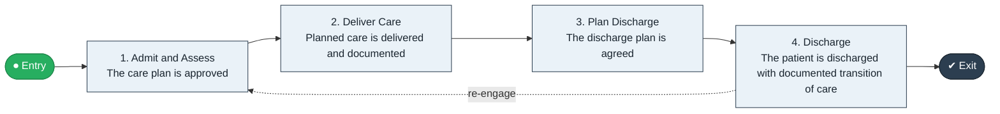

# Admission to Discharge

`value-streams:value-stream-admission-to-discharge-xeuu5u` · **operational** · healthcare · industry-specific

> The end-to-end care delivery stream from admission through care provision to discharge with a documented transition.

**Outcome:** A patient completes a care episode and is discharged with documented transition of care.

**Machine-readable:** this page is generated from — and must stay in sync with — the authoritative record [`value-streams-value-stream-admission-to-discharge-xeuu5u.yaml`](./value-streams-value-stream-admission-to-discharge-xeuu5u.yaml). The front matter above is YAML-extractable metadata.

## Stage flow

## Value stages

| # | Stage | Entry criterion | Exit criterion | Enabling capabilities (count) | Realizing processes (count) | Visible |
|---|---|---|---|---|---|---|
| 1 | **Admit and Assess** | The patient is admitted. | The care plan is approved. | 2 | 1 | yes |
| 2 | **Deliver Care** | A care plan is approved. | Planned care is delivered and documented. | 2 | 2 | yes |
| 3 | **Plan Discharge** | The episode nears completion. | The discharge plan is agreed. | 2 | 1 | yes |
| 4 | **Discharge** | A discharge plan is agreed. | The patient is discharged with documented transition of care. | 2 | 1 | yes |

### 1. Admit and Assess

Complete admission assessment and care plan.

| Aspect | Value |
|---|---|
| Entry criterion | The patient is admitted. |
| Exit criterion | The care plan is approved. |
| Outcome | An approved care plan. |
| Customer visible | True |
| Enabling capabilities | `capabilities:capability-operations-management-pm3w8k` · `capabilities:capability-workforce-management-9e8d8s` |
| Realizing processes | `processes:process-eo-operate-2jnz85` |

### 2. Deliver Care

Deliver care per the plan across the episode.

| Aspect | Value |
|---|---|
| Entry criterion | A care plan is approved. |
| Exit criterion | Planned care is delivered and documented. |
| Outcome | Delivered, documented care. |
| Customer visible | True |
| Enabling capabilities | `capabilities:capability-operations-management-pm3w8k` · `capabilities:capability-information-management-6vjgdh` |
| Realizing processes | `processes:process-eo-operate-2jnz85` · `processes:process-eo-operate-44jsrp` |

### 3. Plan Discharge

Prepare the discharge and transition plan.

| Aspect | Value |
|---|---|
| Entry criterion | The episode nears completion. |
| Exit criterion | The discharge plan is agreed. |
| Outcome | An agreed discharge plan. |
| Customer visible | True |
| Enabling capabilities | `capabilities:capability-customer-management-f3n8wb` · `capabilities:capability-operations-management-pm3w8k` |
| Realizing processes | `processes:process-eo-operate-2jnz85` |

### 4. Discharge

Execute discharge with documented transition.

| Aspect | Value |
|---|---|
| Entry criterion | A discharge plan is agreed. |
| Exit criterion | The patient is discharged with documented transition of care. |
| Outcome | A completed episode with safe transition. |
| Customer visible | True |
| Enabling capabilities | `capabilities:capability-operations-management-pm3w8k` · `capabilities:capability-information-management-6vjgdh` |
| Realizing processes | `processes:process-eo-operate-2jnz85` |

## Scope boundary

**Entry:** A patient is admitted for a care episode.

**Exit:** The patient is discharged with documented transition of care.

**In scope**

- Care planning and delivery during the episode
- Clinical documentation
- Discharge planning and execution

**Out of scope** (owned by the named neighbour)

- Patient access and scheduling (Patient Access to Admission)
- Final billing (Discharge to Bill)

## Traceability

**Capabilities** (`aggregated_capability_refs`, resolving in [business-capabilities](https://github.com/technehub-labs/dea-catalog-business-capabilities)):

- `capabilities:capability-operations-management-pm3w8k`
- `capabilities:capability-workforce-management-9e8d8s`
- `capabilities:capability-information-management-6vjgdh`
- `capabilities:capability-customer-management-f3n8wb`

**Processes** (`process_refs`, resolving in [business-processes](https://github.com/technehub-labs/dea-catalog-business-processes)):

- `processes:process-eo-operate-2jnz85`
- `processes:process-eo-operate-44jsrp`

## Cross-stream links

**Upstream** (their exit feeds this stream's entry):

- [patient access to admission](../value-stream-patient-access-to-admission-szj9jm/README.md) — The access stream ends at admission.

**Downstream** (this stream's exit feeds their entry):

- [discharge to bill](../value-stream-discharge-to-bill-3k7wbb/README.md) — Discharge starts the revenue-cycle back end.

## Measurement

- **Average length of stay** (stage: Discharge) — Mean inpatient days per episode. → [`dea:metric-average-length-of-stay`](https://github.com/technehub-labs/dea-catalog-metrics)
- **Readmission rate within 30 days** (stage: Discharge) — Share of discharges readmitted within 30 days. → [`dea:metric-readmission-rate-within-30-days`](https://github.com/technehub-labs/dea-catalog-metrics)

## Evidence

| Source | Class | Reference |
|---|---|---|
| SRC-007 | industry-reference-model | Healthcare industry reference models (patient-access and revenue-cycle chains, public structure) |

**Rationale:** Admitted under CR-VS-12 (population tranche; candidate VSC-016) from the CR-VS-11 industry evidence register extension. Industry-specific chain (healthcare); distinct from cross-industry streams by applicability (CR-VS-11 method note); cross-catalog references resolve against the sibling catalogs per the referential-integrity gate.

See [research/evidence.md](./research/evidence.md) for the source-backed notes.

## Provenance ladder

| Stage | Date | Actor |
|---|---|---|
| candidate | 2026-10-28 | Emmanuel A. Otchere, candidate universe v0.6 (CR-VS-12) |
| admitted | 2026-10-28 | Emmanuel A. Otchere, admission CR-VS-12 |

---

*Generated by [`scripts/generate_entity_docs.py`](../../../scripts/generate_entity_docs.py) (CR-VS-13) from the authoritative record. Do not edit by hand; regenerate.*
