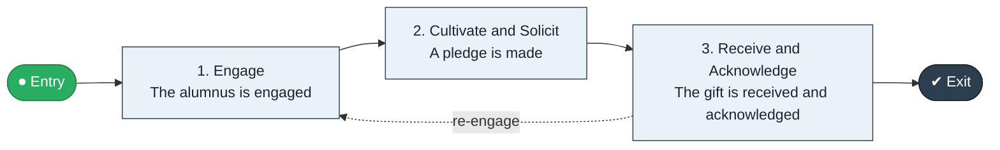

# Alumni Engage to Give

`value-streams:value-stream-alumni-engage-to-give-r5s8qw` · **support** · education · industry-specific

> The advancement stream from alumni engagement through cultivation to received contribution.

**Outcome:** A received, acknowledged alumni contribution.

**Machine-readable:** this page is generated from — and must stay in sync with — the authoritative record [`value-streams-value-stream-alumni-engage-to-give-r5s8qw.yaml`](./value-streams-value-stream-alumni-engage-to-give-r5s8qw.yaml). The front matter above is YAML-extractable metadata.

## Stage flow

## Value stages

| # | Stage | Entry criterion | Exit criterion | Enabling capabilities (count) | Realizing processes (count) | Visible |
|---|---|---|---|---|---|---|
| 1 | **Engage** | An alumnus is identified. | The alumnus is engaged. | 2 | 1 | yes |
| 2 | **Cultivate and Solicit** | The alumnus is engaged. | A pledge is made. | 2 | 1 | yes |
| 3 | **Receive and Acknowledge** | A pledge is made. | The gift is received and acknowledged. | 2 | 1 | yes |

### 1. Engage

Engage the alumnus.

| Aspect | Value |
|---|---|
| Entry criterion | An alumnus is identified. |
| Exit criterion | The alumnus is engaged. |
| Outcome | An engaged alumnus. |
| Customer visible | True |
| Enabling capabilities | `capabilities:capability-marketing-xmc539` · `capabilities:capability-customer-management-f3n8wb` |
| Realizing processes | `processes:process-pr-improve-t6uvan` |

### 2. Cultivate and Solicit

Cultivate and solicit the gift.

| Aspect | Value |
|---|---|
| Entry criterion | The alumnus is engaged. |
| Exit criterion | A pledge is made. |
| Outcome | A pledged gift. |
| Customer visible | True |
| Enabling capabilities | `capabilities:capability-customer-management-f3n8wb` · `capabilities:capability-partner-management-cp3vdb` |
| Realizing processes | `processes:process-pr-operate-bbe384` |

### 3. Receive and Acknowledge

Receive and acknowledge the contribution.

| Aspect | Value |
|---|---|
| Entry criterion | A pledge is made. |
| Exit criterion | The gift is received and acknowledged. |
| Outcome | A received gift. |
| Customer visible | True |
| Enabling capabilities | `capabilities:capability-financial-stewardship-c7xtfk` · `capabilities:capability-customer-management-f3n8wb` |
| Realizing processes | `processes:process-fa-operate-sdppmp` |

## Scope boundary

**Entry:** An alumnus is engaged.

**Exit:** The contribution is received and acknowledged.

**In scope**

- Engagement
- Cultivation and solicitation
- Receipt and acknowledgement

**Out of scope** (owned by the named neighbour)

- Degree delivery
- Corporate partnerships

## Traceability

**Capabilities** (`aggregated_capability_refs`, resolving in [business-capabilities](https://github.com/technehub-labs/dea-catalog-business-capabilities)):

- `capabilities:capability-marketing-xmc539`
- `capabilities:capability-customer-management-f3n8wb`
- `capabilities:capability-partner-management-cp3vdb`
- `capabilities:capability-financial-stewardship-c7xtfk`

**Processes** (`process_refs`, resolving in [business-processes](https://github.com/technehub-labs/dea-catalog-business-processes)):

- `processes:process-pr-improve-t6uvan`
- `processes:process-pr-operate-bbe384`
- `processes:process-fa-operate-sdppmp`

## Cross-stream links

**Upstream:** none recorded.

**Downstream:** none recorded.

## Measurement

- **Alumni participation rate** (stream-level) — Share of alumni contributing per year.

## Evidence

| Source | Class | Reference |
|---|---|---|
| SRC-015 | industry-reference-model | Education and hospitality service chains (public structure) |

**Rationale:** Admitted under CR-VS-12 (population tranche; candidate VSC-085) from the CR-VS-11 industry evidence register extension. Industry-specific chain (education); distinct from cross-industry streams by applicability (CR-VS-11 method note); cross-catalog references resolve against the sibling catalogs per the referential-integrity gate.

See [research/evidence.md](./research/evidence.md) for the source-backed notes.

## Provenance ladder

| Stage | Date | Actor |
|---|---|---|
| candidate | 2026-10-28 | Emmanuel A. Otchere, candidate universe v0.6 (CR-VS-12) |
| admitted | 2026-10-28 | Emmanuel A. Otchere, admission CR-VS-12 |

---

*Generated by [`scripts/generate_entity_docs.py`](../../../scripts/generate_entity_docs.py) (CR-VS-13) from the authoritative record. Do not edit by hand; regenerate.*
