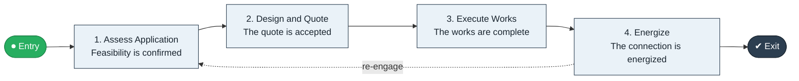

# Apply to Connect

`value-streams:value-stream-apply-to-connect-y64n29` · **operational** · utilities-energy · industry-specific

> The connection stream from connection application through design, works, and energization.

**Outcome:** An energized connection for the applicant.

**Machine-readable:** this page is generated from — and must stay in sync with — the authoritative record [`value-streams-value-stream-apply-to-connect-y64n29.yaml`](./value-streams-value-stream-apply-to-connect-y64n29.yaml). The front matter above is YAML-extractable metadata.

## Stage flow

## Value stages

| # | Stage | Entry criterion | Exit criterion | Enabling capabilities (count) | Realizing processes (count) | Visible |
|---|---|---|---|---|---|---|
| 1 | **Assess Application** | An application is received. | Feasibility is confirmed. | 2 | 1 | yes |
| 2 | **Design and Quote** | Feasibility is confirmed. | The quote is accepted. | 2 | 1 | yes |
| 3 | **Execute Works** | The quote is accepted. | The works are complete. | 1 | 2 | yes |
| 4 | **Energize** | The works are complete. | The connection is energized. | 2 | 1 | yes |

### 1. Assess Application

Assess the application and connection feasibility.

| Aspect | Value |
|---|---|
| Entry criterion | An application is received. |
| Exit criterion | Feasibility is confirmed. |
| Outcome | A feasible application. |
| Customer visible | True |
| Enabling capabilities | `capabilities:capability-customer-management-f3n8wb` · `capabilities:capability-operations-management-pm3w8k` |
| Realizing processes | `processes:process-pr-operate-bbe384` |

### 2. Design and Quote

Design the connection and quote.

| Aspect | Value |
|---|---|
| Entry criterion | Feasibility is confirmed. |
| Exit criterion | The quote is accepted. |
| Outcome | An accepted quote. |
| Customer visible | True |
| Enabling capabilities | `capabilities:capability-technology-management-maus5n` · `capabilities:capability-financial-resource-management-cd3c7c` |
| Realizing processes | `processes:process-eo-design-6j5mxp` |

### 3. Execute Works

Execute the connection works.

| Aspect | Value |
|---|---|
| Entry criterion | The quote is accepted. |
| Exit criterion | The works are complete. |
| Outcome | Completed works. |
| Customer visible | True |
| Enabling capabilities | `capabilities:capability-operations-management-pm3w8k` |
| Realizing processes | `processes:process-eo-build-j9z3q4` · `processes:process-eo-operate-xud3hs` |

### 4. Energize

Energize the connection and activate the account.

| Aspect | Value |
|---|---|
| Entry criterion | The works are complete. |
| Exit criterion | The connection is energized. |
| Outcome | An energized connection. |
| Customer visible | True |
| Enabling capabilities | `capabilities:capability-operations-management-pm3w8k` · `capabilities:capability-customer-management-f3n8wb` |
| Realizing processes | `processes:process-eo-operate-2jnz85` |

## Scope boundary

**Entry:** A connection application is received.

**Exit:** The connection is energized.

**In scope**

- Application and feasibility
- Design and quotation
- Works execution
- Energization

**Out of scope** (owned by the named neighbour)

- Metering (Meter to Bill)
- Network capacity planning

## Traceability

**Capabilities** (`aggregated_capability_refs`, resolving in [business-capabilities](https://github.com/technehub-labs/dea-catalog-business-capabilities)):

- `capabilities:capability-customer-management-f3n8wb`
- `capabilities:capability-operations-management-pm3w8k`
- `capabilities:capability-technology-management-maus5n`
- `capabilities:capability-financial-resource-management-cd3c7c`

**Processes** (`process_refs`, resolving in [business-processes](https://github.com/technehub-labs/dea-catalog-business-processes)):

- `processes:process-pr-operate-bbe384`
- `processes:process-eo-design-6j5mxp`
- `processes:process-eo-build-j9z3q4`
- `processes:process-eo-operate-xud3hs`
- `processes:process-eo-operate-2jnz85`

## Cross-stream links

**Upstream:** none recorded.

**Downstream** (this stream's exit feeds their entry):

- [meter to bill](../value-stream-meter-to-bill-6bhvk9/README.md) — Energized connections begin metered consumption.

## Measurement

- **Connection cycle time** (stream-level) — Elapsed days from application to energization.

## Evidence

| Source | Class | Reference |
|---|---|---|
| SRC-011 | industry-reference-model | Utilities industry reference models (metering and retail-energy chains, public structure) |

**Rationale:** Admitted under CR-VS-12 (population tranche; candidate VSC-044) from the CR-VS-11 industry evidence register extension. Industry-specific chain (utilities-energy); distinct from cross-industry streams by applicability (CR-VS-11 method note); cross-catalog references resolve against the sibling catalogs per the referential-integrity gate.

See [research/evidence.md](./research/evidence.md) for the source-backed notes.

## Provenance ladder

| Stage | Date | Actor |
|---|---|---|
| candidate | 2026-10-28 | Emmanuel A. Otchere, candidate universe v0.6 (CR-VS-12) |
| admitted | 2026-10-28 | Emmanuel A. Otchere, admission CR-VS-12 |

---

*Generated by [`scripts/generate_entity_docs.py`](../../../scripts/generate_entity_docs.py) (CR-VS-13) from the authoritative record. Do not edit by hand; regenerate.*
