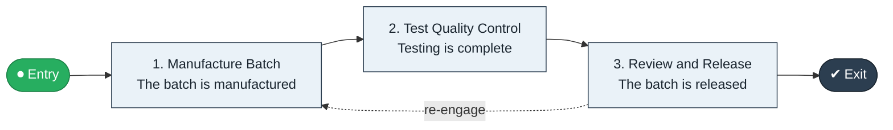

# Batch to Release

`value-streams:value-stream-batch-to-release-mzc7cf` · **operational** · life-sciences · industry-specific

> The GMP stream from batch start through manufacturing and quality control to released batch.

**Outcome:** A quality-released batch available for distribution.

**Machine-readable:** this page is generated from — and must stay in sync with — the authoritative record [`value-streams-value-stream-batch-to-release-mzc7cf.yaml`](./value-streams-value-stream-batch-to-release-mzc7cf.yaml). The front matter above is YAML-extractable metadata.

## Stage flow

## Value stages

| # | Stage | Entry criterion | Exit criterion | Enabling capabilities (count) | Realizing processes (count) | Visible |
|---|---|---|---|---|---|---|
| 1 | **Manufacture Batch** | A batch is scheduled. | The batch is manufactured. | 1 | 1 | no |
| 2 | **Test Quality Control** | The batch is manufactured. | Testing is complete. | 2 | 1 | no |
| 3 | **Review and Release** | Testing is complete. | The batch is released. | 2 | 1 | no |

### 1. Manufacture Batch

Manufacture the batch.

| Aspect | Value |
|---|---|
| Entry criterion | A batch is scheduled. |
| Exit criterion | The batch is manufactured. |
| Outcome | A manufactured batch. |
| Customer visible | False |
| Enabling capabilities | `capabilities:capability-operations-management-pm3w8k` |
| Realizing processes | `processes:process-eo-operate-xud3hs` |

### 2. Test Quality Control

Run quality-control testing.

| Aspect | Value |
|---|---|
| Entry criterion | The batch is manufactured. |
| Exit criterion | Testing is complete. |
| Outcome | QC results. |
| Customer visible | False |
| Enabling capabilities | `capabilities:capability-risk-management-h9uxdw` · `capabilities:capability-information-management-6vjgdh` |
| Realizing processes | `processes:process-eo-operate-44jsrp` |

### 3. Review and Release

Review the batch record and release.

| Aspect | Value |
|---|---|
| Entry criterion | Testing is complete. |
| Exit criterion | The batch is released. |
| Outcome | A released batch. |
| Customer visible | False |
| Enabling capabilities | `capabilities:capability-enterprise-governance-uas48u` · `capabilities:capability-risk-management-h9uxdw` |
| Realizing processes | `processes:process-ge-operate-zwaes5` |

## Scope boundary

**Entry:** A production batch is scheduled.

**Exit:** The batch is released by quality.

**In scope**

- Batch manufacturing
- Quality control testing
- Batch record review and release

**Out of scope** (owned by the named neighbour)

- Supply planning (Plan to Deliver)
- Distribution (Ship to Consignee)

## Traceability

**Capabilities** (`aggregated_capability_refs`, resolving in [business-capabilities](https://github.com/technehub-labs/dea-catalog-business-capabilities)):

- `capabilities:capability-operations-management-pm3w8k`
- `capabilities:capability-risk-management-h9uxdw`
- `capabilities:capability-information-management-6vjgdh`
- `capabilities:capability-enterprise-governance-uas48u`

**Processes** (`process_refs`, resolving in [business-processes](https://github.com/technehub-labs/dea-catalog-business-processes)):

- `processes:process-eo-operate-xud3hs`
- `processes:process-eo-operate-44jsrp`
- `processes:process-ge-operate-zwaes5`

## Cross-stream links

**Upstream:** none recorded.

**Downstream:** none recorded.

## Measurement

- **Batch release cycle time** (stream-level) — Elapsed time from manufacture to release.

## Evidence

| Source | Class | Reference |
|---|---|---|
| SRC-018 | industry-reference-model | Life-sciences reference chains (public GxP/ICH category structure) |

**Rationale:** Admitted under CR-VS-12 (population tranche; candidate VSC-099) from the CR-VS-11 industry evidence register extension. Industry-specific chain (life-sciences); distinct from cross-industry streams by applicability (CR-VS-11 method note); cross-catalog references resolve against the sibling catalogs per the referential-integrity gate.

See [research/evidence.md](./research/evidence.md) for the source-backed notes.

## Provenance ladder

| Stage | Date | Actor |
|---|---|---|
| candidate | 2026-10-28 | Emmanuel A. Otchere, candidate universe v0.6 (CR-VS-12) |
| admitted | 2026-10-28 | Emmanuel A. Otchere, admission CR-VS-12 |

---

*Generated by [`scripts/generate_entity_docs.py`](../../../scripts/generate_entity_docs.py) (CR-VS-13) from the authoritative record. Do not edit by hand; regenerate.*
