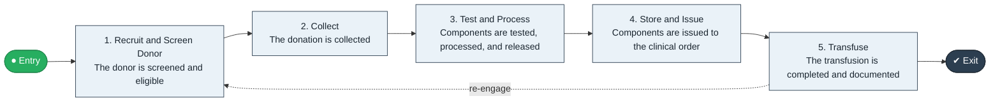

# Blood Donation to Transfusion

`value-streams:value-stream-blood-donation-to-transfusion-m4h36n` · **operational** · healthcare · industry-specific

> The end-to-end blood stream from donor recruitment through collection, testing, processing, and transfusion to the recipient.

**Outcome:** Safe blood components transfused to the patient who needs them.

**Machine-readable:** this page is generated from — and must stay in sync with — the authoritative record [`value-streams-value-stream-blood-donation-to-transfusion-m4h36n.yaml`](./value-streams-value-stream-blood-donation-to-transfusion-m4h36n.yaml). The front matter above is YAML-extractable metadata.

## Stage flow

## Value stages

| # | Stage | Entry criterion | Exit criterion | Enabling capabilities (count) | Realizing processes (count) | Visible |
|---|---|---|---|---|---|---|
| 1 | **Recruit and Screen Donor** | A donor presents or is recruited. | The donor is screened and eligible. | 2 | 1 | yes |
| 2 | **Collect** | A donor is eligible. | The donation is collected. | 1 | 1 | yes |
| 3 | **Test and Process** | A donation is collected. | Components are tested, processed, and released. | 3 | 1 | no |
| 4 | **Store and Issue** | Components are released. | Components are issued to the clinical order. | 2 | 1 | no |
| 5 | **Transfuse** | Components are issued. | The transfusion is completed and documented. | 2 | 1 | yes |

### 1. Recruit and Screen Donor

Recruit the donor and complete donation screening.

| Aspect | Value |
|---|---|
| Entry criterion | A donor presents or is recruited. |
| Exit criterion | The donor is screened and eligible. |
| Outcome | An eligible, screened donor. |
| Customer visible | True |
| Enabling capabilities | `capabilities:capability-marketing-xmc539` · `capabilities:capability-customer-management-f3n8wb` |
| Realizing processes | `processes:process-pr-build-nygvw7` |

### 2. Collect

Collect the donation.

| Aspect | Value |
|---|---|
| Entry criterion | A donor is eligible. |
| Exit criterion | The donation is collected. |
| Outcome | A collected donation. |
| Customer visible | True |
| Enabling capabilities | `capabilities:capability-operations-management-pm3w8k` |
| Realizing processes | `processes:process-eo-operate-2jnz85` |

### 3. Test and Process

Test and process the donation into components.

| Aspect | Value |
|---|---|
| Entry criterion | A donation is collected. |
| Exit criterion | Components are tested, processed, and released. |
| Outcome | Released safe components. |
| Customer visible | False |
| Enabling capabilities | `capabilities:capability-information-management-6vjgdh` · `capabilities:capability-risk-management-h9uxdw` · `capabilities:capability-operations-management-pm3w8k` |
| Realizing processes | `processes:process-eo-operate-44jsrp` |

### 4. Store and Issue

Store components and issue to order.

| Aspect | Value |
|---|---|
| Entry criterion | Components are released. |
| Exit criterion | Components are issued to the clinical order. |
| Outcome | Issued components. |
| Customer visible | False |
| Enabling capabilities | `capabilities:capability-operations-management-pm3w8k` · `capabilities:capability-information-management-6vjgdh` |
| Realizing processes | `processes:process-eo-operate-zwzmbd` |

### 5. Transfuse

Transfuse to the recipient and document.

| Aspect | Value |
|---|---|
| Entry criterion | Components are issued. |
| Exit criterion | The transfusion is completed and documented. |
| Outcome | A transfused, monitored patient. |
| Customer visible | True |
| Enabling capabilities | `capabilities:capability-operations-management-pm3w8k` · `capabilities:capability-information-management-6vjgdh` |
| Realizing processes | `processes:process-eo-operate-2jnz85` |

## Scope boundary

**Entry:** A donor presents or is recruited.

**Exit:** The transfusion is completed and documented.

**In scope**

- Donor recruitment and screening
- Collection
- Testing and processing
- Storage and issue
- Transfusion

**Out of scope** (owned by the named neighbour)

- General laboratory operations
- Research biobanking

## Traceability

**Capabilities** (`aggregated_capability_refs`, resolving in [business-capabilities](https://github.com/technehub-labs/dea-catalog-business-capabilities)):

- `capabilities:capability-marketing-xmc539`
- `capabilities:capability-customer-management-f3n8wb`
- `capabilities:capability-operations-management-pm3w8k`
- `capabilities:capability-information-management-6vjgdh`
- `capabilities:capability-risk-management-h9uxdw`

**Processes** (`process_refs`, resolving in [business-processes](https://github.com/technehub-labs/dea-catalog-business-processes)):

- `processes:process-pr-build-nygvw7`
- `processes:process-eo-operate-2jnz85`
- `processes:process-eo-operate-44jsrp`
- `processes:process-eo-operate-zwzmbd`

## Cross-stream links

**Upstream:** none recorded.

**Downstream:** none recorded.

## Measurement

- **Blood component wastage rate** (stream-level) — Expired or discarded units as a share of collected volume.

## Evidence

| Source | Class | Reference |
|---|---|---|
| SRC-007 | industry-reference-model | Healthcare industry reference models (patient-access and revenue-cycle chains, public structure) |

**Rationale:** Admitted under CR-VS-12 (population tranche; candidate VSC-020) from the CR-VS-11 industry evidence register extension. Industry-specific chain (healthcare); distinct from cross-industry streams by applicability (CR-VS-11 method note); cross-catalog references resolve against the sibling catalogs per the referential-integrity gate.

See [research/evidence.md](./research/evidence.md) for the source-backed notes.

## Provenance ladder

| Stage | Date | Actor |
|---|---|---|
| candidate | 2026-10-28 | Emmanuel A. Otchere, candidate universe v0.6 (CR-VS-12) |
| admitted | 2026-10-28 | Emmanuel A. Otchere, admission CR-VS-12 |

---

*Generated by [`scripts/generate_entity_docs.py`](../../../scripts/generate_entity_docs.py) (CR-VS-13) from the authoritative record. Do not edit by hand; regenerate.*
