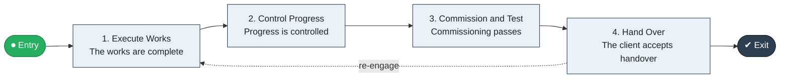

# Build to Handover

`value-streams:value-stream-build-to-handover-9fyyzn` · **operational** · construction-real-estate · industry-specific

> The project-delivery stream from construction start through works and commissioning to client handover.

**Outcome:** A handed-over, commissioned project.

**Machine-readable:** this page is generated from — and must stay in sync with — the authoritative record [`value-streams-value-stream-build-to-handover-9fyyzn.yaml`](./value-streams-value-stream-build-to-handover-9fyyzn.yaml). The front matter above is YAML-extractable metadata.

## Stage flow

## Value stages

| # | Stage | Entry criterion | Exit criterion | Enabling capabilities (count) | Realizing processes (count) | Visible |
|---|---|---|---|---|---|---|
| 1 | **Execute Works** | The project commences. | The works are complete. | 2 | 2 | yes |
| 2 | **Control Progress** | Works are underway. | Progress is controlled. | 2 | 1 | no |
| 3 | **Commission and Test** | The works are complete. | Commissioning passes. | 2 | 1 | no |
| 4 | **Hand Over** | Commissioning passes. | The client accepts handover. | 2 | 1 | yes |

### 1. Execute Works

Execute the construction works.

| Aspect | Value |
|---|---|
| Entry criterion | The project commences. |
| Exit criterion | The works are complete. |
| Outcome | Completed works. |
| Customer visible | True |
| Enabling capabilities | `capabilities:capability-operations-management-pm3w8k` · `capabilities:capability-workforce-management-9e8d8s` |
| Realizing processes | `processes:process-eo-operate-xud3hs` · `processes:process-eo-operate-2jnz85` |

### 2. Control Progress

Control progress, quality, and safety.

| Aspect | Value |
|---|---|
| Entry criterion | Works are underway. |
| Exit criterion | Progress is controlled. |
| Outcome | Controlled progress. |
| Customer visible | False |
| Enabling capabilities | `capabilities:capability-enterprise-performance-management-5fxren` · `capabilities:capability-security-management-wmzc7c` |
| Realizing processes | `processes:process-ge-operate-zwaes5` |

### 3. Commission and Test

Commission and test the asset.

| Aspect | Value |
|---|---|
| Entry criterion | The works are complete. |
| Exit criterion | Commissioning passes. |
| Outcome | A commissioned asset. |
| Customer visible | False |
| Enabling capabilities | `capabilities:capability-technology-management-maus5n` · `capabilities:capability-risk-management-h9uxdw` |
| Realizing processes | `processes:process-eo-operate-44jsrp` |

### 4. Hand Over

Hand over to the client.

| Aspect | Value |
|---|---|
| Entry criterion | Commissioning passes. |
| Exit criterion | The client accepts handover. |
| Outcome | A handed-over project. |
| Customer visible | True |
| Enabling capabilities | `capabilities:capability-customer-management-f3n8wb` · `capabilities:capability-legal-matter-management-zzbd2u` |
| Realizing processes | `processes:process-ge-build-mctdgc` |

## Scope boundary

**Entry:** The project commences on site.

**Exit:** The project is handed over to the client.

**In scope**

- Works execution
- Progress control
- Commissioning and testing
- Handover

**Out of scope** (owned by the named neighbour)

- Pre-contract design
- Defects liability management

## Traceability

**Capabilities** (`aggregated_capability_refs`, resolving in [business-capabilities](https://github.com/technehub-labs/dea-catalog-business-capabilities)):

- `capabilities:capability-operations-management-pm3w8k`
- `capabilities:capability-workforce-management-9e8d8s`
- `capabilities:capability-enterprise-performance-management-5fxren`
- `capabilities:capability-security-management-wmzc7c`
- `capabilities:capability-technology-management-maus5n`
- `capabilities:capability-risk-management-h9uxdw`
- `capabilities:capability-customer-management-f3n8wb`
- `capabilities:capability-legal-matter-management-zzbd2u`

**Processes** (`process_refs`, resolving in [business-processes](https://github.com/technehub-labs/dea-catalog-business-processes)):

- `processes:process-eo-operate-xud3hs`
- `processes:process-eo-operate-2jnz85`
- `processes:process-ge-operate-zwaes5`
- `processes:process-eo-operate-44jsrp`
- `processes:process-ge-build-mctdgc`

## Cross-stream links

**Upstream:** none recorded.

**Downstream:** none recorded.

## Measurement

- **Handover on-time rate** (stream-level) — Share of projects handed over on schedule.

## Evidence

| Source | Class | Reference |
|---|---|---|
| SRC-017 | industry-reference-model | Construction and real-estate chains (public structure) |

**Rationale:** Admitted under CR-VS-12 (population tranche; candidate VSC-093) from the CR-VS-11 industry evidence register extension. Industry-specific chain (construction-real-estate); distinct from cross-industry streams by applicability (CR-VS-11 method note); cross-catalog references resolve against the sibling catalogs per the referential-integrity gate.

See [research/evidence.md](./research/evidence.md) for the source-backed notes.

## Provenance ladder

| Stage | Date | Actor |
|---|---|---|
| candidate | 2026-10-28 | Emmanuel A. Otchere, candidate universe v0.6 (CR-VS-12) |
| admitted | 2026-10-28 | Emmanuel A. Otchere, admission CR-VS-12 |

---

*Generated by [`scripts/generate_entity_docs.py`](../../../scripts/generate_entity_docs.py) (CR-VS-13) from the authoritative record. Do not edit by hand; regenerate.*
