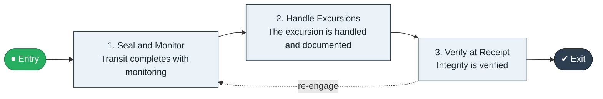

# Cold Chain to Verified

`value-streams:value-stream-cold-chain-to-verified-3srmk2` · **governance** · logistics-transportation, retail-commerce · industry-specific

> The temperature-controlled stream from sealed load through monitored transit to verified cold-chain integrity.

**Outcome:** Delivered goods with verified cold-chain integrity.

**Machine-readable:** this page is generated from — and must stay in sync with — the authoritative record [`value-streams-value-stream-cold-chain-to-verified-3srmk2.yaml`](./value-streams-value-stream-cold-chain-to-verified-3srmk2.yaml). The front matter above is YAML-extractable metadata.

## Stage flow

## Value stages

| # | Stage | Entry criterion | Exit criterion | Enabling capabilities (count) | Realizing processes (count) | Visible |
|---|---|---|---|---|---|---|
| 1 | **Seal and Monitor** | A load is sealed. | Transit completes with monitoring. | 2 | 1 | no |
| 2 | **Handle Excursions** | An excursion occurs. | The excursion is handled and documented. | 2 | 1 | no |
| 3 | **Verify at Receipt** | Transit completes. | Integrity is verified. | 2 | 1 | no |

### 1. Seal and Monitor

Seal the load and monitor temperature in transit.

| Aspect | Value |
|---|---|
| Entry criterion | A load is sealed. |
| Exit criterion | Transit completes with monitoring. |
| Outcome | Monitored transit. |
| Customer visible | False |
| Enabling capabilities | `capabilities:capability-information-management-6vjgdh` · `capabilities:capability-operations-management-pm3w8k` |
| Realizing processes | `processes:process-eo-operate-zh9m57` |

### 2. Handle Excursions

Handle temperature excursions per protocol.

| Aspect | Value |
|---|---|
| Entry criterion | An excursion occurs. |
| Exit criterion | The excursion is handled and documented. |
| Outcome | A handled excursion. |
| Customer visible | False |
| Enabling capabilities | `capabilities:capability-risk-management-h9uxdw` · `capabilities:capability-operations-management-pm3w8k` |
| Realizing processes | `processes:process-eo-operate-44jsrp` |

### 3. Verify at Receipt

Verify cold-chain integrity at receipt.

| Aspect | Value |
|---|---|
| Entry criterion | Transit completes. |
| Exit criterion | Integrity is verified. |
| Outcome | Verified integrity. |
| Customer visible | False |
| Enabling capabilities | `capabilities:capability-risk-management-h9uxdw` · `capabilities:capability-information-management-6vjgdh` |
| Realizing processes | `processes:process-eo-operate-44jsrp` |

## Scope boundary

**Entry:** A temperature-controlled load is sealed.

**Exit:** Cold-chain integrity is verified at delivery.

**In scope**

- Sealed monitored transit
- Excursion handling
- Verification at receipt

**Out of scope** (owned by the named neighbour)

- Ambient freight (Ship to Consignee)
- Quality disposition (Inspect to Disposition)

## Traceability

**Capabilities** (`aggregated_capability_refs`, resolving in [business-capabilities](https://github.com/technehub-labs/dea-catalog-business-capabilities)):

- `capabilities:capability-information-management-6vjgdh`
- `capabilities:capability-operations-management-pm3w8k`
- `capabilities:capability-risk-management-h9uxdw`

**Processes** (`process_refs`, resolving in [business-processes](https://github.com/technehub-labs/dea-catalog-business-processes)):

- `processes:process-eo-operate-zh9m57`
- `processes:process-eo-operate-44jsrp`

## Cross-stream links

**Upstream:** none recorded.

**Downstream:** none recorded.

## Measurement

- **Cold-chain excursion rate** (stream-level) — Share of loads with a reportable excursion.

## Evidence

| Source | Class | Reference |
|---|---|---|
| SRC-016 | industry-reference-model | Manufacturing and logistics reference models (SCOR-style category structure) |
| SRC-013 | industry-reference-model | Retail / consumer-commerce chains (public structure) |

**Rationale:** Admitted under CR-VS-12 (population tranche; candidate VSC-070) from the CR-VS-11 industry evidence register extension. Industry-specific chain (logistics-transportation, retail-commerce); distinct from cross-industry streams by applicability (CR-VS-11 method note); cross-catalog references resolve against the sibling catalogs per the referential-integrity gate.

See [research/evidence.md](./research/evidence.md) for the source-backed notes.

## Provenance ladder

| Stage | Date | Actor |
|---|---|---|
| candidate | 2026-10-28 | Emmanuel A. Otchere, candidate universe v0.6 (CR-VS-12) |
| admitted | 2026-10-28 | Emmanuel A. Otchere, admission CR-VS-12 |

---

*Generated by [`scripts/generate_entity_docs.py`](../../../scripts/generate_entity_docs.py) (CR-VS-13) from the authoritative record. Do not edit by hand; regenerate.*
