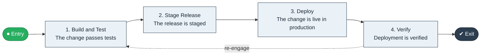

# Commit to Deploy

`value-streams:value-stream-commit-to-deploy-65cr4z` · **operational** · technology · industry-specific

> The software delivery stream from code commit through build, test, and release to production deployment.

**Outcome:** A deployed change in production serving users.

**Machine-readable:** this page is generated from — and must stay in sync with — the authoritative record [`value-streams-value-stream-commit-to-deploy-65cr4z.yaml`](./value-streams-value-stream-commit-to-deploy-65cr4z.yaml). The front matter above is YAML-extractable metadata.

## Stage flow

## Value stages

| # | Stage | Entry criterion | Exit criterion | Enabling capabilities (count) | Realizing processes (count) | Visible |
|---|---|---|---|---|---|---|
| 1 | **Build and Test** | A change is committed. | The change passes tests. | 2 | 2 | no |
| 2 | **Stage Release** | The change passes tests. | The release is staged. | 1 | 1 | no |
| 3 | **Deploy** | The release is staged. | The change is live in production. | 2 | 1 | yes |
| 4 | **Verify** | The change is deployed. | Deployment is verified. | 2 | 1 | no |

### 1. Build and Test

Build the change and run the test suites.

| Aspect | Value |
|---|---|
| Entry criterion | A change is committed. |
| Exit criterion | The change passes tests. |
| Outcome | A tested change. |
| Customer visible | False |
| Enabling capabilities | `capabilities:capability-technology-enablement-y6nkws` · `capabilities:capability-operations-management-pm3w8k` |
| Realizing processes | `processes:process-eo-build-j9z3q4` · `processes:process-eo-operate-44jsrp` |

### 2. Stage Release

Stage the release.

| Aspect | Value |
|---|---|
| Entry criterion | The change passes tests. |
| Exit criterion | The release is staged. |
| Outcome | A staged release. |
| Customer visible | False |
| Enabling capabilities | `capabilities:capability-technology-management-maus5n` |
| Realizing processes | `processes:process-eo-design-6j5mxp` |

### 3. Deploy

Deploy to production.

| Aspect | Value |
|---|---|
| Entry criterion | The release is staged. |
| Exit criterion | The change is live in production. |
| Outcome | A deployed change. |
| Customer visible | True |
| Enabling capabilities | `capabilities:capability-technology-enablement-y6nkws` · `capabilities:capability-operations-management-pm3w8k` |
| Realizing processes | `processes:process-eo-operate-xud3hs` |

### 4. Verify

Verify the deployment in production.

| Aspect | Value |
|---|---|
| Entry criterion | The change is deployed. |
| Exit criterion | Deployment is verified. |
| Outcome | A verified deployment. |
| Customer visible | False |
| Enabling capabilities | `capabilities:capability-information-management-6vjgdh` · `capabilities:capability-enterprise-performance-management-5fxren` |
| Realizing processes | `processes:process-eo-operate-44jsrp` |

## Scope boundary

**Entry:** A change is committed.

**Exit:** The change is deployed to production.

**In scope**

- Build and test
- Release staging
- Production deployment
- Verification

**Out of scope** (owned by the named neighbour)

- Incident response (Incident to Restore)
- Feature development (Concept to Launch)

## Traceability

**Capabilities** (`aggregated_capability_refs`, resolving in [business-capabilities](https://github.com/technehub-labs/dea-catalog-business-capabilities)):

- `capabilities:capability-technology-enablement-y6nkws`
- `capabilities:capability-operations-management-pm3w8k`
- `capabilities:capability-technology-management-maus5n`
- `capabilities:capability-information-management-6vjgdh`
- `capabilities:capability-enterprise-performance-management-5fxren`

**Processes** (`process_refs`, resolving in [business-processes](https://github.com/technehub-labs/dea-catalog-business-processes)):

- `processes:process-eo-build-j9z3q4`
- `processes:process-eo-operate-44jsrp`
- `processes:process-eo-design-6j5mxp`
- `processes:process-eo-operate-xud3hs`

## Cross-stream links

**Upstream** (their exit feeds this stream's entry):

- [concept to launch](../value-stream-concept-to-launch-nhvatv/README.md) — Approved features flow into the delivery pipeline.

**Downstream** (this stream's exit feeds their entry):

- [incident to restore](../value-stream-incident-to-restore-7u3yyz/README.md) — Defective deployments can trigger incidents.

## Measurement

- **Lead time for changes** (stage: Deploy) — Elapsed time from commit to production. → [`dea:metric-lead-time-for-changes`](https://github.com/technehub-labs/dea-catalog-metrics)
- **Release frequency** (stage: Deploy) — Production releases per period. → [`dea:metric-release-frequency`](https://github.com/technehub-labs/dea-catalog-metrics)

## Evidence

| Source | Class | Reference |
|---|---|---|
| SRC-019 | industry-reference-model | Technology / SaaS product chains (public structure) |

**Rationale:** Admitted under CR-VS-12 (population tranche; candidate VSC-105) from the CR-VS-11 industry evidence register extension. Industry-specific chain (technology); distinct from cross-industry streams by applicability (CR-VS-11 method note); cross-catalog references resolve against the sibling catalogs per the referential-integrity gate.

See [research/evidence.md](./research/evidence.md) for the source-backed notes.

## Provenance ladder

| Stage | Date | Actor |
|---|---|---|
| candidate | 2026-10-28 | Emmanuel A. Otchere, candidate universe v0.6 (CR-VS-12) |
| admitted | 2026-10-28 | Emmanuel A. Otchere, admission CR-VS-12 |

---

*Generated by [`scripts/generate_entity_docs.py`](../../../scripts/generate_entity_docs.py) (CR-VS-13) from the authoritative record. Do not edit by hand; regenerate.*
