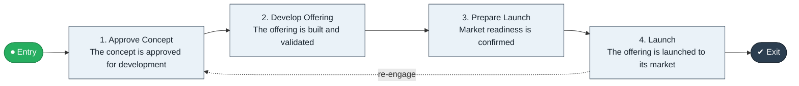

# Concept to Launch

`value-streams:value-stream-concept-to-launch-nhvatv` · **operational** · cross-industry · generic

> The end-to-end stream from approval of an offering concept through development and launch to its market.

**Outcome:** A launched offering delivering value to its intended market.

**Machine-readable:** this page is generated from — and must stay in sync with — the authoritative record [`value-streams-value-stream-concept-to-launch-nhvatv.yaml`](./value-streams-value-stream-concept-to-launch-nhvatv.yaml). The front matter above is YAML-extractable metadata.

## Stage flow

## Value stages

| # | Stage | Entry criterion | Exit criterion | Enabling capabilities (count) | Realizing processes (count) | Visible |
|---|---|---|---|---|---|---|
| 1 | **Approve Concept** | An offering concept is proposed. | The concept is approved for development. | 2 | 1 | no |
| 2 | **Develop Offering** | A development mandate exists. | The offering is built and validated. | 2 | 2 | no |
| 3 | **Prepare Launch** | A validated offering exists. | Market readiness is confirmed. | 2 | 1 | no |
| 4 | **Launch** | Market readiness is confirmed. | The offering is launched to its market. | 2 | 1 | yes |

### 1. Approve Concept

Confirm the offering concept is approved for development.

| Aspect | Value |
|---|---|
| Entry criterion | An offering concept is proposed. |
| Exit criterion | The concept is approved for development. |
| Outcome | A funded development mandate. |
| Customer visible | False |
| Enabling capabilities | `capabilities:capability-offering-management-6egkc8` · `capabilities:capability-marketing-xmc539` |
| Realizing processes | `processes:process-pv-operate-cau4gv` |

### 2. Develop Offering

Build and validate the offering against the approved concept.

| Aspect | Value |
|---|---|
| Entry criterion | A development mandate exists. |
| Exit criterion | The offering is built and validated. |
| Outcome | A validated, launchable offering. |
| Customer visible | False |
| Enabling capabilities | `capabilities:capability-offering-management-6egkc8` · `capabilities:capability-operations-management-pm3w8k` |
| Realizing processes | `processes:process-eo-build-j9z3q4` · `processes:process-eo-operate-44jsrp` |

### 3. Prepare Launch

Prepare the market-facing proposition and readiness.

| Aspect | Value |
|---|---|
| Entry criterion | A validated offering exists. |
| Exit criterion | Market readiness is confirmed. |
| Outcome | Launch-ready propositions and readiness. |
| Customer visible | False |
| Enabling capabilities | `capabilities:capability-marketing-xmc539` · `capabilities:capability-offering-management-6egkc8` |
| Realizing processes | `processes:process-pv-activate-5686v7` |

### 4. Launch

Release the offering to its market.

| Aspect | Value |
|---|---|
| Entry criterion | Market readiness is confirmed. |
| Exit criterion | The offering is launched to its market. |
| Outcome | A launched offering delivering value. |
| Customer visible | True |
| Enabling capabilities | `capabilities:capability-marketing-xmc539` · `capabilities:capability-offering-management-6egkc8` |
| Realizing processes | `processes:process-pv-activate-5686v7` |

## Scope boundary

**Entry:** An offering concept is approved for development.

**Exit:** The offering is launched to its market.

**In scope**

- Approved-concept development
- Offering build and validation
- Market-readiness preparation
- Launch to the intended market

**Out of scope** (owned by the named neighbour)

- Pre-concept innovation intake (Idea Management capability, upstream)
- Post-launch proposition evolution (Concept to Launch exits at launch)
- Order flows (Order to Cash)

## Traceability

**Capabilities** (`aggregated_capability_refs`, resolving in [business-capabilities](https://github.com/technehub-labs/dea-catalog-business-capabilities)):

- `capabilities:capability-offering-management-6egkc8`
- `capabilities:capability-marketing-xmc539`
- `capabilities:capability-operations-management-pm3w8k`

**Processes** (`process_refs`, resolving in [business-processes](https://github.com/technehub-labs/dea-catalog-business-processes)):

- `processes:process-pv-operate-cau4gv`
- `processes:process-eo-build-j9z3q4`
- `processes:process-eo-operate-44jsrp`
- `processes:process-pv-activate-5686v7`

## Cross-stream links

**Upstream:** none recorded.

**Downstream** (this stream's exit feeds their entry):

- [order to cash](../value-stream-order-to-cash-sc8gbu/README.md) — A launched offering becomes sellable and can be ordered.

## Measurement

- **Concept-to-launch lead time** (stage: Launch) — Elapsed time from concept approval to market launch.
- **Launch readiness pass rate** (stage: Prepare Launch) — Share of launch-readiness gates passed at first review.

## Evidence

| Source | Class | Reference |
|---|---|---|
| SRC-002 | cross-industry-process | APQC Process Classification Framework (cross-industry, process-to-value-stream groupings) |
| SRC-006 | commercial-process-models | Hammer & Hurdle-style enterprise process-chain literature (public summaries) |

**Rationale:** Admitted from candidate VSC-004 under CR-VS-04 (evidence raised E2 -> E3 via register v0.2 extension; distinctness closed per CR-VS-02). Innovation/launch chain; distinct from the development value stream (VSC-010 disambiguation record, out of scope) by its market-facing exit. Distinct from Order to Cash on entry, exit, and served party (market vs. customer).

See [research/evidence.md](./research/evidence.md) for the source-backed notes.

## Provenance ladder

| Stage | Date | Actor |
|---|---|---|
| candidate | 2026-10-27 | Emmanuel A. Otchere, candidate universe v0.1 (CR-VS-01, PR #3) |
| candidate | 2026-10-27 | Emmanuel A. Otchere, evidence raised E2 -> E3 (CR-VS-04, register v0.2) |
| admitted | 2026-10-27 | Emmanuel A. Otchere, admission CR-VS-04 |
| active | 2026-10-27 | Emmanuel A. Otchere, CR-VS-07 enrichment (value stages, process links, scope, metrics) |
| active | 2026-10-28 | Emmanuel A. Otchere, CR-VS-08 metric backfill (metric_ref links to dea-catalog-metrics) |
| active | 2026-10-28 | Emmanuel A. Otchere, CR-VS-11 applicability backfill (cross-industry, generic) |

---

*Generated by [`scripts/generate_entity_docs.py`](../../../scripts/generate_entity_docs.py) (CR-VS-13) from the authoritative record. Do not edit by hand; regenerate.*
