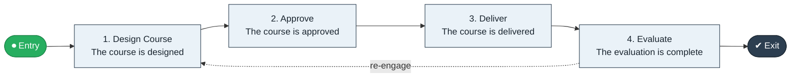

# Course Design to Delivery

`value-streams:value-stream-course-design-to-delivery-pvwqv5` · **development** · education · industry-specific

> The academic stream from course design through approval to delivered and evaluated course.

**Outcome:** A delivered, evaluated course offering.

**Machine-readable:** this page is generated from — and must stay in sync with — the authoritative record [`value-streams-value-stream-course-design-to-delivery-pvwqv5.yaml`](./value-streams-value-stream-course-design-to-delivery-pvwqv5.yaml). The front matter above is YAML-extractable metadata.

## Stage flow

## Value stages

| # | Stage | Entry criterion | Exit criterion | Enabling capabilities (count) | Realizing processes (count) | Visible |
|---|---|---|---|---|---|---|
| 1 | **Design Course** | A cycle opens. | The course is designed. | 2 | 1 | no |
| 2 | **Approve** | The course is designed. | The course is approved. | 2 | 1 | no |
| 3 | **Deliver** | The course is approved. | The course is delivered. | 2 | 1 | yes |
| 4 | **Evaluate** | The course is delivered. | The evaluation is complete. | 2 | 1 | no |

### 1. Design Course

Design the course and outcomes.

| Aspect | Value |
|---|---|
| Entry criterion | A cycle opens. |
| Exit criterion | The course is designed. |
| Outcome | A designed course. |
| Customer visible | False |
| Enabling capabilities | `capabilities:capability-offering-management-6egkc8` · `capabilities:capability-information-management-6vjgdh` |
| Realizing processes | `processes:process-pv-design-8v4k89` |

### 2. Approve

Approve the course for delivery.

| Aspect | Value |
|---|---|
| Entry criterion | The course is designed. |
| Exit criterion | The course is approved. |
| Outcome | An approved course. |
| Customer visible | False |
| Enabling capabilities | `capabilities:capability-enterprise-governance-uas48u` · `capabilities:capability-offering-management-6egkc8` |
| Realizing processes | `processes:process-ge-design-kpsj5b` |

### 3. Deliver

Deliver the course.

| Aspect | Value |
|---|---|
| Entry criterion | The course is approved. |
| Exit criterion | The course is delivered. |
| Outcome | A delivered course. |
| Customer visible | True |
| Enabling capabilities | `capabilities:capability-operations-management-pm3w8k` · `capabilities:capability-workforce-management-9e8d8s` |
| Realizing processes | `processes:process-eo-operate-2jnz85` |

### 4. Evaluate

Evaluate and improve the course.

| Aspect | Value |
|---|---|
| Entry criterion | The course is delivered. |
| Exit criterion | The evaluation is complete. |
| Outcome | A completed evaluation. |
| Customer visible | False |
| Enabling capabilities | `capabilities:capability-insight-management-ms4n9d` · `capabilities:capability-enterprise-performance-management-5fxren` |
| Realizing processes | `processes:process-sd-operate-ucxpz4` |

## Scope boundary

**Entry:** A course design cycle opens.

**Exit:** The course is delivered and evaluated.

**In scope**

- Design and approval
- Delivery
- Evaluation

**Out of scope** (owned by the named neighbour)

- Curriculum governance
- Faculty development

## Traceability

**Capabilities** (`aggregated_capability_refs`, resolving in [business-capabilities](https://github.com/technehub-labs/dea-catalog-business-capabilities)):

- `capabilities:capability-offering-management-6egkc8`
- `capabilities:capability-information-management-6vjgdh`
- `capabilities:capability-enterprise-governance-uas48u`
- `capabilities:capability-operations-management-pm3w8k`
- `capabilities:capability-workforce-management-9e8d8s`
- `capabilities:capability-insight-management-ms4n9d`
- `capabilities:capability-enterprise-performance-management-5fxren`

**Processes** (`process_refs`, resolving in [business-processes](https://github.com/technehub-labs/dea-catalog-business-processes)):

- `processes:process-pv-design-8v4k89`
- `processes:process-ge-design-kpsj5b`
- `processes:process-eo-operate-2jnz85`
- `processes:process-sd-operate-ucxpz4`

## Cross-stream links

**Upstream:** none recorded.

**Downstream:** none recorded.

## Measurement

- **Course evaluation score** (stream-level) — Mean student evaluation score per offering.

## Evidence

| Source | Class | Reference |
|---|---|---|
| SRC-015 | industry-reference-model | Education and hospitality service chains (public structure) |

**Rationale:** Admitted under CR-VS-12 (population tranche; candidate VSC-082) from the CR-VS-11 industry evidence register extension. Industry-specific chain (education); distinct from cross-industry streams by applicability (CR-VS-11 method note); cross-catalog references resolve against the sibling catalogs per the referential-integrity gate.

See [research/evidence.md](./research/evidence.md) for the source-backed notes.

## Provenance ladder

| Stage | Date | Actor |
|---|---|---|
| candidate | 2026-10-28 | Emmanuel A. Otchere, candidate universe v0.6 (CR-VS-12) |
| admitted | 2026-10-28 | Emmanuel A. Otchere, admission CR-VS-12 |

---

*Generated by [`scripts/generate_entity_docs.py`](../../../scripts/generate_entity_docs.py) (CR-VS-13) from the authoritative record. Do not edit by hand; regenerate.*
