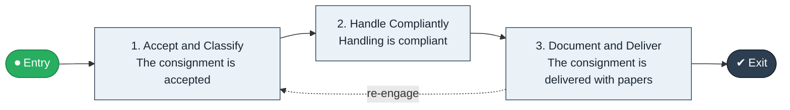

# Dangerous Goods Accept to Deliver

`value-streams:value-stream-dangerous-goods-accept-to-deliver-txbc4c` · **governance** · logistics-transportation · industry-specific

> The DG stream from acceptance check through compliant handling and documentation to delivered consignment.

**Outcome:** A compliantly delivered dangerous-goods consignment.

**Machine-readable:** this page is generated from — and must stay in sync with — the authoritative record [`value-streams-value-stream-dangerous-goods-accept-to-deliver-txbc4c.yaml`](./value-streams-value-stream-dangerous-goods-accept-to-deliver-txbc4c.yaml). The front matter above is YAML-extractable metadata.

## Stage flow

## Value stages

| # | Stage | Entry criterion | Exit criterion | Enabling capabilities (count) | Realizing processes (count) | Visible |
|---|---|---|---|---|---|---|
| 1 | **Accept and Classify** | A DG booking is made. | The consignment is accepted. | 2 | 1 | no |
| 2 | **Handle Compliantly** | The consignment is accepted. | Handling is compliant. | 2 | 2 | no |
| 3 | **Document and Deliver** | Handling is compliant. | The consignment is delivered with papers. | 2 | 2 | yes |

### 1. Accept and Classify

Accept the booking and verify classification and packing.

| Aspect | Value |
|---|---|
| Entry criterion | A DG booking is made. |
| Exit criterion | The consignment is accepted. |
| Outcome | An accepted consignment. |
| Customer visible | False |
| Enabling capabilities | `capabilities:capability-regulation-management-gya4d8` · `capabilities:capability-risk-management-h9uxdw` |
| Realizing processes | `processes:process-ge-operate-tpenm6` |

### 2. Handle Compliantly

Handle and segregate per class.

| Aspect | Value |
|---|---|
| Entry criterion | The consignment is accepted. |
| Exit criterion | Handling is compliant. |
| Outcome | Compliant handling. |
| Customer visible | False |
| Enabling capabilities | `capabilities:capability-security-management-wmzc7c` · `capabilities:capability-operations-management-pm3w8k` |
| Realizing processes | `processes:process-eo-operate-zwzmbd` · `processes:process-eo-operate-zh9m57` |

### 3. Document and Deliver

Complete DG documentation and deliver.

| Aspect | Value |
|---|---|
| Entry criterion | Handling is compliant. |
| Exit criterion | The consignment is delivered with papers. |
| Outcome | A delivered consignment. |
| Customer visible | True |
| Enabling capabilities | `capabilities:capability-regulation-management-gya4d8` · `capabilities:capability-information-management-6vjgdh` |
| Realizing processes | `processes:process-fa-operate-8vqvkk` · `processes:process-eo-operate-zh9m57` |

## Scope boundary

**Entry:** A dangerous-goods booking is made.

**Exit:** The consignment is delivered compliantly.

**In scope**

- Acceptance and classification check
- Compliant handling and segregation
- Documentation and delivery

**Out of scope** (owned by the named neighbour)

- Standard freight (Ship to Consignee)
- Incident response (Safety Incident to Closure)

## Traceability

**Capabilities** (`aggregated_capability_refs`, resolving in [business-capabilities](https://github.com/technehub-labs/dea-catalog-business-capabilities)):

- `capabilities:capability-regulation-management-gya4d8`
- `capabilities:capability-risk-management-h9uxdw`
- `capabilities:capability-security-management-wmzc7c`
- `capabilities:capability-operations-management-pm3w8k`
- `capabilities:capability-information-management-6vjgdh`

**Processes** (`process_refs`, resolving in [business-processes](https://github.com/technehub-labs/dea-catalog-business-processes)):

- `processes:process-ge-operate-tpenm6`
- `processes:process-eo-operate-zwzmbd`
- `processes:process-eo-operate-zh9m57`
- `processes:process-fa-operate-8vqvkk`

## Cross-stream links

**Upstream:** none recorded.

**Downstream:** none recorded.

## Measurement

- **DG documentation accuracy** (stream-level) — Share of consignments with complete compliant papers at delivery.

## Evidence

| Source | Class | Reference |
|---|---|---|
| SRC-016 | industry-reference-model | Manufacturing and logistics reference models (SCOR-style category structure) |

**Rationale:** Admitted under CR-VS-12 (population tranche; candidate VSC-071) from the CR-VS-11 industry evidence register extension. Industry-specific chain (logistics-transportation); distinct from cross-industry streams by applicability (CR-VS-11 method note); cross-catalog references resolve against the sibling catalogs per the referential-integrity gate.

See [research/evidence.md](./research/evidence.md) for the source-backed notes.

## Provenance ladder

| Stage | Date | Actor |
|---|---|---|
| candidate | 2026-10-28 | Emmanuel A. Otchere, candidate universe v0.6 (CR-VS-12) |
| admitted | 2026-10-28 | Emmanuel A. Otchere, admission CR-VS-12 |

---

*Generated by [`scripts/generate_entity_docs.py`](../../../scripts/generate_entity_docs.py) (CR-VS-13) from the authoritative record. Do not edit by hand; regenerate.*
