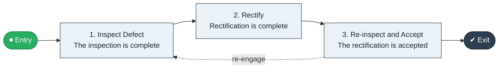

# Defect Report to Rectification

`value-streams:value-stream-defect-report-to-rectification-vce852` · **operational** · construction-real-estate · industry-specific

> The post-handover stream from defect report through inspection to rectified and accepted defect.

**Outcome:** A rectified, accepted defect within the liability period.

**Machine-readable:** this page is generated from — and must stay in sync with — the authoritative record [`value-streams-value-stream-defect-report-to-rectification-vce852.yaml`](./value-streams-value-stream-defect-report-to-rectification-vce852.yaml). The front matter above is YAML-extractable metadata.

## Stage flow

## Value stages

| # | Stage | Entry criterion | Exit criterion | Enabling capabilities (count) | Realizing processes (count) | Visible |
|---|---|---|---|---|---|---|
| 1 | **Inspect Defect** | A defect is reported. | The inspection is complete. | 2 | 1 | yes |
| 2 | **Rectify** | The inspection is complete. | Rectification is complete. | 1 | 1 | yes |
| 3 | **Re-inspect and Accept** | Rectification is complete. | The rectification is accepted. | 2 | 1 | yes |

### 1. Inspect Defect

Inspect the reported defect.

| Aspect | Value |
|---|---|
| Entry criterion | A defect is reported. |
| Exit criterion | The inspection is complete. |
| Outcome | An inspected defect. |
| Customer visible | True |
| Enabling capabilities | `capabilities:capability-operations-management-pm3w8k` · `capabilities:capability-risk-management-h9uxdw` |
| Realizing processes | `processes:process-eo-operate-44jsrp` |

### 2. Rectify

Rectify the defect.

| Aspect | Value |
|---|---|
| Entry criterion | The inspection is complete. |
| Exit criterion | Rectification is complete. |
| Outcome | A rectified defect. |
| Customer visible | True |
| Enabling capabilities | `capabilities:capability-operations-management-pm3w8k` |
| Realizing processes | `processes:process-eo-operate-2jnz85` |

### 3. Re-inspect and Accept

Re-inspect and obtain acceptance.

| Aspect | Value |
|---|---|
| Entry criterion | Rectification is complete. |
| Exit criterion | The rectification is accepted. |
| Outcome | An accepted rectification. |
| Customer visible | True |
| Enabling capabilities | `capabilities:capability-customer-management-f3n8wb` · `capabilities:capability-risk-management-h9uxdw` |
| Realizing processes | `processes:process-eo-operate-44jsrp` |

## Scope boundary

**Entry:** A defect is reported in the liability period.

**Exit:** The rectification is accepted.

**In scope**

- Defect inspection
- Rectification
- Re-inspection and acceptance

**Out of scope** (owned by the named neighbour)

- Build quality (Build to Handover)
- Warranty claims

## Traceability

**Capabilities** (`aggregated_capability_refs`, resolving in [business-capabilities](https://github.com/technehub-labs/dea-catalog-business-capabilities)):

- `capabilities:capability-operations-management-pm3w8k`
- `capabilities:capability-risk-management-h9uxdw`
- `capabilities:capability-customer-management-f3n8wb`

**Processes** (`process_refs`, resolving in [business-processes](https://github.com/technehub-labs/dea-catalog-business-processes)):

- `processes:process-eo-operate-44jsrp`
- `processes:process-eo-operate-2jnz85`

## Cross-stream links

**Upstream:** none recorded.

**Downstream:** none recorded.

## Measurement

- **Defect rectification cycle time** (stream-level) — Elapsed days from report to acceptance.

## Evidence

| Source | Class | Reference |
|---|---|---|
| SRC-017 | industry-reference-model | Construction and real-estate chains (public structure) |

**Rationale:** Admitted under CR-VS-12 (population tranche; candidate VSC-096) from the CR-VS-11 industry evidence register extension. Industry-specific chain (construction-real-estate); distinct from cross-industry streams by applicability (CR-VS-11 method note); cross-catalog references resolve against the sibling catalogs per the referential-integrity gate.

See [research/evidence.md](./research/evidence.md) for the source-backed notes.

## Provenance ladder

| Stage | Date | Actor |
|---|---|---|
| candidate | 2026-10-28 | Emmanuel A. Otchere, candidate universe v0.6 (CR-VS-12) |
| admitted | 2026-10-28 | Emmanuel A. Otchere, admission CR-VS-12 |

---

*Generated by [`scripts/generate_entity_docs.py`](../../../scripts/generate_entity_docs.py) (CR-VS-13) from the authoritative record. Do not edit by hand; regenerate.*
