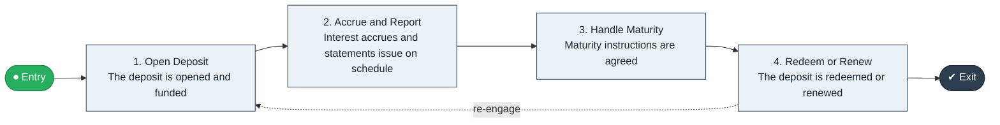

# Deposit to Maturity

`value-streams:value-stream-deposit-to-maturity-gsbm8e` · **operational** · financial-services · industry-specific

> The end-to-end term-deposit stream from deposit opening through interest accrual to maturity and redemption or renewal.

**Outcome:** A term deposit held to maturity and redeemed or renewed.

**Machine-readable:** this page is generated from — and must stay in sync with — the authoritative record [`value-streams-value-stream-deposit-to-maturity-gsbm8e.yaml`](./value-streams-value-stream-deposit-to-maturity-gsbm8e.yaml). The front matter above is YAML-extractable metadata.

## Stage flow

## Value stages

| # | Stage | Entry criterion | Exit criterion | Enabling capabilities (count) | Realizing processes (count) | Visible |
|---|---|---|---|---|---|---|
| 1 | **Open Deposit** | A customer opens a term deposit. | The deposit is opened and funded. | 2 | 1 | yes |
| 2 | **Accrue and Report** | The deposit is funded. | Interest accrues and statements issue on schedule. | 2 | 1 | yes |
| 3 | **Handle Maturity** | The deposit approaches maturity. | Maturity instructions are agreed. | 1 | 1 | yes |
| 4 | **Redeem or Renew** | Instructions are agreed. | The deposit is redeemed or renewed. | 2 | 1 | yes |

### 1. Open Deposit

Open and fund the term deposit.

| Aspect | Value |
|---|---|
| Entry criterion | A customer opens a term deposit. |
| Exit criterion | The deposit is opened and funded. |
| Outcome | A funded term deposit. |
| Customer visible | True |
| Enabling capabilities | `capabilities:capability-customer-management-f3n8wb` · `capabilities:capability-financial-resource-management-cd3c7c` |
| Realizing processes | `processes:process-pr-operate-bbe384` |

### 2. Accrue and Report

Accrue interest and issue statements.

| Aspect | Value |
|---|---|
| Entry criterion | The deposit is funded. |
| Exit criterion | Interest accrues and statements issue on schedule. |
| Outcome | An informed deposit holder. |
| Customer visible | True |
| Enabling capabilities | `capabilities:capability-financial-stewardship-c7xtfk` · `capabilities:capability-information-management-6vjgdh` |
| Realizing processes | `processes:process-fa-operate-ycba3k` |

### 3. Handle Maturity

Prepare maturity instructions with the customer.

| Aspect | Value |
|---|---|
| Entry criterion | The deposit approaches maturity. |
| Exit criterion | Maturity instructions are agreed. |
| Outcome | Agreed maturity instructions. |
| Customer visible | True |
| Enabling capabilities | `capabilities:capability-customer-management-f3n8wb` |
| Realizing processes | `processes:process-pr-improve-t6uvan` |

### 4. Redeem or Renew

Redeem or renew the deposit.

| Aspect | Value |
|---|---|
| Entry criterion | Instructions are agreed. |
| Exit criterion | The deposit is redeemed or renewed. |
| Outcome | A settled maturity. |
| Customer visible | True |
| Enabling capabilities | `capabilities:capability-financial-resource-management-cd3c7c` · `capabilities:capability-customer-management-f3n8wb` |
| Realizing processes | `processes:process-fa-operate-sdppmp` |

## Scope boundary

**Entry:** A customer opens a term deposit.

**Exit:** The deposit matures and is redeemed or renewed.

**In scope**

- Deposit opening
- Interest accrual and statements
- Maturity handling
- Redemption or renewal

**Out of scope** (owned by the named neighbour)

- Onboarding (Onboard to Activate)
- Trading-book operations

## Traceability

**Capabilities** (`aggregated_capability_refs`, resolving in [business-capabilities](https://github.com/technehub-labs/dea-catalog-business-capabilities)):

- `capabilities:capability-customer-management-f3n8wb`
- `capabilities:capability-financial-resource-management-cd3c7c`
- `capabilities:capability-financial-stewardship-c7xtfk`
- `capabilities:capability-information-management-6vjgdh`

**Processes** (`process_refs`, resolving in [business-processes](https://github.com/technehub-labs/dea-catalog-business-processes)):

- `processes:process-pr-operate-bbe384`
- `processes:process-fa-operate-ycba3k`
- `processes:process-pr-improve-t6uvan`
- `processes:process-fa-operate-sdppmp`

## Cross-stream links

**Upstream:** none recorded.

**Downstream:** none recorded.

## Measurement

- **Deposit renewal rate** (stream-level) — Share of maturing deposits renewed.

## Evidence

| Source | Class | Reference |
|---|---|---|
| SRC-008 | industry-reference-model | Banking industry reference models (lending and payments chains, public structure) |

**Rationale:** Admitted under CR-VS-12 (population tranche; candidate VSC-024) from the CR-VS-11 industry evidence register extension. Industry-specific chain (financial-services); distinct from cross-industry streams by applicability (CR-VS-11 method note); cross-catalog references resolve against the sibling catalogs per the referential-integrity gate.

See [research/evidence.md](./research/evidence.md) for the source-backed notes.

## Provenance ladder

| Stage | Date | Actor |
|---|---|---|
| candidate | 2026-10-28 | Emmanuel A. Otchere, candidate universe v0.6 (CR-VS-12) |
| admitted | 2026-10-28 | Emmanuel A. Otchere, admission CR-VS-12 |

---

*Generated by [`scripts/generate_entity_docs.py`](../../../scripts/generate_entity_docs.py) (CR-VS-13) from the authoritative record. Do not edit by hand; regenerate.*
