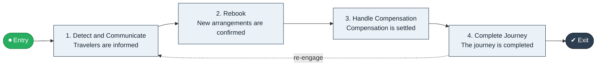

# Disruption to Reaccommodation

`value-streams:value-stream-disruption-to-reaccommodation-tuuywj` · **operational** · hospitality-travel · industry-specific

> The travel stream from disruption detection through rebooking to the reaccommodated traveler.

**Outcome:** A reaccommodated traveler completing the journey.

**Machine-readable:** this page is generated from — and must stay in sync with — the authoritative record [`value-streams-value-stream-disruption-to-reaccommodation-tuuywj.yaml`](./value-streams-value-stream-disruption-to-reaccommodation-tuuywj.yaml). The front matter above is YAML-extractable metadata.

## Stage flow

## Value stages

| # | Stage | Entry criterion | Exit criterion | Enabling capabilities (count) | Realizing processes (count) | Visible |
|---|---|---|---|---|---|---|
| 1 | **Detect and Communicate** | A disruption occurs. | Travelers are informed. | 2 | 1 | yes |
| 2 | **Rebook** | Travelers are informed. | New arrangements are confirmed. | 2 | 1 | yes |
| 3 | **Handle Compensation** | Travelers are rebooked. | Compensation is settled. | 2 | 1 | yes |
| 4 | **Complete Journey** | Travelers are rebooked. | The journey is completed. | 1 | 1 | yes |

### 1. Detect and Communicate

Detect the disruption and communicate to travelers.

| Aspect | Value |
|---|---|
| Entry criterion | A disruption occurs. |
| Exit criterion | Travelers are informed. |
| Outcome | Informed travelers. |
| Customer visible | True |
| Enabling capabilities | `capabilities:capability-information-management-6vjgdh` · `capabilities:capability-customer-management-f3n8wb` |
| Realizing processes | `processes:process-ge-operate-tpenm6` |

### 2. Rebook

Rebook affected travelers.

| Aspect | Value |
|---|---|
| Entry criterion | Travelers are informed. |
| Exit criterion | New arrangements are confirmed. |
| Outcome | Rebooked travelers. |
| Customer visible | True |
| Enabling capabilities | `capabilities:capability-operations-management-pm3w8k` · `capabilities:capability-customer-management-f3n8wb` |
| Realizing processes | `processes:process-pr-operate-bbe384` |

### 3. Handle Compensation

Handle applicable compensation.

| Aspect | Value |
|---|---|
| Entry criterion | Travelers are rebooked. |
| Exit criterion | Compensation is settled. |
| Outcome | Settled compensation. |
| Customer visible | True |
| Enabling capabilities | `capabilities:capability-financial-resource-management-cd3c7c` · `capabilities:capability-customer-management-f3n8wb` |
| Realizing processes | `processes:process-fa-operate-sdppmp` |

### 4. Complete Journey

Confirm journey completion.

| Aspect | Value |
|---|---|
| Entry criterion | Travelers are rebooked. |
| Exit criterion | The journey is completed. |
| Outcome | A completed journey. |
| Customer visible | True |
| Enabling capabilities | `capabilities:capability-operations-management-pm3w8k` |
| Realizing processes | `processes:process-pr-operate-bbe384` |

## Scope boundary

**Entry:** A journey disruption occurs.

**Exit:** The traveler completes the journey.

**In scope**

- Disruption detection and communication
- Rebooking
- Compensation handling
- Journey completion

**Out of scope** (owned by the named neighbour)

- Standard booking
- Loyalty goodwill

## Traceability

**Capabilities** (`aggregated_capability_refs`, resolving in [business-capabilities](https://github.com/technehub-labs/dea-catalog-business-capabilities)):

- `capabilities:capability-information-management-6vjgdh`
- `capabilities:capability-customer-management-f3n8wb`
- `capabilities:capability-operations-management-pm3w8k`
- `capabilities:capability-financial-resource-management-cd3c7c`

**Processes** (`process_refs`, resolving in [business-processes](https://github.com/technehub-labs/dea-catalog-business-processes)):

- `processes:process-ge-operate-tpenm6`
- `processes:process-pr-operate-bbe384`
- `processes:process-fa-operate-sdppmp`

## Cross-stream links

**Upstream:** none recorded.

**Downstream:** none recorded.

## Measurement

- **Reaccommodation cycle time** (stream-level) — Elapsed time from disruption to confirmed rebooking.

## Evidence

| Source | Class | Reference |
|---|---|---|
| SRC-015 | industry-reference-model | Education and hospitality service chains (public structure) |

**Rationale:** Admitted under CR-VS-12 (population tranche; candidate VSC-089) from the CR-VS-11 industry evidence register extension. Industry-specific chain (hospitality-travel); distinct from cross-industry streams by applicability (CR-VS-11 method note); cross-catalog references resolve against the sibling catalogs per the referential-integrity gate.

See [research/evidence.md](./research/evidence.md) for the source-backed notes.

## Provenance ladder

| Stage | Date | Actor |
|---|---|---|
| candidate | 2026-10-28 | Emmanuel A. Otchere, candidate universe v0.6 (CR-VS-12) |
| admitted | 2026-10-28 | Emmanuel A. Otchere, admission CR-VS-12 |

---

*Generated by [`scripts/generate_entity_docs.py`](../../../scripts/generate_entity_docs.py) (CR-VS-13) from the authoritative record. Do not edit by hand; regenerate.*
