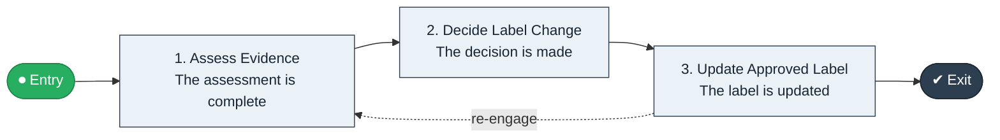

# Drug Safety Label to Update

`value-streams:value-stream-drug-safety-label-to-update-nkcs8f` · **governance** · life-sciences · industry-specific

> The labeling stream from safety evidence accumulation through label change decision to updated approved label.

**Outcome:** An updated, approved product label reflecting current safety evidence.

**Machine-readable:** this page is generated from — and must stay in sync with — the authoritative record [`value-streams-value-stream-drug-safety-label-to-update-nkcs8f.yaml`](./value-streams-value-stream-drug-safety-label-to-update-nkcs8f.yaml). The front matter above is YAML-extractable metadata.

## Stage flow

## Value stages

| # | Stage | Entry criterion | Exit criterion | Enabling capabilities (count) | Realizing processes (count) | Visible |
|---|---|---|---|---|---|---|
| 1 | **Assess Evidence** | Evidence accumulates. | The assessment is complete. | 2 | 1 | no |
| 2 | **Decide Label Change** | The assessment is complete. | The decision is made. | 2 | 1 | no |
| 3 | **Update Approved Label** | The decision is made. | The label is updated. | 2 | 1 | no |

### 1. Assess Evidence

Assess the accumulated safety evidence.

| Aspect | Value |
|---|---|
| Entry criterion | Evidence accumulates. |
| Exit criterion | The assessment is complete. |
| Outcome | A completed assessment. |
| Customer visible | False |
| Enabling capabilities | `capabilities:capability-risk-management-h9uxdw` · `capabilities:capability-insight-management-ms4n9d` |
| Realizing processes | `processes:process-sd-operate-ucxpz4` |

### 2. Decide Label Change

Decide the label change.

| Aspect | Value |
|---|---|
| Entry criterion | The assessment is complete. |
| Exit criterion | The decision is made. |
| Outcome | A made decision. |
| Customer visible | False |
| Enabling capabilities | `capabilities:capability-regulation-management-gya4d8` · `capabilities:capability-enterprise-governance-uas48u` |
| Realizing processes | `processes:process-ge-design-kpsj5b` |

### 3. Update Approved Label

Implement the approved label update.

| Aspect | Value |
|---|---|
| Entry criterion | The decision is made. |
| Exit criterion | The label is updated. |
| Outcome | An updated label. |
| Customer visible | False |
| Enabling capabilities | `capabilities:capability-regulation-management-gya4d8` · `capabilities:capability-information-management-6vjgdh` |
| Realizing processes | `processes:process-fa-operate-8vqvkk` |

## Scope boundary

**Entry:** New safety evidence accumulates.

**Exit:** The approved label is updated.

**In scope**

- Evidence assessment
- Label change decision
- Approved update

**Out of scope** (owned by the named neighbour)

- Pharmacovigilance (Adverse Event to Signal)
- Regulatory dossiers

## Traceability

**Capabilities** (`aggregated_capability_refs`, resolving in [business-capabilities](https://github.com/technehub-labs/dea-catalog-business-capabilities)):

- `capabilities:capability-risk-management-h9uxdw`
- `capabilities:capability-insight-management-ms4n9d`
- `capabilities:capability-regulation-management-gya4d8`
- `capabilities:capability-enterprise-governance-uas48u`
- `capabilities:capability-information-management-6vjgdh`

**Processes** (`process_refs`, resolving in [business-processes](https://github.com/technehub-labs/dea-catalog-business-processes)):

- `processes:process-sd-operate-ucxpz4`
- `processes:process-ge-design-kpsj5b`
- `processes:process-fa-operate-8vqvkk`

## Cross-stream links

**Upstream:** none recorded.

**Downstream:** none recorded.

## Measurement

- **Label update cycle time** (stream-level) — Elapsed time from decision to updated label.

## Evidence

| Source | Class | Reference |
|---|---|---|
| SRC-018 | industry-reference-model | Life-sciences reference chains (public GxP/ICH category structure) |

**Rationale:** Admitted under CR-VS-12 (population tranche; candidate VSC-103) from the CR-VS-11 industry evidence register extension. Industry-specific chain (life-sciences); distinct from cross-industry streams by applicability (CR-VS-11 method note); cross-catalog references resolve against the sibling catalogs per the referential-integrity gate.

See [research/evidence.md](./research/evidence.md) for the source-backed notes.

## Provenance ladder

| Stage | Date | Actor |
|---|---|---|
| candidate | 2026-10-28 | Emmanuel A. Otchere, candidate universe v0.6 (CR-VS-12) |
| admitted | 2026-10-28 | Emmanuel A. Otchere, admission CR-VS-12 |

---

*Generated by [`scripts/generate_entity_docs.py`](../../../scripts/generate_entity_docs.py) (CR-VS-13) from the authoritative record. Do not edit by hand; regenerate.*
