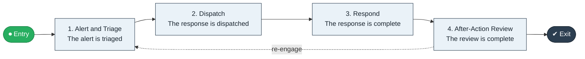

# Emergency Alert to Response

`value-streams:value-stream-emergency-alert-to-response-jtz6qn` · **operational** · public-sector · industry-specific

> The emergency stream from alert through dispatch to response completion and after-action review.

**Outcome:** A responded emergency with completed after-action review.

**Machine-readable:** this page is generated from — and must stay in sync with — the authoritative record [`value-streams-value-stream-emergency-alert-to-response-jtz6qn.yaml`](./value-streams-value-stream-emergency-alert-to-response-jtz6qn.yaml). The front matter above is YAML-extractable metadata.

## Stage flow

## Value stages

| # | Stage | Entry criterion | Exit criterion | Enabling capabilities (count) | Realizing processes (count) | Visible |
|---|---|---|---|---|---|---|
| 1 | **Alert and Triage** | An alert is received. | The alert is triaged. | 2 | 1 | yes |
| 2 | **Dispatch** | The alert is triaged. | The response is dispatched. | 2 | 1 | no |
| 3 | **Respond** | The response is dispatched. | The response is complete. | 1 | 1 | yes |
| 4 | **After-Action Review** | The response is complete. | The review is complete. | 2 | 1 | no |

### 1. Alert and Triage

Receive and triage the alert.

| Aspect | Value |
|---|---|
| Entry criterion | An alert is received. |
| Exit criterion | The alert is triaged. |
| Outcome | A triaged alert. |
| Customer visible | True |
| Enabling capabilities | `capabilities:capability-customer-management-f3n8wb` · `capabilities:capability-operations-management-pm3w8k` |
| Realizing processes | `processes:process-ge-operate-tpenm6` |

### 2. Dispatch

Dispatch the response.

| Aspect | Value |
|---|---|
| Entry criterion | The alert is triaged. |
| Exit criterion | The response is dispatched. |
| Outcome | A dispatched response. |
| Customer visible | False |
| Enabling capabilities | `capabilities:capability-operations-management-pm3w8k` · `capabilities:capability-workforce-planning-b43rhm` |
| Realizing processes | `processes:process-eo-operate-2jnz85` |

### 3. Respond

Execute the response.

| Aspect | Value |
|---|---|
| Entry criterion | The response is dispatched. |
| Exit criterion | The response is complete. |
| Outcome | A completed response. |
| Customer visible | True |
| Enabling capabilities | `capabilities:capability-operations-management-pm3w8k` |
| Realizing processes | `processes:process-eo-operate-2jnz85` |

### 4. After-Action Review

Complete the after-action review.

| Aspect | Value |
|---|---|
| Entry criterion | The response is complete. |
| Exit criterion | The review is complete. |
| Outcome | A completed review. |
| Customer visible | False |
| Enabling capabilities | `capabilities:capability-enterprise-performance-management-5fxren` · `capabilities:capability-enterprise-governance-uas48u` |
| Realizing processes | `processes:process-ge-operate-zwaes5` |

## Scope boundary

**Entry:** An emergency alert is received.

**Exit:** The response is complete and reviewed.

**In scope**

- Alert and triage
- Dispatch
- Response execution
- After-action review

**Out of scope** (owned by the named neighbour)

- Routine case handling (Intake to Resolution)
- Continuity management

## Traceability

**Capabilities** (`aggregated_capability_refs`, resolving in [business-capabilities](https://github.com/technehub-labs/dea-catalog-business-capabilities)):

- `capabilities:capability-customer-management-f3n8wb`
- `capabilities:capability-operations-management-pm3w8k`
- `capabilities:capability-workforce-planning-b43rhm`
- `capabilities:capability-enterprise-performance-management-5fxren`
- `capabilities:capability-enterprise-governance-uas48u`

**Processes** (`process_refs`, resolving in [business-processes](https://github.com/technehub-labs/dea-catalog-business-processes)):

- `processes:process-ge-operate-tpenm6`
- `processes:process-eo-operate-2jnz85`
- `processes:process-ge-operate-zwaes5`

## Cross-stream links

**Upstream** (their exit feeds this stream's entry):

- [outage to restore](../value-stream-outage-to-restore-ff6xme/README.md) — Utility restoration is its industry counterpart.

**Downstream:** none recorded.

## Measurement

- **Alert-to-dispatch time** (stream-level) — Elapsed time from alert to dispatched response.

## Evidence

| Source | Class | Reference |
|---|---|---|
| SRC-014 | industry-reference-model | Public-sector service chains (permits, grants, benefits; public structure) |

**Rationale:** Admitted under CR-VS-12 (population tranche; candidate VSC-079) from the CR-VS-11 industry evidence register extension. Industry-specific chain (public-sector); distinct from cross-industry streams by applicability (CR-VS-11 method note); cross-catalog references resolve against the sibling catalogs per the referential-integrity gate.

See [research/evidence.md](./research/evidence.md) for the source-backed notes.

## Provenance ladder

| Stage | Date | Actor |
|---|---|---|
| candidate | 2026-10-28 | Emmanuel A. Otchere, candidate universe v0.6 (CR-VS-12) |
| admitted | 2026-10-28 | Emmanuel A. Otchere, admission CR-VS-12 |

---

*Generated by [`scripts/generate_entity_docs.py`](../../../scripts/generate_entity_docs.py) (CR-VS-13) from the authoritative record. Do not edit by hand; regenerate.*
