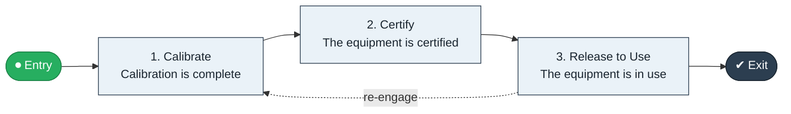

# Equipment Calibration to Certified

`value-streams:value-stream-equipment-calibration-to-certified-qp33gf` · **support** · manufacturing · industry-specific

> The metrology stream from calibration due through calibration execution to certified status.

**Outcome:** Calibration-certified equipment available for use.

**Machine-readable:** this page is generated from — and must stay in sync with — the authoritative record [`value-streams-value-stream-equipment-calibration-to-certified-qp33gf.yaml`](./value-streams-value-stream-equipment-calibration-to-certified-qp33gf.yaml). The front matter above is YAML-extractable metadata.

## Stage flow

## Value stages

| # | Stage | Entry criterion | Exit criterion | Enabling capabilities (count) | Realizing processes (count) | Visible |
|---|---|---|---|---|---|---|
| 1 | **Calibrate** | Calibration falls due. | Calibration is complete. | 2 | 1 | no |
| 2 | **Certify** | Calibration is complete. | The equipment is certified. | 2 | 1 | no |
| 3 | **Release to Use** | The equipment is certified. | The equipment is in use. | 1 | 1 | no |

### 1. Calibrate

Execute the calibration.

| Aspect | Value |
|---|---|
| Entry criterion | Calibration falls due. |
| Exit criterion | Calibration is complete. |
| Outcome | Calibration results. |
| Customer visible | False |
| Enabling capabilities | `capabilities:capability-operations-management-pm3w8k` · `capabilities:capability-information-management-6vjgdh` |
| Realizing processes | `processes:process-eo-operate-j9cjzz` |

### 2. Certify

Certify against the standard.

| Aspect | Value |
|---|---|
| Entry criterion | Calibration is complete. |
| Exit criterion | The equipment is certified. |
| Outcome | A certified instrument. |
| Customer visible | False |
| Enabling capabilities | `capabilities:capability-risk-management-h9uxdw` · `capabilities:capability-regulation-management-gya4d8` |
| Realizing processes | `processes:process-eo-operate-44jsrp` |

### 3. Release to Use

Release the equipment for use.

| Aspect | Value |
|---|---|
| Entry criterion | The equipment is certified. |
| Exit criterion | The equipment is in use. |
| Outcome | Released equipment. |
| Customer visible | False |
| Enabling capabilities | `capabilities:capability-operations-management-pm3w8k` |
| Realizing processes | `processes:process-eo-operate-zwzmbd` |

## Scope boundary

**Entry:** A calibration due date is reached.

**Exit:** The equipment is certified for use.

**In scope**

- Calibration execution
- Certification
- Release to use

**Out of scope** (owned by the named neighbour)

- Maintenance
- Equipment procurement

## Traceability

**Capabilities** (`aggregated_capability_refs`, resolving in [business-capabilities](https://github.com/technehub-labs/dea-catalog-business-capabilities)):

- `capabilities:capability-operations-management-pm3w8k`
- `capabilities:capability-information-management-6vjgdh`
- `capabilities:capability-risk-management-h9uxdw`
- `capabilities:capability-regulation-management-gya4d8`

**Processes** (`process_refs`, resolving in [business-processes](https://github.com/technehub-labs/dea-catalog-business-processes)):

- `processes:process-eo-operate-j9cjzz`
- `processes:process-eo-operate-44jsrp`
- `processes:process-eo-operate-zwzmbd`

## Cross-stream links

**Upstream:** none recorded.

**Downstream:** none recorded.

## Measurement

- **Calibration on-time rate** (stream-level) — Share of calibrations completed before due date.

## Evidence

| Source | Class | Reference |
|---|---|---|
| SRC-016 | industry-reference-model | Manufacturing and logistics reference models (SCOR-style category structure) |

**Rationale:** Admitted under CR-VS-12 (population tranche; candidate VSC-055) from the CR-VS-11 industry evidence register extension. Industry-specific chain (manufacturing); distinct from cross-industry streams by applicability (CR-VS-11 method note); cross-catalog references resolve against the sibling catalogs per the referential-integrity gate.

See [research/evidence.md](./research/evidence.md) for the source-backed notes.

## Provenance ladder

| Stage | Date | Actor |
|---|---|---|
| candidate | 2026-10-28 | Emmanuel A. Otchere, candidate universe v0.6 (CR-VS-12) |
| admitted | 2026-10-28 | Emmanuel A. Otchere, admission CR-VS-12 |

---

*Generated by [`scripts/generate_entity_docs.py`](../../../scripts/generate_entity_docs.py) (CR-VS-13) from the authoritative record. Do not edit by hand; regenerate.*
