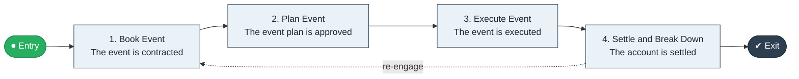

# Event Book to Execute

`value-streams:value-stream-event-book-to-execute-krrav7` · **operational** · hospitality-travel · industry-specific

> The events stream from event booking through planning to executed event and breakdown.

**Outcome:** An executed event with settled account.

**Machine-readable:** this page is generated from — and must stay in sync with — the authoritative record [`value-streams-value-stream-event-book-to-execute-krrav7.yaml`](./value-streams-value-stream-event-book-to-execute-krrav7.yaml). The front matter above is YAML-extractable metadata.

## Stage flow

## Value stages

| # | Stage | Entry criterion | Exit criterion | Enabling capabilities (count) | Realizing processes (count) | Visible |
|---|---|---|---|---|---|---|
| 1 | **Book Event** | An event is booked. | The event is contracted. | 2 | 1 | yes |
| 2 | **Plan Event** | The event is contracted. | The event plan is approved. | 2 | 1 | no |
| 3 | **Execute Event** | The event date arrives. | The event is executed. | 2 | 1 | yes |
| 4 | **Settle and Break Down** | The event completes. | The account is settled. | 2 | 2 | yes |

### 1. Book Event

Book and contract the event.

| Aspect | Value |
|---|---|
| Entry criterion | An event is booked. |
| Exit criterion | The event is contracted. |
| Outcome | A contracted event. |
| Customer visible | True |
| Enabling capabilities | `capabilities:capability-customer-management-f3n8wb` · `capabilities:capability-legal-matter-management-zzbd2u` |
| Realizing processes | `processes:process-ge-build-mctdgc` |

### 2. Plan Event

Plan the event delivery.

| Aspect | Value |
|---|---|
| Entry criterion | The event is contracted. |
| Exit criterion | The event plan is approved. |
| Outcome | An approved plan. |
| Customer visible | False |
| Enabling capabilities | `capabilities:capability-operations-management-pm3w8k` · `capabilities:capability-offering-management-6egkc8` |
| Realizing processes | `processes:process-eo-design-6j5mxp` |

### 3. Execute Event

Execute the event.

| Aspect | Value |
|---|---|
| Entry criterion | The event date arrives. |
| Exit criterion | The event is executed. |
| Outcome | An executed event. |
| Customer visible | True |
| Enabling capabilities | `capabilities:capability-operations-management-pm3w8k` · `capabilities:capability-workforce-management-9e8d8s` |
| Realizing processes | `processes:process-eo-operate-2jnz85` |

### 4. Settle and Break Down

Settle the account and break down.

| Aspect | Value |
|---|---|
| Entry criterion | The event completes. |
| Exit criterion | The account is settled. |
| Outcome | A settled event. |
| Customer visible | True |
| Enabling capabilities | `capabilities:capability-financial-resource-management-cd3c7c` · `capabilities:capability-operations-management-pm3w8k` |
| Realizing processes | `processes:process-fa-operate-sdppmp` · `processes:process-eo-retire-rpg6d4` |

## Scope boundary

**Entry:** An event is booked.

**Exit:** The event is executed and the account settled.

**In scope**

- Booking and contracting
- Event planning
- Execution
- Settlement and breakdown

**Out of scope** (owned by the named neighbour)

- Lodging (Book to Stay)
- Catering supply chain

## Traceability

**Capabilities** (`aggregated_capability_refs`, resolving in [business-capabilities](https://github.com/technehub-labs/dea-catalog-business-capabilities)):

- `capabilities:capability-customer-management-f3n8wb`
- `capabilities:capability-legal-matter-management-zzbd2u`
- `capabilities:capability-operations-management-pm3w8k`
- `capabilities:capability-offering-management-6egkc8`
- `capabilities:capability-workforce-management-9e8d8s`
- `capabilities:capability-financial-resource-management-cd3c7c`

**Processes** (`process_refs`, resolving in [business-processes](https://github.com/technehub-labs/dea-catalog-business-processes)):

- `processes:process-ge-build-mctdgc`
- `processes:process-eo-design-6j5mxp`
- `processes:process-eo-operate-2jnz85`
- `processes:process-fa-operate-sdppmp`
- `processes:process-eo-retire-rpg6d4`

## Cross-stream links

**Upstream:** none recorded.

**Downstream:** none recorded.

## Measurement

- **Event execution satisfaction** (stream-level) — Post-event satisfaction score.

## Evidence

| Source | Class | Reference |
|---|---|---|
| SRC-015 | industry-reference-model | Education and hospitality service chains (public structure) |

**Rationale:** Admitted under CR-VS-12 (population tranche; candidate VSC-088) from the CR-VS-11 industry evidence register extension. Industry-specific chain (hospitality-travel); distinct from cross-industry streams by applicability (CR-VS-11 method note); cross-catalog references resolve against the sibling catalogs per the referential-integrity gate.

See [research/evidence.md](./research/evidence.md) for the source-backed notes.

## Provenance ladder

| Stage | Date | Actor |
|---|---|---|
| candidate | 2026-10-28 | Emmanuel A. Otchere, candidate universe v0.6 (CR-VS-12) |
| admitted | 2026-10-28 | Emmanuel A. Otchere, admission CR-VS-12 |

---

*Generated by [`scripts/generate_entity_docs.py`](../../../scripts/generate_entity_docs.py) (CR-VS-13) from the authoritative record. Do not edit by hand; regenerate.*
