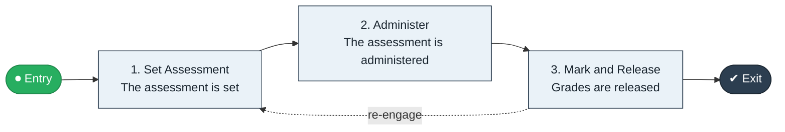

# Exam Set to Grade

`value-streams:value-stream-exam-set-to-grade-cyfqd5` · **support** · education · industry-specific

> The assessment stream from exam setting through administration to released grades.

**Outcome:** Released, moderated grades for the assessment.

**Machine-readable:** this page is generated from — and must stay in sync with — the authoritative record [`value-streams-value-stream-exam-set-to-grade-cyfqd5.yaml`](./value-streams-value-stream-exam-set-to-grade-cyfqd5.yaml). The front matter above is YAML-extractable metadata.

## Stage flow

## Value stages

| # | Stage | Entry criterion | Exit criterion | Enabling capabilities (count) | Realizing processes (count) | Visible |
|---|---|---|---|---|---|---|
| 1 | **Set Assessment** | A cycle is scheduled. | The assessment is set. | 2 | 1 | no |
| 2 | **Administer** | The assessment is set. | The assessment is administered. | 1 | 1 | yes |
| 3 | **Mark and Release** | The assessment is administered. | Grades are released. | 2 | 1 | yes |

### 1. Set Assessment

Set and moderate the assessment.

| Aspect | Value |
|---|---|
| Entry criterion | A cycle is scheduled. |
| Exit criterion | The assessment is set. |
| Outcome | A set assessment. |
| Customer visible | False |
| Enabling capabilities | `capabilities:capability-information-management-6vjgdh` · `capabilities:capability-enterprise-governance-uas48u` |
| Realizing processes | `processes:process-eo-operate-44jsrp` |

### 2. Administer

Administer the assessment.

| Aspect | Value |
|---|---|
| Entry criterion | The assessment is set. |
| Exit criterion | The assessment is administered. |
| Outcome | An administered assessment. |
| Customer visible | True |
| Enabling capabilities | `capabilities:capability-operations-management-pm3w8k` |
| Realizing processes | `processes:process-eo-operate-2jnz85` |

### 3. Mark and Release

Mark and release the grades.

| Aspect | Value |
|---|---|
| Entry criterion | The assessment is administered. |
| Exit criterion | Grades are released. |
| Outcome | Released grades. |
| Customer visible | True |
| Enabling capabilities | `capabilities:capability-information-management-6vjgdh` · `capabilities:capability-enterprise-governance-uas48u` |
| Realizing processes | `processes:process-fa-operate-ycba3k` |

## Scope boundary

**Entry:** An assessment cycle is scheduled.

**Exit:** Grades are released.

**In scope**

- Assessment setting and moderation
- Administration
- Marking and grade release

**Out of scope** (owned by the named neighbour)

- Course delivery (Course Design to Delivery)
- Certification (Inspect to Certificate pattern)

## Traceability

**Capabilities** (`aggregated_capability_refs`, resolving in [business-capabilities](https://github.com/technehub-labs/dea-catalog-business-capabilities)):

- `capabilities:capability-information-management-6vjgdh`
- `capabilities:capability-enterprise-governance-uas48u`
- `capabilities:capability-operations-management-pm3w8k`

**Processes** (`process_refs`, resolving in [business-processes](https://github.com/technehub-labs/dea-catalog-business-processes)):

- `processes:process-eo-operate-44jsrp`
- `processes:process-eo-operate-2jnz85`
- `processes:process-fa-operate-ycba3k`

## Cross-stream links

**Upstream:** none recorded.

**Downstream:** none recorded.

## Measurement

- **Grade release turnaround** (stream-level) — Elapsed time from administration to released grades.

## Evidence

| Source | Class | Reference |
|---|---|---|
| SRC-015 | industry-reference-model | Education and hospitality service chains (public structure) |

**Rationale:** Admitted under CR-VS-12 (population tranche; candidate VSC-086) from the CR-VS-11 industry evidence register extension. Industry-specific chain (education); distinct from cross-industry streams by applicability (CR-VS-11 method note); cross-catalog references resolve against the sibling catalogs per the referential-integrity gate.

See [research/evidence.md](./research/evidence.md) for the source-backed notes.

## Provenance ladder

| Stage | Date | Actor |
|---|---|---|
| candidate | 2026-10-28 | Emmanuel A. Otchere, candidate universe v0.6 (CR-VS-12) |
| admitted | 2026-10-28 | Emmanuel A. Otchere, admission CR-VS-12 |

---

*Generated by [`scripts/generate_entity_docs.py`](../../../scripts/generate_entity_docs.py) (CR-VS-13) from the authoritative record. Do not edit by hand; regenerate.*
