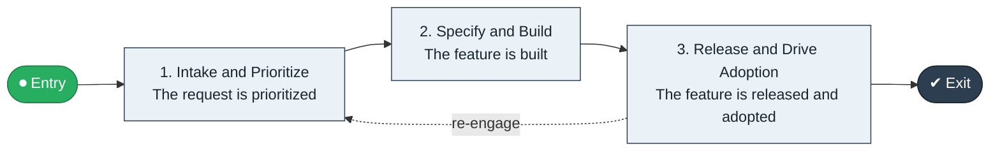

# Feature Request to Release

`value-streams:value-stream-feature-request-to-release-2fyemr` · **operational** · technology · industry-specific

> The product stream from feature request through prioritization and build to released feature.

**Outcome:** A released feature adopted by users.

**Machine-readable:** this page is generated from — and must stay in sync with — the authoritative record [`value-streams-value-stream-feature-request-to-release-2fyemr.yaml`](./value-streams-value-stream-feature-request-to-release-2fyemr.yaml). The front matter above is YAML-extractable metadata.

## Stage flow

## Value stages

| # | Stage | Entry criterion | Exit criterion | Enabling capabilities (count) | Realizing processes (count) | Visible |
|---|---|---|---|---|---|---|
| 1 | **Intake and Prioritize** | A request is received. | The request is prioritized. | 2 | 1 | yes |
| 2 | **Specify and Build** | The request is prioritized. | The feature is built. | 2 | 2 | no |
| 3 | **Release and Drive Adoption** | The feature is built. | The feature is released and adopted. | 2 | 2 | yes |

### 1. Intake and Prioritize

Intake and prioritize the request.

| Aspect | Value |
|---|---|
| Entry criterion | A request is received. |
| Exit criterion | The request is prioritized. |
| Outcome | A prioritized request. |
| Customer visible | True |
| Enabling capabilities | `capabilities:capability-customer-management-f3n8wb` · `capabilities:capability-idea-management-86dckf` |
| Realizing processes | `processes:process-sd-operate-ucxpz4` |

### 2. Specify and Build

Specify the feature and build it.

| Aspect | Value |
|---|---|
| Entry criterion | The request is prioritized. |
| Exit criterion | The feature is built. |
| Outcome | A built feature. |
| Customer visible | False |
| Enabling capabilities | `capabilities:capability-offering-management-6egkc8` · `capabilities:capability-technology-enablement-y6nkws` |
| Realizing processes | `processes:process-pv-design-8v4k89` · `processes:process-eo-build-j9z3q4` |

### 3. Release and Drive Adoption

Release the feature and drive adoption.

| Aspect | Value |
|---|---|
| Entry criterion | The feature is built. |
| Exit criterion | The feature is released and adopted. |
| Outcome | An adopted feature. |
| Customer visible | True |
| Enabling capabilities | `capabilities:capability-marketing-xmc539` · `capabilities:capability-operations-management-pm3w8k` |
| Realizing processes | `processes:process-pr-build-nygvw7` · `processes:process-eo-operate-xud3hs` |

## Scope boundary

**Entry:** A feature request is received.

**Exit:** The feature is released.

**In scope**

- Intake and prioritization
- Specification and build
- Release and adoption

**Out of scope** (owned by the named neighbour)

- Roadmap planning (Plan to Forecast pattern)
- Delivery pipeline (Commit to Deploy)

## Traceability

**Capabilities** (`aggregated_capability_refs`, resolving in [business-capabilities](https://github.com/technehub-labs/dea-catalog-business-capabilities)):

- `capabilities:capability-customer-management-f3n8wb`
- `capabilities:capability-idea-management-86dckf`
- `capabilities:capability-offering-management-6egkc8`
- `capabilities:capability-technology-enablement-y6nkws`
- `capabilities:capability-marketing-xmc539`
- `capabilities:capability-operations-management-pm3w8k`

**Processes** (`process_refs`, resolving in [business-processes](https://github.com/technehub-labs/dea-catalog-business-processes)):

- `processes:process-sd-operate-ucxpz4`
- `processes:process-pv-design-8v4k89`
- `processes:process-eo-build-j9z3q4`
- `processes:process-pr-build-nygvw7`
- `processes:process-eo-operate-xud3hs`

## Cross-stream links

**Upstream** (their exit feeds this stream's entry):

- [commit to deploy](../value-stream-commit-to-deploy-65cr4z/README.md) — Built features deploy through the pipeline.

**Downstream:** none recorded.

## Measurement

- **Feature adoption time** (stream-level) — Elapsed time from release to target adoption.

## Evidence

| Source | Class | Reference |
|---|---|---|
| SRC-019 | industry-reference-model | Technology / SaaS product chains (public structure) |

**Rationale:** Admitted under CR-VS-12 (population tranche; candidate VSC-107) from the CR-VS-11 industry evidence register extension. Industry-specific chain (technology); distinct from cross-industry streams by applicability (CR-VS-11 method note); cross-catalog references resolve against the sibling catalogs per the referential-integrity gate.

See [research/evidence.md](./research/evidence.md) for the source-backed notes.

## Provenance ladder

| Stage | Date | Actor |
|---|---|---|
| candidate | 2026-10-28 | Emmanuel A. Otchere, candidate universe v0.6 (CR-VS-12) |
| admitted | 2026-10-28 | Emmanuel A. Otchere, admission CR-VS-12 |

---

*Generated by [`scripts/generate_entity_docs.py`](../../../scripts/generate_entity_docs.py) (CR-VS-13) from the authoritative record. Do not edit by hand; regenerate.*
