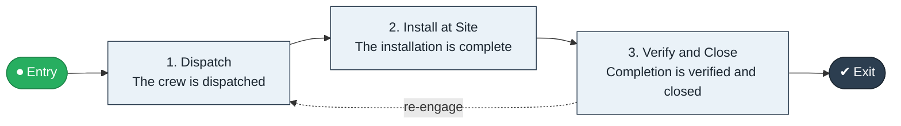

# Field Install to Verify

`value-streams:value-stream-field-install-to-verify-tmyca3` · **support** · telecommunications · industry-specific

> The field-operations stream from install work order through site work to verified completion.

**Outcome:** A verified completed field installation.

**Machine-readable:** this page is generated from — and must stay in sync with — the authoritative record [`value-streams-value-stream-field-install-to-verify-tmyca3.yaml`](./value-streams-value-stream-field-install-to-verify-tmyca3.yaml). The front matter above is YAML-extractable metadata.

## Stage flow

## Value stages

| # | Stage | Entry criterion | Exit criterion | Enabling capabilities (count) | Realizing processes (count) | Visible |
|---|---|---|---|---|---|---|
| 1 | **Dispatch** | A work order is issued. | The crew is dispatched. | 2 | 1 | no |
| 2 | **Install at Site** | The crew is dispatched. | The installation is complete. | 1 | 1 | yes |
| 3 | **Verify and Close** | The installation is complete. | Completion is verified and closed. | 2 | 1 | yes |

### 1. Dispatch

Dispatch the field work order.

| Aspect | Value |
|---|---|
| Entry criterion | A work order is issued. |
| Exit criterion | The crew is dispatched. |
| Outcome | A dispatched order. |
| Customer visible | False |
| Enabling capabilities | `capabilities:capability-operations-management-pm3w8k` · `capabilities:capability-workforce-planning-b43rhm` |
| Realizing processes | `processes:process-eo-operate-2jnz85` |

### 2. Install at Site

Execute the site installation.

| Aspect | Value |
|---|---|
| Entry criterion | The crew is dispatched. |
| Exit criterion | The installation is complete. |
| Outcome | A completed installation. |
| Customer visible | True |
| Enabling capabilities | `capabilities:capability-operations-management-pm3w8k` |
| Realizing processes | `processes:process-eo-operate-j9cjzz` |

### 3. Verify and Close

Verify the installation and close the order.

| Aspect | Value |
|---|---|
| Entry criterion | The installation is complete. |
| Exit criterion | Completion is verified and closed. |
| Outcome | A verified installation. |
| Customer visible | True |
| Enabling capabilities | `capabilities:capability-operations-management-pm3w8k` · `capabilities:capability-information-management-6vjgdh` |
| Realizing processes | `processes:process-eo-operate-44jsrp` |

## Scope boundary

**Entry:** An install work order is issued.

**Exit:** The installation is verified complete.

**In scope**

- Work order dispatch
- Site installation
- Verification and closeout

**Out of scope** (owned by the named neighbour)

- Provisioning (Order to Activation)
- Field force scheduling

## Traceability

**Capabilities** (`aggregated_capability_refs`, resolving in [business-capabilities](https://github.com/technehub-labs/dea-catalog-business-capabilities)):

- `capabilities:capability-operations-management-pm3w8k`
- `capabilities:capability-workforce-planning-b43rhm`
- `capabilities:capability-information-management-6vjgdh`

**Processes** (`process_refs`, resolving in [business-processes](https://github.com/technehub-labs/dea-catalog-business-processes)):

- `processes:process-eo-operate-2jnz85`
- `processes:process-eo-operate-j9cjzz`
- `processes:process-eo-operate-44jsrp`

## Cross-stream links

**Upstream:** none recorded.

**Downstream:** none recorded.

## Measurement

- **Field install first-time completion rate** (stream-level) — Share of installs completed on first visit.

## Evidence

| Source | Class | Reference |
|---|---|---|
| SRC-010 | industry-reference-model | Telecommunications industry reference models (eTOM category-level structure) |

**Rationale:** Admitted under CR-VS-12 (population tranche; candidate VSC-042) from the CR-VS-11 industry evidence register extension. Industry-specific chain (telecommunications); distinct from cross-industry streams by applicability (CR-VS-11 method note); cross-catalog references resolve against the sibling catalogs per the referential-integrity gate.

See [research/evidence.md](./research/evidence.md) for the source-backed notes.

## Provenance ladder

| Stage | Date | Actor |
|---|---|---|
| candidate | 2026-10-28 | Emmanuel A. Otchere, candidate universe v0.6 (CR-VS-12) |
| admitted | 2026-10-28 | Emmanuel A. Otchere, admission CR-VS-12 |

---

*Generated by [`scripts/generate_entity_docs.py`](../../../scripts/generate_entity_docs.py) (CR-VS-13) from the authoritative record. Do not edit by hand; regenerate.*
