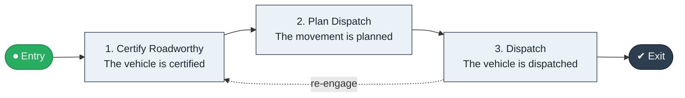

# Fleet Maintain to Dispatch

`value-streams:value-stream-fleet-maintain-to-dispatch-urh4zb` · **support** · logistics-transportation · industry-specific

> The fleet stream from maintenance completion through roadworthiness to dispatchable vehicle status.

**Outcome:** A roadworthy, dispatchable vehicle.

**Machine-readable:** this page is generated from — and must stay in sync with — the authoritative record [`value-streams-value-stream-fleet-maintain-to-dispatch-urh4zb.yaml`](./value-streams-value-stream-fleet-maintain-to-dispatch-urh4zb.yaml). The front matter above is YAML-extractable metadata.

## Stage flow

## Value stages

| # | Stage | Entry criterion | Exit criterion | Enabling capabilities (count) | Realizing processes (count) | Visible |
|---|---|---|---|---|---|---|
| 1 | **Certify Roadworthy** | Maintenance completes. | The vehicle is certified. | 2 | 1 | no |
| 2 | **Plan Dispatch** | The vehicle is certified. | The movement is planned. | 2 | 1 | no |
| 3 | **Dispatch** | The movement is planned. | The vehicle is dispatched. | 1 | 1 | no |

### 1. Certify Roadworthy

Certify the vehicle roadworthy.

| Aspect | Value |
|---|---|
| Entry criterion | Maintenance completes. |
| Exit criterion | The vehicle is certified. |
| Outcome | A certified vehicle. |
| Customer visible | False |
| Enabling capabilities | `capabilities:capability-risk-management-h9uxdw` · `capabilities:capability-operations-management-pm3w8k` |
| Realizing processes | `processes:process-eo-operate-44jsrp` |

### 2. Plan Dispatch

Plan the vehicle's next movement.

| Aspect | Value |
|---|---|
| Entry criterion | The vehicle is certified. |
| Exit criterion | The movement is planned. |
| Outcome | A planned movement. |
| Customer visible | False |
| Enabling capabilities | `capabilities:capability-operations-management-pm3w8k` · `capabilities:capability-enterprise-performance-management-5fxren` |
| Realizing processes | `processes:process-sd-build-2pkz5n` |

### 3. Dispatch

Dispatch the vehicle.

| Aspect | Value |
|---|---|
| Entry criterion | The movement is planned. |
| Exit criterion | The vehicle is dispatched. |
| Outcome | A dispatched vehicle. |
| Customer visible | False |
| Enabling capabilities | `capabilities:capability-operations-management-pm3w8k` |
| Realizing processes | `processes:process-eo-operate-zh9m57` |

## Scope boundary

**Entry:** A vehicle completes maintenance.

**Exit:** The vehicle is dispatched on a revenue movement.

**In scope**

- Roadworthiness certification
- Dispatch planning
- Dispatch

**Out of scope** (owned by the named neighbour)

- Linehaul operations (Ship to Consignee)
- Fleet acquisition (Acquire to Retire)

## Traceability

**Capabilities** (`aggregated_capability_refs`, resolving in [business-capabilities](https://github.com/technehub-labs/dea-catalog-business-capabilities)):

- `capabilities:capability-risk-management-h9uxdw`
- `capabilities:capability-operations-management-pm3w8k`
- `capabilities:capability-enterprise-performance-management-5fxren`

**Processes** (`process_refs`, resolving in [business-processes](https://github.com/technehub-labs/dea-catalog-business-processes)):

- `processes:process-eo-operate-44jsrp`
- `processes:process-sd-build-2pkz5n`
- `processes:process-eo-operate-zh9m57`

## Cross-stream links

**Upstream** (their exit feeds this stream's entry):

- [acquire to retire](../value-stream-acquire-to-retire-g5x89g/README.md) — Vehicles live in the asset lifecycle.

**Downstream:** none recorded.

## Measurement

- **Fleet utilization** (stream-level) — Share of available vehicle time on revenue movements.

## Evidence

| Source | Class | Reference |
|---|---|---|
| SRC-016 | industry-reference-model | Manufacturing and logistics reference models (SCOR-style category structure) |

**Rationale:** Admitted under CR-VS-12 (population tranche; candidate VSC-069) from the CR-VS-11 industry evidence register extension. Industry-specific chain (logistics-transportation); distinct from cross-industry streams by applicability (CR-VS-11 method note); cross-catalog references resolve against the sibling catalogs per the referential-integrity gate.

See [research/evidence.md](./research/evidence.md) for the source-backed notes.

## Provenance ladder

| Stage | Date | Actor |
|---|---|---|
| candidate | 2026-10-28 | Emmanuel A. Otchere, candidate universe v0.6 (CR-VS-12) |
| admitted | 2026-10-28 | Emmanuel A. Otchere, admission CR-VS-12 |

---

*Generated by [`scripts/generate_entity_docs.py`](../../../scripts/generate_entity_docs.py) (CR-VS-13) from the authoritative record. Do not edit by hand; regenerate.*
