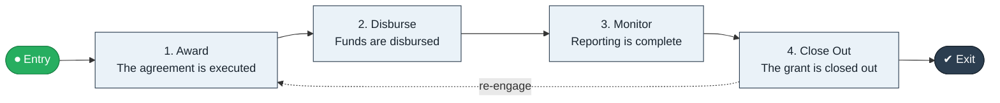

# Grant Award to Closeout

`value-streams:value-stream-grant-award-to-closeout-pvhec7` · **operational** · public-sector · industry-specific

> The grants stream from award through disbursement and monitoring to closeout.

**Outcome:** A closed-out grant with settled funds and reported outcomes.

**Machine-readable:** this page is generated from — and must stay in sync with — the authoritative record [`value-streams-value-stream-grant-award-to-closeout-pvhec7.yaml`](./value-streams-value-stream-grant-award-to-closeout-pvhec7.yaml). The front matter above is YAML-extractable metadata.

## Stage flow

## Value stages

| # | Stage | Entry criterion | Exit criterion | Enabling capabilities (count) | Realizing processes (count) | Visible |
|---|---|---|---|---|---|---|
| 1 | **Award** | A grant is awarded. | The agreement is executed. | 2 | 1 | yes |
| 2 | **Disburse** | The agreement is executed. | Funds are disbursed. | 1 | 1 | yes |
| 3 | **Monitor** | Funds are disbursed. | Reporting is complete. | 2 | 1 | no |
| 4 | **Close Out** | Reporting is complete. | The grant is closed out. | 2 | 1 | no |

### 1. Award

Award the grant and execute the agreement.

| Aspect | Value |
|---|---|
| Entry criterion | A grant is awarded. |
| Exit criterion | The agreement is executed. |
| Outcome | An executed agreement. |
| Customer visible | True |
| Enabling capabilities | `capabilities:capability-legal-matter-management-zzbd2u` · `capabilities:capability-partner-management-cp3vdb` |
| Realizing processes | `processes:process-ge-build-mctdgc` |

### 2. Disburse

Disburse funds per schedule.

| Aspect | Value |
|---|---|
| Entry criterion | The agreement is executed. |
| Exit criterion | Funds are disbursed. |
| Outcome | Disbursed funds. |
| Customer visible | True |
| Enabling capabilities | `capabilities:capability-financial-stewardship-c7xtfk` |
| Realizing processes | `processes:process-fa-operate-wkqaqp` |

### 3. Monitor

Monitor use of funds and milestone reporting.

| Aspect | Value |
|---|---|
| Entry criterion | Funds are disbursed. |
| Exit criterion | Reporting is complete. |
| Outcome | Complete reporting. |
| Customer visible | False |
| Enabling capabilities | `capabilities:capability-enterprise-performance-management-5fxren` · `capabilities:capability-enterprise-governance-uas48u` |
| Realizing processes | `processes:process-sd-operate-ucxpz4` |

### 4. Close Out

Close out the grant with settled funds.

| Aspect | Value |
|---|---|
| Entry criterion | Reporting is complete. |
| Exit criterion | The grant is closed out. |
| Outcome | A closed grant. |
| Customer visible | False |
| Enabling capabilities | `capabilities:capability-financial-stewardship-c7xtfk` · `capabilities:capability-enterprise-governance-uas48u` |
| Realizing processes | `processes:process-fa-operate-4xn4d6` |

## Scope boundary

**Entry:** A grant is awarded.

**Exit:** The grant is closed out with settled funds.

**In scope**

- Award and agreement
- Disbursement
- Monitoring and reporting
- Closeout

**Out of scope** (owned by the named neighbour)

- Application assessment (Apply to Decide)
- Audit programs

## Traceability

**Capabilities** (`aggregated_capability_refs`, resolving in [business-capabilities](https://github.com/technehub-labs/dea-catalog-business-capabilities)):

- `capabilities:capability-legal-matter-management-zzbd2u`
- `capabilities:capability-partner-management-cp3vdb`
- `capabilities:capability-financial-stewardship-c7xtfk`
- `capabilities:capability-enterprise-performance-management-5fxren`
- `capabilities:capability-enterprise-governance-uas48u`

**Processes** (`process_refs`, resolving in [business-processes](https://github.com/technehub-labs/dea-catalog-business-processes)):

- `processes:process-ge-build-mctdgc`
- `processes:process-fa-operate-wkqaqp`
- `processes:process-sd-operate-ucxpz4`
- `processes:process-fa-operate-4xn4d6`

## Cross-stream links

**Upstream:** none recorded.

**Downstream:** none recorded.

## Measurement

- **Grant closeout timeliness** (stream-level) — Share of grants closed within the closeout window.

## Evidence

| Source | Class | Reference |
|---|---|---|
| SRC-014 | industry-reference-model | Public-sector service chains (permits, grants, benefits; public structure) |

**Rationale:** Admitted under CR-VS-12 (population tranche; candidate VSC-076) from the CR-VS-11 industry evidence register extension. Industry-specific chain (public-sector); distinct from cross-industry streams by applicability (CR-VS-11 method note); cross-catalog references resolve against the sibling catalogs per the referential-integrity gate.

See [research/evidence.md](./research/evidence.md) for the source-backed notes.

## Provenance ladder

| Stage | Date | Actor |
|---|---|---|
| candidate | 2026-10-28 | Emmanuel A. Otchere, candidate universe v0.6 (CR-VS-12) |
| admitted | 2026-10-28 | Emmanuel A. Otchere, admission CR-VS-12 |

---

*Generated by [`scripts/generate_entity_docs.py`](../../../scripts/generate_entity_docs.py) (CR-VS-13) from the authoritative record. Do not edit by hand; regenerate.*
