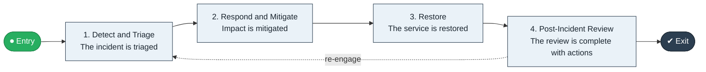

# Incident to Restore

`value-streams:value-stream-incident-to-restore-7u3yyz` · **operational** · technology · industry-specific

> The reliability stream from incident detection through response to restored service with post-incident review.

**Outcome:** Restored service with a completed post-incident review.

**Machine-readable:** this page is generated from — and must stay in sync with — the authoritative record [`value-streams-value-stream-incident-to-restore-7u3yyz.yaml`](./value-streams-value-stream-incident-to-restore-7u3yyz.yaml). The front matter above is YAML-extractable metadata.

## Stage flow

## Value stages

| # | Stage | Entry criterion | Exit criterion | Enabling capabilities (count) | Realizing processes (count) | Visible |
|---|---|---|---|---|---|---|
| 1 | **Detect and Triage** | An incident occurs. | The incident is triaged. | 2 | 1 | yes |
| 2 | **Respond and Mitigate** | The incident is triaged. | Impact is mitigated. | 2 | 1 | yes |
| 3 | **Restore** | Impact is mitigated. | The service is restored. | 1 | 1 | yes |
| 4 | **Post-Incident Review** | The service is restored. | The review is complete with actions. | 2 | 1 | no |

### 1. Detect and Triage

Detect and triage the incident.

| Aspect | Value |
|---|---|
| Entry criterion | An incident occurs. |
| Exit criterion | The incident is triaged. |
| Outcome | A triaged incident. |
| Customer visible | True |
| Enabling capabilities | `capabilities:capability-information-management-6vjgdh` · `capabilities:capability-security-management-wmzc7c` |
| Realizing processes | `processes:process-ge-operate-tpenm6` |

### 2. Respond and Mitigate

Respond and mitigate impact.

| Aspect | Value |
|---|---|
| Entry criterion | The incident is triaged. |
| Exit criterion | Impact is mitigated. |
| Outcome | Mitigated impact. |
| Customer visible | True |
| Enabling capabilities | `capabilities:capability-operations-management-pm3w8k` · `capabilities:capability-technology-enablement-y6nkws` |
| Realizing processes | `processes:process-eo-operate-2jnz85` |

### 3. Restore

Restore the service.

| Aspect | Value |
|---|---|
| Entry criterion | Impact is mitigated. |
| Exit criterion | The service is restored. |
| Outcome | Restored service. |
| Customer visible | True |
| Enabling capabilities | `capabilities:capability-technology-enablement-y6nkws` |
| Realizing processes | `processes:process-eo-operate-j9cjzz` |

### 4. Post-Incident Review

Complete the post-incident review.

| Aspect | Value |
|---|---|
| Entry criterion | The service is restored. |
| Exit criterion | The review is complete with actions. |
| Outcome | A completed review. |
| Customer visible | False |
| Enabling capabilities | `capabilities:capability-enterprise-performance-management-5fxren` · `capabilities:capability-enterprise-governance-uas48u` |
| Realizing processes | `processes:process-ge-operate-zwaes5` |

## Scope boundary

**Entry:** An incident is detected or reported.

**Exit:** Service is restored and the review is complete.

**In scope**

- Detection and triage
- Response and mitigation
- Restoration
- Post-incident review

**Out of scope** (owned by the named neighbour)

- Change deployment (Commit to Deploy)
- Problem management

## Traceability

**Capabilities** (`aggregated_capability_refs`, resolving in [business-capabilities](https://github.com/technehub-labs/dea-catalog-business-capabilities)):

- `capabilities:capability-information-management-6vjgdh`
- `capabilities:capability-security-management-wmzc7c`
- `capabilities:capability-operations-management-pm3w8k`
- `capabilities:capability-technology-enablement-y6nkws`
- `capabilities:capability-enterprise-performance-management-5fxren`
- `capabilities:capability-enterprise-governance-uas48u`

**Processes** (`process_refs`, resolving in [business-processes](https://github.com/technehub-labs/dea-catalog-business-processes)):

- `processes:process-ge-operate-tpenm6`
- `processes:process-eo-operate-2jnz85`
- `processes:process-eo-operate-j9cjzz`
- `processes:process-ge-operate-zwaes5`

## Cross-stream links

**Upstream:** none recorded.

**Downstream:** none recorded.

## Measurement

- **Mean time to restore service** (stage: Restore) — Mean elapsed time from detection to restoration. → [`dea:metric-mean-time-to-restore-service`](https://github.com/technehub-labs/dea-catalog-metrics)

## Evidence

| Source | Class | Reference |
|---|---|---|
| SRC-019 | industry-reference-model | Technology / SaaS product chains (public structure) |

**Rationale:** Admitted under CR-VS-12 (population tranche; candidate VSC-106) from the CR-VS-11 industry evidence register extension. Industry-specific chain (technology); distinct from cross-industry streams by applicability (CR-VS-11 method note); cross-catalog references resolve against the sibling catalogs per the referential-integrity gate.

See [research/evidence.md](./research/evidence.md) for the source-backed notes.

## Provenance ladder

| Stage | Date | Actor |
|---|---|---|
| candidate | 2026-10-28 | Emmanuel A. Otchere, candidate universe v0.6 (CR-VS-12) |
| admitted | 2026-10-28 | Emmanuel A. Otchere, admission CR-VS-12 |

---

*Generated by [`scripts/generate_entity_docs.py`](../../../scripts/generate_entity_docs.py) (CR-VS-13) from the authoritative record. Do not edit by hand; regenerate.*
