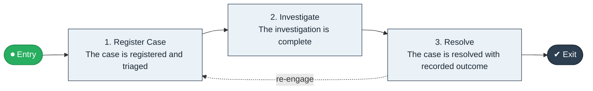

# Intake to Resolution

`value-streams:value-stream-intake-to-resolution-3ydzzy` · **operational** · public-sector · industry-specific

> The case-handling stream from case intake through investigation to resolved case with recorded outcome.

**Outcome:** A resolved case with recorded, communicated outcome.

**Machine-readable:** this page is generated from — and must stay in sync with — the authoritative record [`value-streams-value-stream-intake-to-resolution-3ydzzy.yaml`](./value-streams-value-stream-intake-to-resolution-3ydzzy.yaml). The front matter above is YAML-extractable metadata.

## Stage flow

## Value stages

| # | Stage | Entry criterion | Exit criterion | Enabling capabilities (count) | Realizing processes (count) | Visible |
|---|---|---|---|---|---|---|
| 1 | **Register Case** | A case is reported. | The case is registered and triaged. | 2 | 1 | yes |
| 2 | **Investigate** | The case is triaged. | The investigation is complete. | 2 | 1 | no |
| 3 | **Resolve** | The investigation is complete. | The case is resolved with recorded outcome. | 2 | 1 | yes |

### 1. Register Case

Register and triage the case.

| Aspect | Value |
|---|---|
| Entry criterion | A case is reported. |
| Exit criterion | The case is registered and triaged. |
| Outcome | A triaged case. |
| Customer visible | True |
| Enabling capabilities | `capabilities:capability-customer-management-f3n8wb` · `capabilities:capability-information-management-6vjgdh` |
| Realizing processes | `processes:process-pr-operate-bbe384` |

### 2. Investigate

Investigate the case.

| Aspect | Value |
|---|---|
| Entry criterion | The case is triaged. |
| Exit criterion | The investigation is complete. |
| Outcome | A completed investigation. |
| Customer visible | False |
| Enabling capabilities | `capabilities:capability-operations-management-pm3w8k` · `capabilities:capability-risk-management-h9uxdw` |
| Realizing processes | `processes:process-ge-operate-zwaes5` |

### 3. Resolve

Resolve the case and record the outcome.

| Aspect | Value |
|---|---|
| Entry criterion | The investigation is complete. |
| Exit criterion | The case is resolved with recorded outcome. |
| Outcome | A resolved case. |
| Customer visible | True |
| Enabling capabilities | `capabilities:capability-enterprise-governance-uas48u` · `capabilities:capability-operations-management-pm3w8k` |
| Realizing processes | `processes:process-pr-operate-bbe384` |

## Scope boundary

**Entry:** A case is reported or referred.

**Exit:** The case is resolved and the outcome recorded.

**In scope**

- Case registration and triage
- Investigation
- Resolution and outcome recording

**Out of scope** (owned by the named neighbour)

- Applications (Apply to Decide)
- Enforcement referrals

## Traceability

**Capabilities** (`aggregated_capability_refs`, resolving in [business-capabilities](https://github.com/technehub-labs/dea-catalog-business-capabilities)):

- `capabilities:capability-customer-management-f3n8wb`
- `capabilities:capability-information-management-6vjgdh`
- `capabilities:capability-operations-management-pm3w8k`
- `capabilities:capability-risk-management-h9uxdw`
- `capabilities:capability-enterprise-governance-uas48u`

**Processes** (`process_refs`, resolving in [business-processes](https://github.com/technehub-labs/dea-catalog-business-processes)):

- `processes:process-pr-operate-bbe384`
- `processes:process-ge-operate-zwaes5`

## Cross-stream links

**Upstream:** none recorded.

**Downstream:** none recorded.

## Measurement

- **Case resolution cycle time** (stream-level) — Elapsed time from intake to resolution.

## Evidence

| Source | Class | Reference |
|---|---|---|
| SRC-014 | industry-reference-model | Public-sector service chains (permits, grants, benefits; public structure) |

**Rationale:** Admitted under CR-VS-12 (population tranche; candidate VSC-074) from the CR-VS-11 industry evidence register extension. Industry-specific chain (public-sector); distinct from cross-industry streams by applicability (CR-VS-11 method note); cross-catalog references resolve against the sibling catalogs per the referential-integrity gate.

See [research/evidence.md](./research/evidence.md) for the source-backed notes.

## Provenance ladder

| Stage | Date | Actor |
|---|---|---|
| candidate | 2026-10-28 | Emmanuel A. Otchere, candidate universe v0.6 (CR-VS-12) |
| admitted | 2026-10-28 | Emmanuel A. Otchere, admission CR-VS-12 |

---

*Generated by [`scripts/generate_entity_docs.py`](../../../scripts/generate_entity_docs.py) (CR-VS-13) from the authoritative record. Do not edit by hand; regenerate.*
