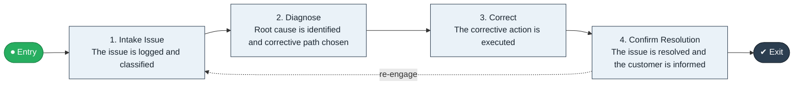

# Issue to Resolve

`value-streams:value-stream-issue-to-resolve-crmbay` · **operational** · cross-industry · generic

> The end-to-end stream from a raised customer issue through diagnosis, corrective action, and confirmed resolution.

**Outcome:** The customer's issue is resolved and trust is restored.

**Machine-readable:** this page is generated from — and must stay in sync with — the authoritative record [`value-streams-value-stream-issue-to-resolve-crmbay.yaml`](./value-streams-value-stream-issue-to-resolve-crmbay.yaml). The front matter above is YAML-extractable metadata.

## Stage flow

## Value stages

| # | Stage | Entry criterion | Exit criterion | Enabling capabilities (count) | Realizing processes (count) | Visible |
|---|---|---|---|---|---|---|
| 1 | **Intake Issue** | A customer raises an issue or complaint. | The issue is logged and classified. | 2 | 1 | yes |
| 2 | **Diagnose** | An owned issue record exists. | Root cause is identified and corrective path chosen. | 2 | 1 | yes |
| 3 | **Correct** | A corrective plan exists. | The corrective action is executed. | 1 | 1 | yes |
| 4 | **Confirm Resolution** | The corrective action is executed. | The issue is resolved and the customer is informed. | 1 | 1 | yes |

### 1. Intake Issue

Capture and classify the customer issue or complaint.

| Aspect | Value |
|---|---|
| Entry criterion | A customer raises an issue or complaint. |
| Exit criterion | The issue is logged and classified. |
| Outcome | A visible, owned issue record. |
| Customer visible | True |
| Enabling capabilities | `capabilities:capability-customer-management-f3n8wb` · `capabilities:capability-information-management-6vjgdh` |
| Realizing processes | `processes:process-pr-operate-bbe384` |

### 2. Diagnose

Investigate the issue and identify root cause.

| Aspect | Value |
|---|---|
| Entry criterion | An owned issue record exists. |
| Exit criterion | Root cause is identified and corrective path chosen. |
| Outcome | An understood cause and corrective plan. |
| Customer visible | True |
| Enabling capabilities | `capabilities:capability-operations-management-pm3w8k` · `capabilities:capability-customer-management-f3n8wb` |
| Realizing processes | `processes:process-eo-operate-44jsrp` |

### 3. Correct

Execute the corrective action.

| Aspect | Value |
|---|---|
| Entry criterion | A corrective plan exists. |
| Exit criterion | The corrective action is executed. |
| Outcome | A restored customer situation. |
| Customer visible | True |
| Enabling capabilities | `capabilities:capability-operations-management-pm3w8k` |
| Realizing processes | `processes:process-eo-operate-2jnz85` |

### 4. Confirm Resolution

Confirm resolution with the customer and close the record.

| Aspect | Value |
|---|---|
| Entry criterion | The corrective action is executed. |
| Exit criterion | The issue is resolved and the customer is informed. |
| Outcome | Restored trust and a closed issue. |
| Customer visible | True |
| Enabling capabilities | `capabilities:capability-customer-management-f3n8wb` |
| Realizing processes | `processes:process-pr-operate-bbe384` |

## Scope boundary

**Entry:** A customer raises an issue or complaint.

**Exit:** The issue is resolved and the customer is informed.

**In scope**

- Issue intake and triage
- Diagnosis and root-cause analysis
- Corrective action execution
- Resolution confirmation and closure

**Out of scope** (owned by the named neighbour)

- Order flows (Order to Cash)
- Contractual relationship management (Contract to Renewal)
- Multi-channel journey design (out of scope at first order)

## Traceability

**Capabilities** (`aggregated_capability_refs`, resolving in [business-capabilities](https://github.com/technehub-labs/dea-catalog-business-capabilities)):

- `capabilities:capability-customer-management-f3n8wb`
- `capabilities:capability-operations-management-pm3w8k`
- `capabilities:capability-information-management-6vjgdh`

**Processes** (`process_refs`, resolving in [business-processes](https://github.com/technehub-labs/dea-catalog-business-processes)):

- `processes:process-pr-operate-bbe384`
- `processes:process-eo-operate-44jsrp`
- `processes:process-eo-operate-2jnz85`

## Cross-stream links

**Upstream** (their exit feeds this stream's entry):

- [order to cash](../value-stream-order-to-cash-sc8gbu/README.md) — Issues typically arise after fulfillment of an order.
- [contract to renewal](../value-stream-contract-to-renewal-5x3r4x/README.md) — Service issues surface during the contracted relationship.

**Downstream** (this stream's exit feeds their entry):

- [return to credit](../value-stream-return-to-credit-qan2dn/README.md) — Unresolved dissatisfaction can convert to a return.

## Measurement

- **Mean time to resolve** (stage: Confirm Resolution) — Average elapsed time from issue intake to confirmed resolution.
- **First-contact resolution rate** (stage: Diagnose) — Share of issues resolved without handoff or repeat contact. → [`dea:metric-first-contact-resolution`](https://github.com/technehub-labs/dea-catalog-metrics)

## Evidence

| Source | Class | Reference |
|---|---|---|
| SRC-006 | commercial-process-models | Hammer & Hurdle-style enterprise process-chain literature (public summaries) |

**Rationale:** Admitted from candidate VSC-003 under CR-VS-03 (evidence at E3/high, distinctness closed per CR-VS-02). Service-side chain: no order is involved; distinct from Order to Cash on entry and exit, and from journeys (multi-channel experience is out of scope at first order). Alternate name: Fault to Restore (VSC-014, merged per CR-VS-05 RES-003).

See [research/evidence.md](./research/evidence.md) for the source-backed notes.

## Provenance ladder

| Stage | Date | Actor |
|---|---|---|
| candidate | 2026-10-27 | Emmanuel A. Otchere, candidate universe v0.1 (CR-VS-01, PR #3) |
| admitted | 2026-10-27 | Emmanuel A. Otchere, admission CR-VS-03 |
| active | 2026-10-27 | Emmanuel A. Otchere, CR-VS-07 enrichment (value stages, process links, scope, metrics) |
| active | 2026-10-28 | Emmanuel A. Otchere, CR-VS-08 metric backfill (metric_ref links to dea-catalog-metrics) |
| active | 2026-10-28 | Emmanuel A. Otchere, CR-VS-11 applicability backfill (cross-industry, generic) |

---

*Generated by [`scripts/generate_entity_docs.py`](../../../scripts/generate_entity_docs.py) (CR-VS-13) from the authoritative record. Do not edit by hand; regenerate.*
