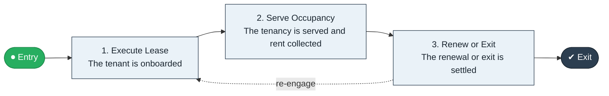

# Lease Sign to Renewal

`value-streams:value-stream-lease-sign-to-renewal-9mr2yp` · **operational** · construction-real-estate · industry-specific

> The property stream from lease execution through occupancy service to lease renewal or exit.

**Outcome:** A settled renewal or exit at lease end.

**Machine-readable:** this page is generated from — and must stay in sync with — the authoritative record [`value-streams-value-stream-lease-sign-to-renewal-9mr2yp.yaml`](./value-streams-value-stream-lease-sign-to-renewal-9mr2yp.yaml). The front matter above is YAML-extractable metadata.

## Stage flow

## Value stages

| # | Stage | Entry criterion | Exit criterion | Enabling capabilities (count) | Realizing processes (count) | Visible |
|---|---|---|---|---|---|---|
| 1 | **Execute Lease** | A lease is executed. | The tenant is onboarded. | 2 | 1 | yes |
| 2 | **Serve Occupancy** | The tenancy starts. | The tenancy is served and rent collected. | 2 | 2 | yes |
| 3 | **Renew or Exit** | The lease approaches end. | The renewal or exit is settled. | 2 | 1 | yes |

### 1. Execute Lease

Execute the lease and onboard the tenant.

| Aspect | Value |
|---|---|
| Entry criterion | A lease is executed. |
| Exit criterion | The tenant is onboarded. |
| Outcome | An onboarded tenant. |
| Customer visible | True |
| Enabling capabilities | `capabilities:capability-legal-matter-management-zzbd2u` · `capabilities:capability-customer-management-f3n8wb` |
| Realizing processes | `processes:process-ge-build-mctdgc` |

### 2. Serve Occupancy

Serve the tenancy and collect rent.

| Aspect | Value |
|---|---|
| Entry criterion | The tenancy starts. |
| Exit criterion | The tenancy is served and rent collected. |
| Outcome | A served tenancy. |
| Customer visible | True |
| Enabling capabilities | `capabilities:capability-operations-management-pm3w8k` · `capabilities:capability-financial-resource-management-cd3c7c` |
| Realizing processes | `processes:process-eo-operate-2jnz85` · `processes:process-fa-operate-sdppmp` |

### 3. Renew or Exit

Settle the renewal or exit.

| Aspect | Value |
|---|---|
| Entry criterion | The lease approaches end. |
| Exit criterion | The renewal or exit is settled. |
| Outcome | A settled lease end. |
| Customer visible | True |
| Enabling capabilities | `capabilities:capability-legal-matter-management-zzbd2u` · `capabilities:capability-customer-management-f3n8wb` |
| Realizing processes | `processes:process-pr-improve-t6uvan` |

## Scope boundary

**Entry:** A lease is executed.

**Exit:** The renewal or exit is settled.

**In scope**

- Lease execution and onboarding
- Occupancy service and rent collection
- Renewal decision and settlement

**Out of scope** (owned by the named neighbour)

- Sales transactions (List to Close)
- Facilities management

## Traceability

**Capabilities** (`aggregated_capability_refs`, resolving in [business-capabilities](https://github.com/technehub-labs/dea-catalog-business-capabilities)):

- `capabilities:capability-legal-matter-management-zzbd2u`
- `capabilities:capability-customer-management-f3n8wb`
- `capabilities:capability-operations-management-pm3w8k`
- `capabilities:capability-financial-resource-management-cd3c7c`

**Processes** (`process_refs`, resolving in [business-processes](https://github.com/technehub-labs/dea-catalog-business-processes)):

- `processes:process-ge-build-mctdgc`
- `processes:process-eo-operate-2jnz85`
- `processes:process-fa-operate-sdppmp`
- `processes:process-pr-improve-t6uvan`

## Cross-stream links

**Upstream:** none recorded.

**Downstream:** none recorded.

## Measurement

- **Lease renewal rate** (stream-level) — Share of expiring leases renewed.

## Evidence

| Source | Class | Reference |
|---|---|---|
| SRC-017 | industry-reference-model | Construction and real-estate chains (public structure) |

**Rationale:** Admitted under CR-VS-12 (population tranche; candidate VSC-095) from the CR-VS-11 industry evidence register extension. Industry-specific chain (construction-real-estate); distinct from cross-industry streams by applicability (CR-VS-11 method note); cross-catalog references resolve against the sibling catalogs per the referential-integrity gate.

See [research/evidence.md](./research/evidence.md) for the source-backed notes.

## Provenance ladder

| Stage | Date | Actor |
|---|---|---|
| candidate | 2026-10-28 | Emmanuel A. Otchere, candidate universe v0.6 (CR-VS-12) |
| admitted | 2026-10-28 | Emmanuel A. Otchere, admission CR-VS-12 |

---

*Generated by [`scripts/generate_entity_docs.py`](../../../scripts/generate_entity_docs.py) (CR-VS-13) from the authoritative record. Do not edit by hand; regenerate.*
