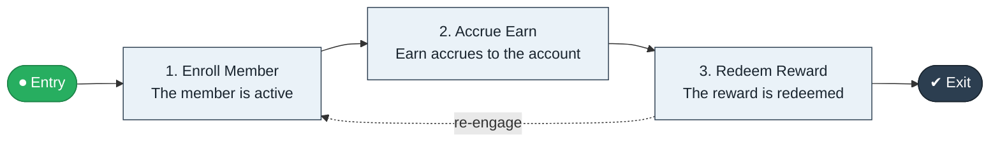

# Loyalty Enroll to Reward

`value-streams:value-stream-loyalty-enroll-to-reward-txebyw` · **operational** · retail-commerce · industry-specific

> The loyalty stream from enrollment through earn accrual to redeemed reward.

**Outcome:** An engaged loyalty member redeeming rewards.

**Machine-readable:** this page is generated from — and must stay in sync with — the authoritative record [`value-streams-value-stream-loyalty-enroll-to-reward-txebyw.yaml`](./value-streams-value-stream-loyalty-enroll-to-reward-txebyw.yaml). The front matter above is YAML-extractable metadata.

## Stage flow

## Value stages

| # | Stage | Entry criterion | Exit criterion | Enabling capabilities (count) | Realizing processes (count) | Visible |
|---|---|---|---|---|---|---|
| 1 | **Enroll Member** | A customer enrolls. | The member is active. | 2 | 1 | yes |
| 2 | **Accrue Earn** | The member is active. | Earn accrues to the account. | 2 | 1 | no |
| 3 | **Redeem Reward** | Earn accrues. | The reward is redeemed. | 2 | 1 | yes |

### 1. Enroll Member

Enroll the customer in the program.

| Aspect | Value |
|---|---|
| Entry criterion | A customer enrolls. |
| Exit criterion | The member is active. |
| Outcome | An active member. |
| Customer visible | True |
| Enabling capabilities | `capabilities:capability-customer-management-f3n8wb` · `capabilities:capability-marketing-xmc539` |
| Realizing processes | `processes:process-pr-build-nygvw7` |

### 2. Accrue Earn

Accrue earn on qualifying activity.

| Aspect | Value |
|---|---|
| Entry criterion | The member is active. |
| Exit criterion | Earn accrues to the account. |
| Outcome | Accrued earn. |
| Customer visible | False |
| Enabling capabilities | `capabilities:capability-information-management-6vjgdh` · `capabilities:capability-financial-resource-management-cd3c7c` |
| Realizing processes | `processes:process-fa-operate-g9zpnq` |

### 3. Redeem Reward

Redeem the accrued earn for rewards.

| Aspect | Value |
|---|---|
| Entry criterion | Earn accrues. |
| Exit criterion | The reward is redeemed. |
| Outcome | A redeemed reward. |
| Customer visible | True |
| Enabling capabilities | `capabilities:capability-customer-management-f3n8wb` · `capabilities:capability-financial-resource-management-cd3c7c` |
| Realizing processes | `processes:process-fa-operate-sdppmp` |

## Scope boundary

**Entry:** A customer enrolls in the loyalty program.

**Exit:** The member redeems a reward.

**In scope**

- Enrollment
- Earn accrual
- Reward redemption

**Out of scope** (owned by the named neighbour)

- Marketing campaigns (Promotion Plan to Execution)
- Payments

## Traceability

**Capabilities** (`aggregated_capability_refs`, resolving in [business-capabilities](https://github.com/technehub-labs/dea-catalog-business-capabilities)):

- `capabilities:capability-customer-management-f3n8wb`
- `capabilities:capability-marketing-xmc539`
- `capabilities:capability-information-management-6vjgdh`
- `capabilities:capability-financial-resource-management-cd3c7c`

**Processes** (`process_refs`, resolving in [business-processes](https://github.com/technehub-labs/dea-catalog-business-processes)):

- `processes:process-pr-build-nygvw7`
- `processes:process-fa-operate-g9zpnq`
- `processes:process-fa-operate-sdppmp`

## Cross-stream links

**Upstream:** none recorded.

**Downstream:** none recorded.

## Measurement

- **Member active rate** (stream-level) — Share of members with qualifying activity per period.

## Evidence

| Source | Class | Reference |
|---|---|---|
| SRC-013 | industry-reference-model | Retail / consumer-commerce chains (public structure) |

**Rationale:** Admitted under CR-VS-12 (population tranche; candidate VSC-062) from the CR-VS-11 industry evidence register extension. Industry-specific chain (retail-commerce); distinct from cross-industry streams by applicability (CR-VS-11 method note); cross-catalog references resolve against the sibling catalogs per the referential-integrity gate.

See [research/evidence.md](./research/evidence.md) for the source-backed notes.

## Provenance ladder

| Stage | Date | Actor |
|---|---|---|
| candidate | 2026-10-28 | Emmanuel A. Otchere, candidate universe v0.6 (CR-VS-12) |
| admitted | 2026-10-28 | Emmanuel A. Otchere, admission CR-VS-12 |

---

*Generated by [`scripts/generate_entity_docs.py`](../../../scripts/generate_entity_docs.py) (CR-VS-13) from the authoritative record. Do not edit by hand; regenerate.*
