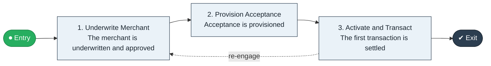

# Merchant Acquire to Transact

`value-streams:value-stream-merchant-acquire-to-transact-ffxrpg` · **operational** · financial-services · industry-specific

> The end-to-end merchant-acquiring stream from merchant application through underwriting, terminal provisioning, and first transaction.

**Outcome:** An acquiring relationship live with the merchant's first settled transaction.

**Machine-readable:** this page is generated from — and must stay in sync with — the authoritative record [`value-streams-value-stream-merchant-acquire-to-transact-ffxrpg.yaml`](./value-streams-value-stream-merchant-acquire-to-transact-ffxrpg.yaml). The front matter above is YAML-extractable metadata.

## Stage flow

## Value stages

| # | Stage | Entry criterion | Exit criterion | Enabling capabilities (count) | Realizing processes (count) | Visible |
|---|---|---|---|---|---|---|
| 1 | **Underwrite Merchant** | A merchant applies. | The merchant is underwritten and approved. | 2 | 1 | yes |
| 2 | **Provision Acceptance** | The merchant is approved. | Acceptance is provisioned. | 2 | 1 | yes |
| 3 | **Activate and Transact** | Acceptance is provisioned. | The first transaction is settled. | 2 | 2 | yes |

### 1. Underwrite Merchant

Underwrite the merchant application.

| Aspect | Value |
|---|---|
| Entry criterion | A merchant applies. |
| Exit criterion | The merchant is underwritten and approved. |
| Outcome | An approved merchant. |
| Customer visible | True |
| Enabling capabilities | `capabilities:capability-risk-management-h9uxdw` · `capabilities:capability-customer-management-f3n8wb` |
| Realizing processes | `processes:process-ge-operate-tpenm6` |

### 2. Provision Acceptance

Provision terminals or API integration.

| Aspect | Value |
|---|---|
| Entry criterion | The merchant is approved. |
| Exit criterion | Acceptance is provisioned. |
| Outcome | Provisioned acceptance. |
| Customer visible | True |
| Enabling capabilities | `capabilities:capability-technology-enablement-y6nkws` · `capabilities:capability-operations-management-pm3w8k` |
| Realizing processes | `processes:process-eo-build-j9z3q4` |

### 3. Activate and Transact

Activate the merchant and process the first transaction.

| Aspect | Value |
|---|---|
| Entry criterion | Acceptance is provisioned. |
| Exit criterion | The first transaction is settled. |
| Outcome | A live merchant relationship. |
| Customer visible | True |
| Enabling capabilities | `capabilities:capability-operations-management-pm3w8k` · `capabilities:capability-financial-stewardship-c7xtfk` |
| Realizing processes | `processes:process-eo-operate-2jnz85` · `processes:process-fa-operate-g9zpnq` |

## Scope boundary

**Entry:** A merchant applies for acceptance.

**Exit:** The merchant's first transaction is settled.

**In scope**

- Merchant application and underwriting
- Terminal or integration provisioning
- Activation and first transaction

**Out of scope** (owned by the named neighbour)

- Card issuance (Card Issue to Activate)
- Merchant chargeback handling (Return to Credit pattern)

## Traceability

**Capabilities** (`aggregated_capability_refs`, resolving in [business-capabilities](https://github.com/technehub-labs/dea-catalog-business-capabilities)):

- `capabilities:capability-risk-management-h9uxdw`
- `capabilities:capability-customer-management-f3n8wb`
- `capabilities:capability-technology-enablement-y6nkws`
- `capabilities:capability-operations-management-pm3w8k`
- `capabilities:capability-financial-stewardship-c7xtfk`

**Processes** (`process_refs`, resolving in [business-processes](https://github.com/technehub-labs/dea-catalog-business-processes)):

- `processes:process-ge-operate-tpenm6`
- `processes:process-eo-build-j9z3q4`
- `processes:process-eo-operate-2jnz85`
- `processes:process-fa-operate-g9zpnq`

## Cross-stream links

**Upstream:** none recorded.

**Downstream:** none recorded.

## Measurement

- **Merchant onboarding cycle time** (stream-level) — Elapsed days from application to first settled transaction.

## Evidence

| Source | Class | Reference |
|---|---|---|
| SRC-008 | industry-reference-model | Banking industry reference models (lending and payments chains, public structure) |

**Rationale:** Admitted under CR-VS-12 (population tranche; candidate VSC-027) from the CR-VS-11 industry evidence register extension. Industry-specific chain (financial-services); distinct from cross-industry streams by applicability (CR-VS-11 method note); cross-catalog references resolve against the sibling catalogs per the referential-integrity gate.

See [research/evidence.md](./research/evidence.md) for the source-backed notes.

## Provenance ladder

| Stage | Date | Actor |
|---|---|---|
| candidate | 2026-10-28 | Emmanuel A. Otchere, candidate universe v0.6 (CR-VS-12) |
| admitted | 2026-10-28 | Emmanuel A. Otchere, admission CR-VS-12 |

---

*Generated by [`scripts/generate_entity_docs.py`](../../../scripts/generate_entity_docs.py) (CR-VS-13) from the authoritative record. Do not edit by hand; regenerate.*
