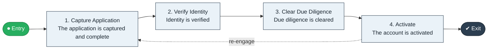

# Onboard to Activate

`value-streams:value-stream-onboard-to-activate-ft6jk9` · **operational** · financial-services · industry-specific

> The end-to-end customer-onboarding stream from account application through identity verification (KYC) and due diligence to an activated account.

**Outcome:** A KYC-cleared, activated account for the customer.

**Machine-readable:** this page is generated from — and must stay in sync with — the authoritative record [`value-streams-value-stream-onboard-to-activate-ft6jk9.yaml`](./value-streams-value-stream-onboard-to-activate-ft6jk9.yaml). The front matter above is YAML-extractable metadata.

## Stage flow

## Value stages

| # | Stage | Entry criterion | Exit criterion | Enabling capabilities (count) | Realizing processes (count) | Visible |
|---|---|---|---|---|---|---|
| 1 | **Capture Application** | An application is received. | The application is captured and complete. | 1 | 1 | yes |
| 2 | **Verify Identity** | The application is complete. | Identity is verified. | 2 | 1 | yes |
| 3 | **Clear Due Diligence** | Identity is verified. | Due diligence is cleared. | 2 | 1 | no |
| 4 | **Activate** | Due diligence is cleared. | The account is activated. | 2 | 1 | yes |

### 1. Capture Application

Capture the account application.

| Aspect | Value |
|---|---|
| Entry criterion | An application is received. |
| Exit criterion | The application is captured and complete. |
| Outcome | A complete application. |
| Customer visible | True |
| Enabling capabilities | `capabilities:capability-customer-management-f3n8wb` |
| Realizing processes | `processes:process-pr-operate-bbe384` |

### 2. Verify Identity

Verify identity per KYC requirements.

| Aspect | Value |
|---|---|
| Entry criterion | The application is complete. |
| Exit criterion | Identity is verified. |
| Outcome | A verified identity. |
| Customer visible | True |
| Enabling capabilities | `capabilities:capability-risk-management-h9uxdw` · `capabilities:capability-regulation-management-gya4d8` |
| Realizing processes | `processes:process-ge-operate-tpenm6` |

### 3. Clear Due Diligence

Complete due-diligence checks and risk classification.

| Aspect | Value |
|---|---|
| Entry criterion | Identity is verified. |
| Exit criterion | Due diligence is cleared. |
| Outcome | A due-diligence-cleared customer. |
| Customer visible | False |
| Enabling capabilities | `capabilities:capability-risk-management-h9uxdw` · `capabilities:capability-regulation-management-gya4d8` |
| Realizing processes | `processes:process-ge-operate-tpenm6` |

### 4. Activate

Open and activate the account and welcome the customer.

| Aspect | Value |
|---|---|
| Entry criterion | Due diligence is cleared. |
| Exit criterion | The account is activated. |
| Outcome | An activated account. |
| Customer visible | True |
| Enabling capabilities | `capabilities:capability-customer-management-f3n8wb` · `capabilities:capability-financial-resource-management-cd3c7c` |
| Realizing processes | `processes:process-pr-operate-bbe384` |

## Scope boundary

**Entry:** An account application is received.

**Exit:** The account is activated after identity verification and due diligence.

**In scope**

- Application capture
- Identity verification (KYC)
- Due-diligence clearing
- Activation and welcome

**Out of scope** (owned by the named neighbour)

- Product application (Application to Book)
- Ongoing relationship service (Contract to Renewal)

## Traceability

**Capabilities** (`aggregated_capability_refs`, resolving in [business-capabilities](https://github.com/technehub-labs/dea-catalog-business-capabilities)):

- `capabilities:capability-customer-management-f3n8wb`
- `capabilities:capability-risk-management-h9uxdw`
- `capabilities:capability-regulation-management-gya4d8`
- `capabilities:capability-financial-resource-management-cd3c7c`

**Processes** (`process_refs`, resolving in [business-processes](https://github.com/technehub-labs/dea-catalog-business-processes)):

- `processes:process-pr-operate-bbe384`
- `processes:process-ge-operate-tpenm6`

## Cross-stream links

**Upstream** (their exit feeds this stream's entry):

- [application to book](../value-stream-application-to-book-4yz2pa/README.md) — Lending follows the same KYC-cleared onboarding.

**Downstream** (this stream's exit feeds their entry):

- [contract to renewal](../value-stream-contract-to-renewal-5x3r4x/README.md) — The activated relationship is served through its term.

## Measurement

- **Know-your-customer onboarding time** (stage: Activate) — Elapsed time from application to activation. → [`dea:metric-know-your-customer-onboarding-time`](https://github.com/technehub-labs/dea-catalog-metrics)
- **Onboarding completion rate** (stage: Activate) — Share of started onboardings completed. → [`dea:metric-onboarding-completion-rate`](https://github.com/technehub-labs/dea-catalog-metrics)

## Evidence

| Source | Class | Reference |
|---|---|---|
| SRC-008 | industry-reference-model | Banking industry reference models (lending and payments chains, public structure) |
| SRC-012 | industry-reference-model | Financial-crime and regulatory operations chains (public structure) |

**Rationale:** Admitted under CR-VS-12 (population tranche; candidate VSC-022) from the CR-VS-11 industry evidence register extension. Industry-specific chain (financial-services); distinct from cross-industry streams by applicability (CR-VS-11 method note); cross-catalog references resolve against the sibling catalogs per the referential-integrity gate.

See [research/evidence.md](./research/evidence.md) for the source-backed notes.

## Provenance ladder

| Stage | Date | Actor |
|---|---|---|
| candidate | 2026-10-28 | Emmanuel A. Otchere, candidate universe v0.6 (CR-VS-12) |
| admitted | 2026-10-28 | Emmanuel A. Otchere, admission CR-VS-12 |

---

*Generated by [`scripts/generate_entity_docs.py`](../../../scripts/generate_entity_docs.py) (CR-VS-13) from the authoritative record. Do not edit by hand; regenerate.*
