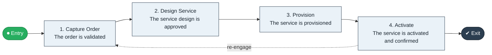

# Order to Activation

`value-streams:value-stream-order-to-activation-uxqth5` · **operational** · telecommunications · industry-specific

> The end-to-end telecom fulfilment stream from customer order through service design, provisioning, and activation.

**Outcome:** An activated service for the customer.

**Machine-readable:** this page is generated from — and must stay in sync with — the authoritative record [`value-streams-value-stream-order-to-activation-uxqth5.yaml`](./value-streams-value-stream-order-to-activation-uxqth5.yaml). The front matter above is YAML-extractable metadata.

## Stage flow

## Value stages

| # | Stage | Entry criterion | Exit criterion | Enabling capabilities (count) | Realizing processes (count) | Visible |
|---|---|---|---|---|---|---|
| 1 | **Capture Order** | An order is accepted. | The order is validated. | 2 | 1 | yes |
| 2 | **Design Service** | The order is validated. | The service design is approved. | 2 | 1 | no |
| 3 | **Provision** | The design is approved. | The service is provisioned. | 2 | 1 | no |
| 4 | **Activate** | The service is provisioned. | The service is activated and confirmed. | 2 | 1 | yes |

### 1. Capture Order

Capture and validate the service order.

| Aspect | Value |
|---|---|
| Entry criterion | An order is accepted. |
| Exit criterion | The order is validated. |
| Outcome | A validated order. |
| Customer visible | True |
| Enabling capabilities | `capabilities:capability-customer-management-f3n8wb` · `capabilities:capability-information-management-6vjgdh` |
| Realizing processes | `processes:process-pr-operate-bbe384` |

### 2. Design Service

Design the service and check feasibility.

| Aspect | Value |
|---|---|
| Entry criterion | The order is validated. |
| Exit criterion | The service design is approved. |
| Outcome | An approved design. |
| Customer visible | False |
| Enabling capabilities | `capabilities:capability-technology-management-maus5n` · `capabilities:capability-operations-management-pm3w8k` |
| Realizing processes | `processes:process-eo-design-6j5mxp` |

### 3. Provision

Provision network resources and configure the service.

| Aspect | Value |
|---|---|
| Entry criterion | The design is approved. |
| Exit criterion | The service is provisioned. |
| Outcome | A provisioned service. |
| Customer visible | False |
| Enabling capabilities | `capabilities:capability-technology-enablement-y6nkws` · `capabilities:capability-operations-management-pm3w8k` |
| Realizing processes | `processes:process-eo-build-j9z3q4` |

### 4. Activate

Activate and confirm the service.

| Aspect | Value |
|---|---|
| Entry criterion | The service is provisioned. |
| Exit criterion | The service is activated and confirmed. |
| Outcome | An activated service. |
| Customer visible | True |
| Enabling capabilities | `capabilities:capability-operations-management-pm3w8k` · `capabilities:capability-customer-management-f3n8wb` |
| Realizing processes | `processes:process-eo-operate-2jnz85` |

## Scope boundary

**Entry:** A customer order for service is accepted.

**Exit:** The service is activated and confirmed to the customer.

**In scope**

- Order capture and validation
- Service design and feasibility
- Provisioning and configuration
- Activation and confirmation

**Out of scope** (owned by the named neighbour)

- Billing (Usage to Bill)
- Fault handling (Trouble to Restore)

## Traceability

**Capabilities** (`aggregated_capability_refs`, resolving in [business-capabilities](https://github.com/technehub-labs/dea-catalog-business-capabilities)):

- `capabilities:capability-customer-management-f3n8wb`
- `capabilities:capability-information-management-6vjgdh`
- `capabilities:capability-technology-management-maus5n`
- `capabilities:capability-operations-management-pm3w8k`
- `capabilities:capability-technology-enablement-y6nkws`

**Processes** (`process_refs`, resolving in [business-processes](https://github.com/technehub-labs/dea-catalog-business-processes)):

- `processes:process-pr-operate-bbe384`
- `processes:process-eo-design-6j5mxp`
- `processes:process-eo-build-j9z3q4`
- `processes:process-eo-operate-2jnz85`

## Cross-stream links

**Upstream** (their exit feeds this stream's entry):

- [order to cash](../value-stream-order-to-cash-sc8gbu/README.md) — Activation is the telecom specialization of order fulfilment; charging follows.

**Downstream** (this stream's exit feeds their entry):

- [usage to bill](../value-stream-usage-to-bill-tyf4zn/README.md) — Activated services start metered usage.

## Measurement

- **Provisioning cycle time** (stage: Activate) — Elapsed time from order to activation. → [`dea:metric-provisioning-cycle-time-telecom`](https://github.com/technehub-labs/dea-catalog-metrics)

## Evidence

| Source | Class | Reference |
|---|---|---|
| SRC-010 | industry-reference-model | Telecommunications industry reference models (eTOM category-level structure) |

**Rationale:** Admitted under CR-VS-12 (population tranche; candidate VSC-036) from the CR-VS-11 industry evidence register extension. Industry-specific chain (telecommunications); distinct from cross-industry streams by applicability (CR-VS-11 method note); cross-catalog references resolve against the sibling catalogs per the referential-integrity gate.

See [research/evidence.md](./research/evidence.md) for the source-backed notes.

## Provenance ladder

| Stage | Date | Actor |
|---|---|---|
| candidate | 2026-10-28 | Emmanuel A. Otchere, candidate universe v0.6 (CR-VS-12) |
| admitted | 2026-10-28 | Emmanuel A. Otchere, admission CR-VS-12 |

---

*Generated by [`scripts/generate_entity_docs.py`](../../../scripts/generate_entity_docs.py) (CR-VS-13) from the authoritative record. Do not edit by hand; regenerate.*
