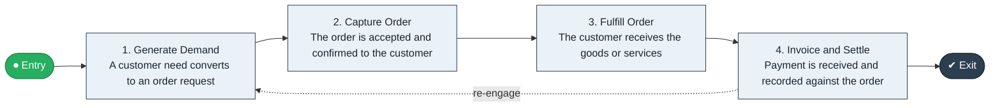

# Order to Cash

`value-streams:value-stream-order-to-cash-sc8gbu` · **operational** · cross-industry · generic

> The end-to-end stream from demand generation through order capture, fulfillment, invoicing, and payment settlement.

**Outcome:** Customer receives the fulfilled order and the enterprise recognizes payment against it.

**Machine-readable:** this page is generated from — and must stay in sync with — the authoritative record [`value-streams-value-stream-order-to-cash-sc8gbu.yaml`](./value-streams-value-stream-order-to-cash-sc8gbu.yaml). The front matter above is YAML-extractable metadata.

## Stage flow

## Value stages

| # | Stage | Entry criterion | Exit criterion | Enabling capabilities (count) | Realizing processes (count) | Visible |
|---|---|---|---|---|---|---|
| 1 | **Generate Demand** | A customer need is identified as addressable. | A customer need converts to an order request. | 2 | 1 | yes |
| 2 | **Capture Order** | An order request exists. | The order is accepted and confirmed to the customer. | 2 | 1 | yes |
| 3 | **Fulfill Order** | An accepted order is booked. | The customer receives the goods or services. | 2 | 3 | yes |
| 4 | **Invoice and Settle** | The order is fulfilled. | Payment is received and recorded against the order. | 2 | 2 | yes |

### 1. Generate Demand

Qualify and nurture the customer need until it converts to an order request.

| Aspect | Value |
|---|---|
| Entry criterion | A customer need is identified as addressable. |
| Exit criterion | A customer need converts to an order request. |
| Outcome | A qualified order request in the hands of the enterprise. |
| Customer visible | True |
| Enabling capabilities | `capabilities:capability-marketing-xmc539` · `capabilities:capability-customer-management-f3n8wb` |
| Realizing processes | `processes:process-pr-build-nygvw7` |

### 2. Capture Order

Record, validate, and accept the customer order.

| Aspect | Value |
|---|---|
| Entry criterion | An order request exists. |
| Exit criterion | The order is accepted and confirmed to the customer. |
| Outcome | An accepted, bookable order. |
| Customer visible | True |
| Enabling capabilities | `capabilities:capability-customer-management-f3n8wb` · `capabilities:capability-information-management-6vjgdh` |
| Realizing processes | `processes:process-pr-operate-bbe384` |

### 3. Fulfill Order

Source, assemble, and deliver the goods or services ordered.

| Aspect | Value |
|---|---|
| Entry criterion | An accepted order is booked. |
| Exit criterion | The customer receives the goods or services. |
| Outcome | A fulfilled order in the customer's hands. |
| Customer visible | True |
| Enabling capabilities | `capabilities:capability-operations-management-pm3w8k` · `capabilities:capability-financial-resource-management-cd3c7c` |
| Realizing processes | `processes:process-eo-operate-2jnz85` · `processes:process-eo-operate-zwzmbd` · `processes:process-eo-operate-zh9m57` |

### 4. Invoice and Settle

Invoice the fulfilled order and recognize payment against it.

| Aspect | Value |
|---|---|
| Entry criterion | The order is fulfilled. |
| Exit criterion | Payment is received and recorded against the order. |
| Outcome | Recognized payment closing the value exchange. |
| Customer visible | True |
| Enabling capabilities | `capabilities:capability-financial-stewardship-c7xtfk` · `capabilities:capability-financial-resource-management-cd3c7c` |
| Realizing processes | `processes:process-fa-operate-sdppmp` · `processes:process-fa-operate-g9zpnq` |

## Scope boundary

**Entry:** A customer need converts to an order (request for goods or services); demand generation is the pre-order stage (CR-VS-02 RES-001).

**Exit:** Payment is received and recorded against the order.

**In scope**

- Demand generation as the pre-order stage (CR-VS-02 RES-001)
- Order capture and acceptance
- Fulfillment of goods and services
- Invoicing and payment settlement

**Out of scope** (owned by the named neighbour)

- Post-sale relationship service (Contract to Renewal)
- Production planning (Plan to Deliver)
- Return flows (Return to Credit)

## Traceability

**Capabilities** (`aggregated_capability_refs`, resolving in [business-capabilities](https://github.com/technehub-labs/dea-catalog-business-capabilities)):

- `capabilities:capability-customer-management-f3n8wb`
- `capabilities:capability-operations-management-pm3w8k`
- `capabilities:capability-financial-stewardship-c7xtfk`
- `capabilities:capability-marketing-xmc539`
- `capabilities:capability-information-management-6vjgdh`
- `capabilities:capability-financial-resource-management-cd3c7c`

**Processes** (`process_refs`, resolving in [business-processes](https://github.com/technehub-labs/dea-catalog-business-processes)):

- `processes:process-pr-build-nygvw7`
- `processes:process-pr-operate-bbe384`
- `processes:process-eo-operate-2jnz85`
- `processes:process-eo-operate-zwzmbd`
- `processes:process-eo-operate-zh9m57`
- `processes:process-fa-operate-sdppmp`
- `processes:process-fa-operate-g9zpnq`

## Cross-stream links

**Upstream:** none recorded.

**Downstream** (this stream's exit feeds their entry):

- [contract to renewal](../value-stream-contract-to-renewal-5x3r4x/README.md) — An executed order seeds the post-sale relationship.
- [return to credit](../value-stream-return-to-credit-qan2dn/README.md) — A post-delivery defect or dissatisfaction triggers a return.

## Measurement

- **Order-to-cash cycle time** (stage: Invoice and Settle) — Elapsed time from order acceptance to payment recognition; shorter is better.
- **Perfect order rate** (stage: Fulfill Order) — Share of orders delivered complete, on time, with accurate documentation. → [`dea:metric-perfect-order-rate`](https://github.com/technehub-labs/dea-catalog-metrics)
- **Days sales outstanding** (stage: Invoice and Settle) — Average days from invoice to collected payment. → [`dea:metric-days-sales-outstanding`](https://github.com/technehub-labs/dea-catalog-metrics)

## Evidence

| Source | Class | Reference |
|---|---|---|
| SRC-002 | cross-industry-process | APQC Process Classification Framework (cross-industry, process-to-value-stream groupings) |
| SRC-006 | commercial-process-models | Hammer & Hurdle-style enterprise process-chain literature (public summaries) |

**Rationale:** Admitted from candidate VSC-001 under CR-VS-03 (evidence at E3/high, distinctness closed per CR-VS-02). Absorbs VSC-007 (Lead to Cash) per CR-VS-02 RES-001. Boundary vs. VSC-005 (Plan to Deliver): fulfillment is shared vocabulary; this stream exits at payment recognition (CR-VS-02 boundary statement).

See [research/evidence.md](./research/evidence.md) for the source-backed notes.

## Provenance ladder

| Stage | Date | Actor |
|---|---|---|
| candidate | 2026-10-27 | Emmanuel A. Otchere, candidate universe v0.1 (CR-VS-01, PR #3) |
| admitted | 2026-10-27 | Emmanuel A. Otchere, admission CR-VS-03 |
| active | 2026-10-27 | Emmanuel A. Otchere, CR-VS-07 enrichment (value stages, process links, scope, metrics) |
| active | 2026-10-28 | Emmanuel A. Otchere, CR-VS-08 metric backfill (metric_ref links to dea-catalog-metrics) |
| active | 2026-10-28 | Emmanuel A. Otchere, CR-VS-11 applicability backfill (cross-industry, generic) |

---

*Generated by [`scripts/generate_entity_docs.py`](../../../scripts/generate_entity_docs.py) (CR-VS-13) from the authoritative record. Do not edit by hand; regenerate.*
