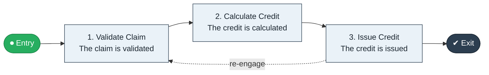

# Outage Claim to Credit

`value-streams:value-stream-outage-claim-to-credit-x479f6` · **governance** · utilities-energy · industry-specific

> The regulatory compensation stream from a customer's outage-compensation claim through validation to issued credit.

**Outcome:** Regulation-compliant compensation credits issued for qualifying outages.

**Machine-readable:** this page is generated from — and must stay in sync with — the authoritative record [`value-streams-value-stream-outage-claim-to-credit-x479f6.yaml`](./value-streams-value-stream-outage-claim-to-credit-x479f6.yaml). The front matter above is YAML-extractable metadata.

## Stage flow

## Value stages

| # | Stage | Entry criterion | Exit criterion | Enabling capabilities (count) | Realizing processes (count) | Visible |
|---|---|---|---|---|---|---|
| 1 | **Validate Claim** | A claim is received. | The claim is validated. | 2 | 1 | yes |
| 2 | **Calculate Credit** | The claim is validated. | The credit is calculated. | 2 | 1 | no |
| 3 | **Issue Credit** | The credit is calculated. | The credit is issued. | 2 | 1 | yes |

### 1. Validate Claim

Validate the claim against outage records.

| Aspect | Value |
|---|---|
| Entry criterion | A claim is received. |
| Exit criterion | The claim is validated. |
| Outcome | A validated claim. |
| Customer visible | True |
| Enabling capabilities | `capabilities:capability-customer-management-f3n8wb` · `capabilities:capability-information-management-6vjgdh` |
| Realizing processes | `processes:process-pr-operate-bbe384` |

### 2. Calculate Credit

Calculate the compensation credit.

| Aspect | Value |
|---|---|
| Entry criterion | The claim is validated. |
| Exit criterion | The credit is calculated. |
| Outcome | A calculated credit. |
| Customer visible | False |
| Enabling capabilities | `capabilities:capability-financial-resource-management-cd3c7c` · `capabilities:capability-regulation-management-gya4d8` |
| Realizing processes | `processes:process-fa-operate-g9zpnq` |

### 3. Issue Credit

Issue the credit to the customer's bill.

| Aspect | Value |
|---|---|
| Entry criterion | The credit is calculated. |
| Exit criterion | The credit is issued. |
| Outcome | An issued credit. |
| Customer visible | True |
| Enabling capabilities | `capabilities:capability-financial-resource-management-cd3c7c` · `capabilities:capability-customer-management-f3n8wb` |
| Realizing processes | `processes:process-fa-operate-sdppmp` |

## Scope boundary

**Entry:** A customer claims outage compensation.

**Exit:** The qualifying credit is issued to the bill.

**In scope**

- Claim validation against outage records
- Credit calculation
- Issuance to the bill

**Out of scope** (owned by the named neighbour)

- Supply restoration (Outage to Restore)
- General billing inquiries (Meter to Bill)

## Traceability

**Capabilities** (`aggregated_capability_refs`, resolving in [business-capabilities](https://github.com/technehub-labs/dea-catalog-business-capabilities)):

- `capabilities:capability-customer-management-f3n8wb`
- `capabilities:capability-information-management-6vjgdh`
- `capabilities:capability-financial-resource-management-cd3c7c`
- `capabilities:capability-regulation-management-gya4d8`

**Processes** (`process_refs`, resolving in [business-processes](https://github.com/technehub-labs/dea-catalog-business-processes)):

- `processes:process-pr-operate-bbe384`
- `processes:process-fa-operate-g9zpnq`
- `processes:process-fa-operate-sdppmp`

## Cross-stream links

**Upstream:** none recorded.

**Downstream:** none recorded.

## Measurement

- **Compensation claim cycle time** (stream-level) — Elapsed days from claim to issued credit.

## Evidence

| Source | Class | Reference |
|---|---|---|
| SRC-011 | industry-reference-model | Utilities industry reference models (metering and retail-energy chains, public structure) |

**Rationale:** Admitted under CR-VS-12 (population tranche; candidate VSC-046) from the CR-VS-11 industry evidence register extension. Industry-specific chain (utilities-energy); distinct from cross-industry streams by applicability (CR-VS-11 method note); cross-catalog references resolve against the sibling catalogs per the referential-integrity gate.

See [research/evidence.md](./research/evidence.md) for the source-backed notes.

## Provenance ladder

| Stage | Date | Actor |
|---|---|---|
| candidate | 2026-10-28 | Emmanuel A. Otchere, candidate universe v0.6 (CR-VS-12) |
| admitted | 2026-10-28 | Emmanuel A. Otchere, admission CR-VS-12 |

---

*Generated by [`scripts/generate_entity_docs.py`](../../../scripts/generate_entity_docs.py) (CR-VS-13) from the authoritative record. Do not edit by hand; regenerate.*
