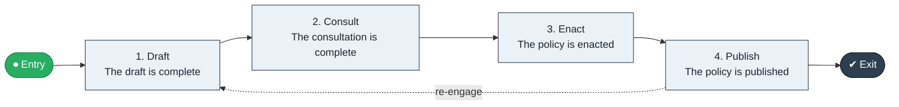

# Policy Draft to Enactment

`value-streams:value-stream-policy-draft-to-enactment-nhqx6e` · **governance** · public-sector · industry-specific

> The policy stream from drafting through consultation to enacted and published policy.

**Outcome:** An enacted, published policy instrument.

**Machine-readable:** this page is generated from — and must stay in sync with — the authoritative record [`value-streams-value-stream-policy-draft-to-enactment-nhqx6e.yaml`](./value-streams-value-stream-policy-draft-to-enactment-nhqx6e.yaml). The front matter above is YAML-extractable metadata.

## Stage flow

## Value stages

| # | Stage | Entry criterion | Exit criterion | Enabling capabilities (count) | Realizing processes (count) | Visible |
|---|---|---|---|---|---|---|
| 1 | **Draft** | A mandate exists. | The draft is complete. | 2 | 1 | no |
| 2 | **Consult** | The draft is complete. | The consultation is complete. | 2 | 1 | yes |
| 3 | **Enact** | The consultation is complete. | The policy is enacted. | 2 | 1 | no |
| 4 | **Publish** | The policy is enacted. | The policy is published. | 1 | 1 | yes |

### 1. Draft

Draft the policy instrument.

| Aspect | Value |
|---|---|
| Entry criterion | A mandate exists. |
| Exit criterion | The draft is complete. |
| Outcome | A policy draft. |
| Customer visible | False |
| Enabling capabilities | `capabilities:capability-legal-matter-management-zzbd2u` · `capabilities:capability-information-management-6vjgdh` |
| Realizing processes | `processes:process-ge-build-3p38us` |

### 2. Consult

Run the consultation.

| Aspect | Value |
|---|---|
| Entry criterion | The draft is complete. |
| Exit criterion | The consultation is complete. |
| Outcome | Consultation outcomes. |
| Customer visible | True |
| Enabling capabilities | `capabilities:capability-customer-management-f3n8wb` · `capabilities:capability-enterprise-governance-uas48u` |
| Realizing processes | `processes:process-sd-operate-ucxpz4` |

### 3. Enact

Enact the policy.

| Aspect | Value |
|---|---|
| Entry criterion | The consultation is complete. |
| Exit criterion | The policy is enacted. |
| Outcome | An enacted policy. |
| Customer visible | False |
| Enabling capabilities | `capabilities:capability-enterprise-governance-uas48u` · `capabilities:capability-legal-matter-management-zzbd2u` |
| Realizing processes | `processes:process-ge-build-mctdgc` |

### 4. Publish

Publish the enacted policy.

| Aspect | Value |
|---|---|
| Entry criterion | The policy is enacted. |
| Exit criterion | The policy is published. |
| Outcome | A published policy. |
| Customer visible | True |
| Enabling capabilities | `capabilities:capability-information-management-6vjgdh` |
| Realizing processes | `processes:process-ge-build-3p38us` |

## Scope boundary

**Entry:** A policy need is mandated.

**Exit:** The policy is enacted and published.

**In scope**

- Drafting
- Consultation
- Enactment
- Publication

**Out of scope** (owned by the named neighbour)

- Legislative process
- Regulatory impact analysis

## Traceability

**Capabilities** (`aggregated_capability_refs`, resolving in [business-capabilities](https://github.com/technehub-labs/dea-catalog-business-capabilities)):

- `capabilities:capability-legal-matter-management-zzbd2u`
- `capabilities:capability-information-management-6vjgdh`
- `capabilities:capability-customer-management-f3n8wb`
- `capabilities:capability-enterprise-governance-uas48u`

**Processes** (`process_refs`, resolving in [business-processes](https://github.com/technehub-labs/dea-catalog-business-processes)):

- `processes:process-ge-build-3p38us`
- `processes:process-sd-operate-ucxpz4`
- `processes:process-ge-build-mctdgc`

## Cross-stream links

**Upstream:** none recorded.

**Downstream:** none recorded.

## Measurement

- **Consultation participation** (stream-level) — Responses received per consultation.

## Evidence

| Source | Class | Reference |
|---|---|---|
| SRC-014 | industry-reference-model | Public-sector service chains (permits, grants, benefits; public structure) |

**Rationale:** Admitted under CR-VS-12 (population tranche; candidate VSC-078) from the CR-VS-11 industry evidence register extension. Industry-specific chain (public-sector); distinct from cross-industry streams by applicability (CR-VS-11 method note); cross-catalog references resolve against the sibling catalogs per the referential-integrity gate.

See [research/evidence.md](./research/evidence.md) for the source-backed notes.

## Provenance ladder

| Stage | Date | Actor |
|---|---|---|
| candidate | 2026-10-28 | Emmanuel A. Otchere, candidate universe v0.6 (CR-VS-12) |
| admitted | 2026-10-28 | Emmanuel A. Otchere, admission CR-VS-12 |

---

*Generated by [`scripts/generate_entity_docs.py`](../../../scripts/generate_entity_docs.py) (CR-VS-13) from the authoritative record. Do not edit by hand; regenerate.*
