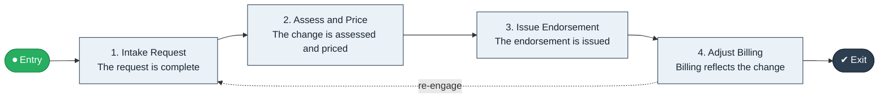

# Policy to Endorsement

`value-streams:value-stream-policy-to-endorsement-3jwbzy` · **operational** · insurance · industry-specific

> The policy-administration stream from an endorsement request through assessment to an issued policy change.

**Outcome:** An accurately issued endorsement on the in-force policy.

**Machine-readable:** this page is generated from — and must stay in sync with — the authoritative record [`value-streams-value-stream-policy-to-endorsement-3jwbzy.yaml`](./value-streams-value-stream-policy-to-endorsement-3jwbzy.yaml). The front matter above is YAML-extractable metadata.

## Stage flow

## Value stages

| # | Stage | Entry criterion | Exit criterion | Enabling capabilities (count) | Realizing processes (count) | Visible |
|---|---|---|---|---|---|---|
| 1 | **Intake Request** | A request is received. | The request is complete. | 1 | 1 | yes |
| 2 | **Assess and Price** | The request is complete. | The change is assessed and priced. | 2 | 1 | no |
| 3 | **Issue Endorsement** | The change is priced. | The endorsement is issued. | 2 | 1 | yes |
| 4 | **Adjust Billing** | The endorsement is issued. | Billing reflects the change. | 1 | 1 | yes |

### 1. Intake Request

Receive and clarify the endorsement request.

| Aspect | Value |
|---|---|
| Entry criterion | A request is received. |
| Exit criterion | The request is complete. |
| Outcome | A complete request. |
| Customer visible | True |
| Enabling capabilities | `capabilities:capability-customer-management-f3n8wb` |
| Realizing processes | `processes:process-pr-operate-bbe384` |

### 2. Assess and Price

Assess the change and price the premium impact.

| Aspect | Value |
|---|---|
| Entry criterion | The request is complete. |
| Exit criterion | The change is assessed and priced. |
| Outcome | A priced change. |
| Customer visible | False |
| Enabling capabilities | `capabilities:capability-risk-management-h9uxdw` · `capabilities:capability-financial-resource-management-cd3c7c` |
| Realizing processes | `processes:process-ge-operate-tpenm6` |

### 3. Issue Endorsement

Issue the endorsement to the policy.

| Aspect | Value |
|---|---|
| Entry criterion | The change is priced. |
| Exit criterion | The endorsement is issued. |
| Outcome | An issued endorsement. |
| Customer visible | True |
| Enabling capabilities | `capabilities:capability-legal-matter-management-zzbd2u` · `capabilities:capability-information-management-6vjgdh` |
| Realizing processes | `processes:process-ge-build-mctdgc` |

### 4. Adjust Billing

Adjust billing for the change.

| Aspect | Value |
|---|---|
| Entry criterion | The endorsement is issued. |
| Exit criterion | Billing reflects the change. |
| Outcome | Reconciled billing. |
| Customer visible | True |
| Enabling capabilities | `capabilities:capability-financial-resource-management-cd3c7c` |
| Realizing processes | `processes:process-fa-operate-sdppmp` |

## Scope boundary

**Entry:** An endorsement request is received.

**Exit:** The endorsement is issued and billed.

**In scope**

- Endorsement intake
- Assessment and pricing
- Issuance
- Billing adjustment

**Out of scope** (owned by the named neighbour)

- Renewal (Contract to Renewal)
- New business (Quote to Bind)

## Traceability

**Capabilities** (`aggregated_capability_refs`, resolving in [business-capabilities](https://github.com/technehub-labs/dea-catalog-business-capabilities)):

- `capabilities:capability-customer-management-f3n8wb`
- `capabilities:capability-risk-management-h9uxdw`
- `capabilities:capability-financial-resource-management-cd3c7c`
- `capabilities:capability-legal-matter-management-zzbd2u`
- `capabilities:capability-information-management-6vjgdh`

**Processes** (`process_refs`, resolving in [business-processes](https://github.com/technehub-labs/dea-catalog-business-processes)):

- `processes:process-pr-operate-bbe384`
- `processes:process-ge-operate-tpenm6`
- `processes:process-ge-build-mctdgc`
- `processes:process-fa-operate-sdppmp`

## Cross-stream links

**Upstream:** none recorded.

**Downstream:** none recorded.

## Measurement

- **Endorsement issuance turnaround** (stream-level) — Elapsed time from request to issued endorsement.

## Evidence

| Source | Class | Reference |
|---|---|---|
| SRC-009 | industry-reference-model | Insurance industry reference models (policy and claims lifecycles, public structure) |

**Rationale:** Admitted under CR-VS-12 (population tranche; candidate VSC-031) from the CR-VS-11 industry evidence register extension. Industry-specific chain (insurance); distinct from cross-industry streams by applicability (CR-VS-11 method note); cross-catalog references resolve against the sibling catalogs per the referential-integrity gate.

See [research/evidence.md](./research/evidence.md) for the source-backed notes.

## Provenance ladder

| Stage | Date | Actor |
|---|---|---|
| candidate | 2026-10-28 | Emmanuel A. Otchere, candidate universe v0.6 (CR-VS-12) |
| admitted | 2026-10-28 | Emmanuel A. Otchere, admission CR-VS-12 |

---

*Generated by [`scripts/generate_entity_docs.py`](../../../scripts/generate_entity_docs.py) (CR-VS-13) from the authoritative record. Do not edit by hand; regenerate.*
