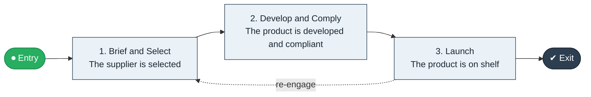

# Private Label Design to Launch

`value-streams:value-stream-private-label-design-to-launch-mh6xqr` · **development** · retail-commerce · industry-specific

> The private-label stream from product brief through development to launched own-brand product.

**Outcome:** A launched private-label product on shelf.

**Machine-readable:** this page is generated from — and must stay in sync with — the authoritative record [`value-streams-value-stream-private-label-design-to-launch-mh6xqr.yaml`](./value-streams-value-stream-private-label-design-to-launch-mh6xqr.yaml). The front matter above is YAML-extractable metadata.

## Stage flow

## Value stages

| # | Stage | Entry criterion | Exit criterion | Enabling capabilities (count) | Realizing processes (count) | Visible |
|---|---|---|---|---|---|---|
| 1 | **Brief and Select** | A brief is approved. | The supplier is selected. | 2 | 1 | no |
| 2 | **Develop and Comply** | The supplier is selected. | The product is developed and compliant. | 2 | 1 | no |
| 3 | **Launch** | The product is compliant. | The product is on shelf. | 2 | 1 | yes |

### 1. Brief and Select

Approve the brief and select the supplier.

| Aspect | Value |
|---|---|
| Entry criterion | A brief is approved. |
| Exit criterion | The supplier is selected. |
| Outcome | A selected supplier. |
| Customer visible | False |
| Enabling capabilities | `capabilities:capability-offering-management-6egkc8` · `capabilities:capability-supplier-management-d6fuj4` |
| Realizing processes | `processes:process-eo-operate-vzcxx7` |

### 2. Develop and Comply

Develop the product to compliance.

| Aspect | Value |
|---|---|
| Entry criterion | The supplier is selected. |
| Exit criterion | The product is developed and compliant. |
| Outcome | A compliant product. |
| Customer visible | False |
| Enabling capabilities | `capabilities:capability-risk-management-h9uxdw` · `capabilities:capability-offering-management-6egkc8` |
| Realizing processes | `processes:process-eo-operate-44jsrp` |

### 3. Launch

Launch to shelf.

| Aspect | Value |
|---|---|
| Entry criterion | The product is compliant. |
| Exit criterion | The product is on shelf. |
| Outcome | A launched product. |
| Customer visible | True |
| Enabling capabilities | `capabilities:capability-offering-management-6egkc8` · `capabilities:capability-marketing-xmc539` |
| Realizing processes | `processes:process-pv-operate-cau4gv` |

## Scope boundary

**Entry:** A private-label product brief is approved.

**Exit:** The product is launched and on shelf.

**In scope**

- Product brief and supplier selection
- Development and compliance
- Launch

**Out of scope** (owned by the named neighbour)

- National-brand buying (Assortment to Shelf)
- Concept to Launch (generic product development)

## Traceability

**Capabilities** (`aggregated_capability_refs`, resolving in [business-capabilities](https://github.com/technehub-labs/dea-catalog-business-capabilities)):

- `capabilities:capability-offering-management-6egkc8`
- `capabilities:capability-supplier-management-d6fuj4`
- `capabilities:capability-risk-management-h9uxdw`
- `capabilities:capability-marketing-xmc539`

**Processes** (`process_refs`, resolving in [business-processes](https://github.com/technehub-labs/dea-catalog-business-processes)):

- `processes:process-eo-operate-vzcxx7`
- `processes:process-eo-operate-44jsrp`
- `processes:process-pv-operate-cau4gv`

## Cross-stream links

**Upstream** (their exit feeds this stream's entry):

- [concept to launch](../value-stream-concept-to-launch-nhvatv/README.md) — The private-label specialization of product development.

**Downstream** (this stream's exit feeds their entry):

- [assortment to shelf](../value-stream-assortment-to-shelf-ex2sqq/README.md) — The launched product enters the assortment.

## Measurement

- **Brief-to-shelf time** (stream-level) — Elapsed weeks from brief to on-shelf availability.

## Evidence

| Source | Class | Reference |
|---|---|---|
| SRC-013 | industry-reference-model | Retail / consumer-commerce chains (public structure) |

**Rationale:** Admitted under CR-VS-12 (population tranche; candidate VSC-063) from the CR-VS-11 industry evidence register extension. Industry-specific chain (retail-commerce); distinct from cross-industry streams by applicability (CR-VS-11 method note); cross-catalog references resolve against the sibling catalogs per the referential-integrity gate.

See [research/evidence.md](./research/evidence.md) for the source-backed notes.

## Provenance ladder

| Stage | Date | Actor |
|---|---|---|
| candidate | 2026-10-28 | Emmanuel A. Otchere, candidate universe v0.6 (CR-VS-12) |
| admitted | 2026-10-28 | Emmanuel A. Otchere, admission CR-VS-12 |

---

*Generated by [`scripts/generate_entity_docs.py`](../../../scripts/generate_entity_docs.py) (CR-VS-13) from the authoritative record. Do not edit by hand; regenerate.*
