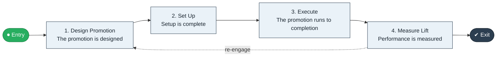

# Promotion Plan to Execution

`value-streams:value-stream-promotion-plan-to-execution-j73nkj` · **operational** · retail-commerce · industry-specific

> The promotions stream from promotion design through setup to executed promotion with measured lift.

**Outcome:** An executed promotion with measured performance.

**Machine-readable:** this page is generated from — and must stay in sync with — the authoritative record [`value-streams-value-stream-promotion-plan-to-execution-j73nkj.yaml`](./value-streams-value-stream-promotion-plan-to-execution-j73nkj.yaml). The front matter above is YAML-extractable metadata.

## Stage flow

## Value stages

| # | Stage | Entry criterion | Exit criterion | Enabling capabilities (count) | Realizing processes (count) | Visible |
|---|---|---|---|---|---|---|
| 1 | **Design Promotion** | A promotion is approved for design. | The promotion is designed. | 1 | 1 | no |
| 2 | **Set Up** | The promotion is designed. | Setup is complete. | 2 | 1 | no |
| 3 | **Execute** | Setup is complete. | The promotion runs to completion. | 2 | 1 | yes |
| 4 | **Measure Lift** | The promotion completes. | Performance is measured. | 2 | 1 | no |

### 1. Design Promotion

Design the promotion mechanics.

| Aspect | Value |
|---|---|
| Entry criterion | A promotion is approved for design. |
| Exit criterion | The promotion is designed. |
| Outcome | A designed promotion. |
| Customer visible | False |
| Enabling capabilities | `capabilities:capability-marketing-xmc539` |
| Realizing processes | `processes:process-pr-design-j6fakx` |

### 2. Set Up

Set up pricing, media, and stock for the promotion.

| Aspect | Value |
|---|---|
| Entry criterion | The promotion is designed. |
| Exit criterion | Setup is complete. |
| Outcome | A staged promotion. |
| Customer visible | False |
| Enabling capabilities | `capabilities:capability-marketing-xmc539` · `capabilities:capability-operations-management-pm3w8k` |
| Realizing processes | `processes:process-pr-build-nygvw7` |

### 3. Execute

Run the promotion in market.

| Aspect | Value |
|---|---|
| Entry criterion | Setup is complete. |
| Exit criterion | The promotion runs to completion. |
| Outcome | An executed promotion. |
| Customer visible | True |
| Enabling capabilities | `capabilities:capability-marketing-xmc539` · `capabilities:capability-operations-management-pm3w8k` |
| Realizing processes | `processes:process-eo-operate-2jnz85` |

### 4. Measure Lift

Measure the promotion's lift and effectiveness.

| Aspect | Value |
|---|---|
| Entry criterion | The promotion completes. |
| Exit criterion | Performance is measured. |
| Outcome | Measured performance. |
| Customer visible | False |
| Enabling capabilities | `capabilities:capability-insight-management-ms4n9d` · `capabilities:capability-enterprise-performance-management-5fxren` |
| Realizing processes | `processes:process-sd-operate-ucxpz4` |

## Scope boundary

**Entry:** A promotion is designed and approved.

**Exit:** The promotion is executed and its lift measured.

**In scope**

- Promotion design
- Setup and pricing
- Execution
- Measurement

**Out of scope** (owned by the named neighbour)

- Everyday pricing
- Loyalty program management

## Traceability

**Capabilities** (`aggregated_capability_refs`, resolving in [business-capabilities](https://github.com/technehub-labs/dea-catalog-business-capabilities)):

- `capabilities:capability-marketing-xmc539`
- `capabilities:capability-operations-management-pm3w8k`
- `capabilities:capability-insight-management-ms4n9d`
- `capabilities:capability-enterprise-performance-management-5fxren`

**Processes** (`process_refs`, resolving in [business-processes](https://github.com/technehub-labs/dea-catalog-business-processes)):

- `processes:process-pr-design-j6fakx`
- `processes:process-pr-build-nygvw7`
- `processes:process-eo-operate-2jnz85`
- `processes:process-sd-operate-ucxpz4`

## Cross-stream links

**Upstream:** none recorded.

**Downstream:** none recorded.

## Measurement

- **Promotion lift** (stream-level) — Incremental sales attributable to the promotion.

## Evidence

| Source | Class | Reference |
|---|---|---|
| SRC-013 | industry-reference-model | Retail / consumer-commerce chains (public structure) |

**Rationale:** Admitted under CR-VS-12 (population tranche; candidate VSC-061) from the CR-VS-11 industry evidence register extension. Industry-specific chain (retail-commerce); distinct from cross-industry streams by applicability (CR-VS-11 method note); cross-catalog references resolve against the sibling catalogs per the referential-integrity gate.

See [research/evidence.md](./research/evidence.md) for the source-backed notes.

## Provenance ladder

| Stage | Date | Actor |
|---|---|---|
| candidate | 2026-10-28 | Emmanuel A. Otchere, candidate universe v0.6 (CR-VS-12) |
| admitted | 2026-10-28 | Emmanuel A. Otchere, admission CR-VS-12 |

---

*Generated by [`scripts/generate_entity_docs.py`](../../../scripts/generate_entity_docs.py) (CR-VS-13) from the authoritative record. Do not edit by hand; regenerate.*
