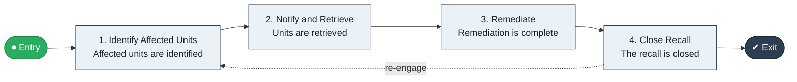

# Recall to Remediation

`value-streams:value-stream-recall-to-remediation-kq3mwc` · **governance** · manufacturing, retail-commerce · industry-specific

> The product-recall stream from recall decision through affected-unit traceability to remediation closure.

**Outcome:** All affected units remediated with the recall closed.

**Machine-readable:** this page is generated from — and must stay in sync with — the authoritative record [`value-streams-value-stream-recall-to-remediation-kq3mwc.yaml`](./value-streams-value-stream-recall-to-remediation-kq3mwc.yaml). The front matter above is YAML-extractable metadata.

## Stage flow

## Value stages

| # | Stage | Entry criterion | Exit criterion | Enabling capabilities (count) | Realizing processes (count) | Visible |
|---|---|---|---|---|---|---|
| 1 | **Identify Affected Units** | A recall is decided. | Affected units are identified. | 2 | 1 | no |
| 2 | **Notify and Retrieve** | Units are identified. | Units are retrieved. | 2 | 2 | yes |
| 3 | **Remediate** | Units are retrieved. | Remediation is complete. | 2 | 1 | yes |
| 4 | **Close Recall** | Remediation is complete. | The recall is closed. | 2 | 1 | yes |

### 1. Identify Affected Units

Trace affected units through the distribution chain.

| Aspect | Value |
|---|---|
| Entry criterion | A recall is decided. |
| Exit criterion | Affected units are identified. |
| Outcome | An affected-unit list. |
| Customer visible | False |
| Enabling capabilities | `capabilities:capability-information-management-6vjgdh` · `capabilities:capability-operations-management-pm3w8k` |
| Realizing processes | `processes:process-sd-operate-ucxpz4` |

### 2. Notify and Retrieve

Notify and retrieve affected units.

| Aspect | Value |
|---|---|
| Entry criterion | Units are identified. |
| Exit criterion | Units are retrieved. |
| Outcome | Retrieved units. |
| Customer visible | True |
| Enabling capabilities | `capabilities:capability-customer-management-f3n8wb` · `capabilities:capability-operations-management-pm3w8k` |
| Realizing processes | `processes:process-eo-operate-zh9m57` · `processes:process-eo-operate-zwzmbd` |

### 3. Remediate

Remediate or replace the units.

| Aspect | Value |
|---|---|
| Entry criterion | Units are retrieved. |
| Exit criterion | Remediation is complete. |
| Outcome | Remediated units. |
| Customer visible | True |
| Enabling capabilities | `capabilities:capability-operations-management-pm3w8k` · `capabilities:capability-customer-management-f3n8wb` |
| Realizing processes | `processes:process-eo-operate-2jnz85` |

### 4. Close Recall

Close the recall with verification.

| Aspect | Value |
|---|---|
| Entry criterion | Remediation is complete. |
| Exit criterion | The recall is closed. |
| Outcome | A closed recall. |
| Customer visible | True |
| Enabling capabilities | `capabilities:capability-enterprise-governance-uas48u` · `capabilities:capability-enterprise-performance-management-5fxren` |
| Realizing processes | `processes:process-ge-operate-zwaes5` |

## Scope boundary

**Entry:** A recall decision is made.

**Exit:** The recall is closed with remediation complete.

**In scope**

- Affected-unit identification
- Notification and retrieval
- Remediation
- Closure

**Out of scope** (owned by the named neighbour)

- Quality (Inspect to Disposition)
- Field service

## Traceability

**Capabilities** (`aggregated_capability_refs`, resolving in [business-capabilities](https://github.com/technehub-labs/dea-catalog-business-capabilities)):

- `capabilities:capability-information-management-6vjgdh`
- `capabilities:capability-operations-management-pm3w8k`
- `capabilities:capability-customer-management-f3n8wb`
- `capabilities:capability-enterprise-governance-uas48u`
- `capabilities:capability-enterprise-performance-management-5fxren`

**Processes** (`process_refs`, resolving in [business-processes](https://github.com/technehub-labs/dea-catalog-business-processes)):

- `processes:process-sd-operate-ucxpz4`
- `processes:process-eo-operate-zh9m57`
- `processes:process-eo-operate-zwzmbd`
- `processes:process-eo-operate-2jnz85`
- `processes:process-ge-operate-zwaes5`

## Cross-stream links

**Upstream:** none recorded.

**Downstream:** none recorded.

## Measurement

- **Recall retrieval rate** (stream-level) — Share of affected units retrieved and remediated.

## Evidence

| Source | Class | Reference |
|---|---|---|
| SRC-016 | industry-reference-model | Manufacturing and logistics reference models (SCOR-style category structure) |
| SRC-013 | industry-reference-model | Retail / consumer-commerce chains (public structure) |

**Rationale:** Admitted under CR-VS-12 (population tranche; candidate VSC-056) from the CR-VS-11 industry evidence register extension. Industry-specific chain (manufacturing, retail-commerce); distinct from cross-industry streams by applicability (CR-VS-11 method note); cross-catalog references resolve against the sibling catalogs per the referential-integrity gate.

See [research/evidence.md](./research/evidence.md) for the source-backed notes.

## Provenance ladder

| Stage | Date | Actor |
|---|---|---|
| candidate | 2026-10-28 | Emmanuel A. Otchere, candidate universe v0.6 (CR-VS-12) |
| admitted | 2026-10-28 | Emmanuel A. Otchere, admission CR-VS-12 |

---

*Generated by [`scripts/generate_entity_docs.py`](../../../scripts/generate_entity_docs.py) (CR-VS-13) from the authoritative record. Do not edit by hand; regenerate.*
