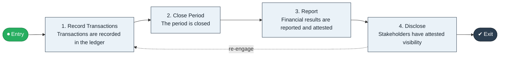

# Record to Report

`value-streams:value-stream-record-to-report-zw9z2r` · **governance** · cross-industry · generic

> The end-to-end stream from recording of transactions through period close and attested financial reporting.

**Outcome:** Attested financial visibility for stakeholders.

**Machine-readable:** this page is generated from — and must stay in sync with — the authoritative record [`value-streams-value-stream-record-to-report-zw9z2r.yaml`](./value-streams-value-stream-record-to-report-zw9z2r.yaml). The front matter above is YAML-extractable metadata.

## Stage flow

## Value stages

| # | Stage | Entry criterion | Exit criterion | Enabling capabilities (count) | Realizing processes (count) | Visible |
|---|---|---|---|---|---|---|
| 1 | **Record Transactions** | An accounting period opens or a transaction occurs. | Transactions are recorded in the ledger. | 2 | 1 | no |
| 2 | **Close Period** | The period's transactions are recorded. | The period is closed. | 1 | 1 | no |
| 3 | **Report** | A period is closed. | Financial results are reported and attested. | 2 | 1 | no |
| 4 | **Disclose** | Results are attested. | Stakeholders have attested visibility. | 2 | 2 | yes |

### 1. Record Transactions

Record enterprise transactions in the ledger.

| Aspect | Value |
|---|---|
| Entry criterion | An accounting period opens or a transaction occurs. |
| Exit criterion | Transactions are recorded in the ledger. |
| Outcome | A complete transactional record. |
| Customer visible | False |
| Enabling capabilities | `capabilities:capability-financial-stewardship-c7xtfk` · `capabilities:capability-information-management-6vjgdh` |
| Realizing processes | `processes:process-fa-operate-g9zpnq` |

### 2. Close Period

Perform period close and reconciliation.

| Aspect | Value |
|---|---|
| Entry criterion | The period's transactions are recorded. |
| Exit criterion | The period is closed. |
| Outcome | A closed, reconciled period. |
| Customer visible | False |
| Enabling capabilities | `capabilities:capability-financial-stewardship-c7xtfk` |
| Realizing processes | `processes:process-fa-operate-4xn4d6` |

### 3. Report

Compile and attest financial results.

| Aspect | Value |
|---|---|
| Entry criterion | A period is closed. |
| Exit criterion | Financial results are reported and attested. |
| Outcome | Attested financial results. |
| Customer visible | False |
| Enabling capabilities | `capabilities:capability-financial-stewardship-c7xtfk` · `capabilities:capability-enterprise-performance-management-5fxren` |
| Realizing processes | `processes:process-fa-operate-ycba3k` |

### 4. Disclose

Publish results to stakeholders.

| Aspect | Value |
|---|---|
| Entry criterion | Results are attested. |
| Exit criterion | Stakeholders have attested visibility. |
| Outcome | Attested financial visibility for stakeholders. |
| Customer visible | True |
| Enabling capabilities | `capabilities:capability-financial-stewardship-c7xtfk` · `capabilities:capability-enterprise-governance-uas48u` |
| Realizing processes | `processes:process-fa-operate-8vqvkk` · `processes:process-fa-operate-ycba3k` |

## Scope boundary

**Entry:** An accounting period opens or a transaction is recorded.

**Exit:** Financial results are reported and attested.

**In scope**

- Transaction recording
- Period close
- Attested financial reporting
- Disclosure and stakeholder visibility

**Out of scope** (owned by the named neighbour)

- Forward-looking commitments (Plan to Forecast)
- Payment settlement flows (Order to Cash / Procure to Pay)
- Tax strategy design (Regulation Management capability)

## Traceability

**Capabilities** (`aggregated_capability_refs`, resolving in [business-capabilities](https://github.com/technehub-labs/dea-catalog-business-capabilities)):

- `capabilities:capability-financial-stewardship-c7xtfk`
- `capabilities:capability-financial-resource-management-cd3c7c`
- `capabilities:capability-information-management-6vjgdh`
- `capabilities:capability-enterprise-performance-management-5fxren`
- `capabilities:capability-enterprise-governance-uas48u`

**Processes** (`process_refs`, resolving in [business-processes](https://github.com/technehub-labs/dea-catalog-business-processes)):

- `processes:process-fa-operate-g9zpnq`
- `processes:process-fa-operate-4xn4d6`
- `processes:process-fa-operate-ycba3k`
- `processes:process-fa-operate-8vqvkk`

## Cross-stream links

**Upstream** (their exit feeds this stream's entry):

- [plan to forecast](../value-stream-plan-to-forecast-89vb4q/README.md) — Ratified plans are the commitments attested against.
- [order to cash](../value-stream-order-to-cash-sc8gbu/README.md) — Recognized payments are recorded as transactions.
- [procure to pay](../value-stream-procure-to-pay-utma5c/README.md) — Supplier settlements are recorded as transactions.

**Downstream:** none recorded.

## Measurement

- **Close cycle time** (stage: Close Period) — Elapsed days from period end to attested close. → [`dea:metric-financial-close-cycle-time`](https://github.com/technehub-labs/dea-catalog-metrics)
- **Restatement rate** (stage: Report) — Count of restatements per reporting year; zero is the target. → [`dea:metric-financial-restatement-count`](https://github.com/technehub-labs/dea-catalog-metrics)

## Evidence

| Source | Class | Reference |
|---|---|---|
| SRC-002 | cross-industry-process | APQC Process Classification Framework (cross-industry, process-to-value-stream groupings) |
| SRC-003 | standards-body | OMG Business Architecture Core Metamodel (BACM) — ValueStream element |
| SRC-006 | commercial-process-models | Hammer & Hurdle-style enterprise process-chain literature (public summaries) |

**Rationale:** Admitted from candidate VSC-009 under CR-VS-04 (evidence raised E2 -> E3 via register v0.2 extension; distinctness closed per CR-VS-02). Finance reporting chain; served party is enterprise governance stakeholders (SRC-003). Boundary vs. Plan to Forecast: backward-looking attestation vs. forward-looking commitment (CR-VS-02 RES-002).

See [research/evidence.md](./research/evidence.md) for the source-backed notes.

## Provenance ladder

| Stage | Date | Actor |
|---|---|---|
| candidate | 2026-10-27 | Emmanuel A. Otchere, candidate universe v0.1 (CR-VS-01, PR #3) |
| candidate | 2026-10-27 | Emmanuel A. Otchere, evidence raised E2 -> E3 (CR-VS-04, register v0.2) |
| admitted | 2026-10-27 | Emmanuel A. Otchere, admission CR-VS-04 |
| active | 2026-10-27 | Emmanuel A. Otchere, CR-VS-07 enrichment (value stages, process links, scope, metrics) |
| active | 2026-10-28 | Emmanuel A. Otchere, CR-VS-08 metric backfill (metric_ref links to dea-catalog-metrics) |
| active | 2026-10-28 | Emmanuel A. Otchere, CR-VS-11 applicability backfill (cross-industry, generic) |

---

*Generated by [`scripts/generate_entity_docs.py`](../../../scripts/generate_entity_docs.py) (CR-VS-13) from the authoritative record. Do not edit by hand; regenerate.*
