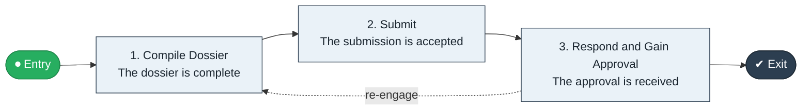

# Regulatory Dossier to Approval

`value-streams:value-stream-regulatory-dossier-to-approval-mgbk2u` · **governance** · life-sciences · industry-specific

> The regulatory stream from dossier compilation through submission to marketing approval.

**Outcome:** A received marketing approval for the dossier.

**Machine-readable:** this page is generated from — and must stay in sync with — the authoritative record [`value-streams-value-stream-regulatory-dossier-to-approval-mgbk2u.yaml`](./value-streams-value-stream-regulatory-dossier-to-approval-mgbk2u.yaml). The front matter above is YAML-extractable metadata.

## Stage flow

## Value stages

| # | Stage | Entry criterion | Exit criterion | Enabling capabilities (count) | Realizing processes (count) | Visible |
|---|---|---|---|---|---|---|
| 1 | **Compile Dossier** | A cycle opens. | The dossier is complete. | 2 | 1 | no |
| 2 | **Submit** | The dossier is complete. | The submission is accepted. | 2 | 1 | no |
| 3 | **Respond and Gain Approval** | Review questions arrive. | The approval is received. | 2 | 1 | no |

### 1. Compile Dossier

Compile the regulatory dossier.

| Aspect | Value |
|---|---|
| Entry criterion | A cycle opens. |
| Exit criterion | The dossier is complete. |
| Outcome | A complete dossier. |
| Customer visible | False |
| Enabling capabilities | `capabilities:capability-information-management-6vjgdh` · `capabilities:capability-regulation-management-gya4d8` |
| Realizing processes | `processes:process-fa-operate-ycba3k` |

### 2. Submit

Submit the dossier.

| Aspect | Value |
|---|---|
| Entry criterion | The dossier is complete. |
| Exit criterion | The submission is accepted. |
| Outcome | An accepted submission. |
| Customer visible | False |
| Enabling capabilities | `capabilities:capability-regulation-management-gya4d8` · `capabilities:capability-legal-matter-management-zzbd2u` |
| Realizing processes | `processes:process-fa-operate-8vqvkk` |

### 3. Respond and Gain Approval

Respond to review questions and gain approval.

| Aspect | Value |
|---|---|
| Entry criterion | Review questions arrive. |
| Exit criterion | The approval is received. |
| Outcome | A received approval. |
| Customer visible | False |
| Enabling capabilities | `capabilities:capability-regulation-management-gya4d8` · `capabilities:capability-enterprise-governance-uas48u` |
| Realizing processes | `processes:process-ge-operate-zwaes5` |

## Scope boundary

**Entry:** A dossier compilation cycle opens.

**Exit:** The approval is received.

**In scope**

- Dossier compilation
- Submission
- Review response and approval

**Out of scope** (owned by the named neighbour)

- Clinical readout (Trial to Readout)
- Lifecycle license maintenance

## Traceability

**Capabilities** (`aggregated_capability_refs`, resolving in [business-capabilities](https://github.com/technehub-labs/dea-catalog-business-capabilities)):

- `capabilities:capability-information-management-6vjgdh`
- `capabilities:capability-regulation-management-gya4d8`
- `capabilities:capability-legal-matter-management-zzbd2u`
- `capabilities:capability-enterprise-governance-uas48u`

**Processes** (`process_refs`, resolving in [business-processes](https://github.com/technehub-labs/dea-catalog-business-processes)):

- `processes:process-fa-operate-ycba3k`
- `processes:process-fa-operate-8vqvkk`
- `processes:process-ge-operate-zwaes5`

## Cross-stream links

**Upstream:** none recorded.

**Downstream:** none recorded.

## Measurement

- **Submission-to-approval time** (stream-level) — Elapsed months from submission to approval.

## Evidence

| Source | Class | Reference |
|---|---|---|
| SRC-018 | industry-reference-model | Life-sciences reference chains (public GxP/ICH category structure) |

**Rationale:** Admitted under CR-VS-12 (population tranche; candidate VSC-102) from the CR-VS-11 industry evidence register extension. Industry-specific chain (life-sciences); distinct from cross-industry streams by applicability (CR-VS-11 method note); cross-catalog references resolve against the sibling catalogs per the referential-integrity gate.

See [research/evidence.md](./research/evidence.md) for the source-backed notes.

## Provenance ladder

| Stage | Date | Actor |
|---|---|---|
| candidate | 2026-10-28 | Emmanuel A. Otchere, candidate universe v0.6 (CR-VS-12) |
| admitted | 2026-10-28 | Emmanuel A. Otchere, admission CR-VS-12 |

---

*Generated by [`scripts/generate_entity_docs.py`](../../../scripts/generate_entity_docs.py) (CR-VS-13) from the authoritative record. Do not edit by hand; regenerate.*
