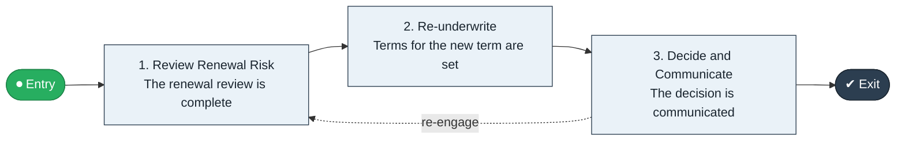

# Renewal Risk to Decision

`value-streams:value-stream-renewal-risk-to-decision-rcjb6b` · **operational** · insurance · industry-specific

> The renewal stream from renewal-risk review through re-underwriting to the renewal decision.

**Outcome:** A data-driven renewal decision communicated before expiry.

**Machine-readable:** this page is generated from — and must stay in sync with — the authoritative record [`value-streams-value-stream-renewal-risk-to-decision-rcjb6b.yaml`](./value-streams-value-stream-renewal-risk-to-decision-rcjb6b.yaml). The front matter above is YAML-extractable metadata.

## Stage flow

## Value stages

| # | Stage | Entry criterion | Exit criterion | Enabling capabilities (count) | Realizing processes (count) | Visible |
|---|---|---|---|---|---|---|
| 1 | **Review Renewal Risk** | A policy approaches renewal. | The renewal review is complete. | 2 | 1 | no |
| 2 | **Re-underwrite** | The review is complete. | Terms for the new term are set. | 2 | 1 | no |
| 3 | **Decide and Communicate** | Terms are set. | The decision is communicated. | 1 | 1 | yes |

### 1. Review Renewal Risk

Review the risk and loss experience.

| Aspect | Value |
|---|---|
| Entry criterion | A policy approaches renewal. |
| Exit criterion | The renewal review is complete. |
| Outcome | A completed review. |
| Customer visible | False |
| Enabling capabilities | `capabilities:capability-insight-management-ms4n9d` · `capabilities:capability-risk-management-h9uxdw` |
| Realizing processes | `processes:process-sd-operate-ucxpz4` |

### 2. Re-underwrite

Re-underwrite the risk for the new term.

| Aspect | Value |
|---|---|
| Entry criterion | The review is complete. |
| Exit criterion | Terms for the new term are set. |
| Outcome | Set renewal terms. |
| Customer visible | False |
| Enabling capabilities | `capabilities:capability-risk-management-h9uxdw` · `capabilities:capability-financial-resource-management-cd3c7c` |
| Realizing processes | `processes:process-ge-operate-tpenm6` |

### 3. Decide and Communicate

Decide and communicate the renewal offer.

| Aspect | Value |
|---|---|
| Entry criterion | Terms are set. |
| Exit criterion | The decision is communicated. |
| Outcome | A communicated decision. |
| Customer visible | True |
| Enabling capabilities | `capabilities:capability-customer-management-f3n8wb` |
| Realizing processes | `processes:process-pr-improve-t6uvan` |

## Scope boundary

**Entry:** A policy approaches renewal.

**Exit:** The renewal decision is made and communicated.

**In scope**

- Renewal risk review
- Re-underwriting
- Decision and communication

**Out of scope** (owned by the named neighbour)

- Binding (Quote to Bind)
- Broker channel management

## Traceability

**Capabilities** (`aggregated_capability_refs`, resolving in [business-capabilities](https://github.com/technehub-labs/dea-catalog-business-capabilities)):

- `capabilities:capability-insight-management-ms4n9d`
- `capabilities:capability-risk-management-h9uxdw`
- `capabilities:capability-financial-resource-management-cd3c7c`
- `capabilities:capability-customer-management-f3n8wb`

**Processes** (`process_refs`, resolving in [business-processes](https://github.com/technehub-labs/dea-catalog-business-processes)):

- `processes:process-sd-operate-ucxpz4`
- `processes:process-ge-operate-tpenm6`
- `processes:process-pr-improve-t6uvan`

## Cross-stream links

**Upstream** (their exit feeds this stream's entry):

- [quote to bind](../value-stream-quote-to-bind-szgnjc/README.md) — Non-renewed risks re-enter underwriting.

**Downstream:** none recorded.

## Measurement

- **Renewal retention rate** (stream-level) — Share of expiring policies renewed.

## Evidence

| Source | Class | Reference |
|---|---|---|
| SRC-009 | industry-reference-model | Insurance industry reference models (policy and claims lifecycles, public structure) |

**Rationale:** Admitted under CR-VS-12 (population tranche; candidate VSC-032) from the CR-VS-11 industry evidence register extension. Industry-specific chain (insurance); distinct from cross-industry streams by applicability (CR-VS-11 method note); cross-catalog references resolve against the sibling catalogs per the referential-integrity gate.

See [research/evidence.md](./research/evidence.md) for the source-backed notes.

## Provenance ladder

| Stage | Date | Actor |
|---|---|---|
| candidate | 2026-10-28 | Emmanuel A. Otchere, candidate universe v0.6 (CR-VS-12) |
| admitted | 2026-10-28 | Emmanuel A. Otchere, admission CR-VS-12 |

---

*Generated by [`scripts/generate_entity_docs.py`](../../../scripts/generate_entity_docs.py) (CR-VS-13) from the authoritative record. Do not edit by hand; regenerate.*
