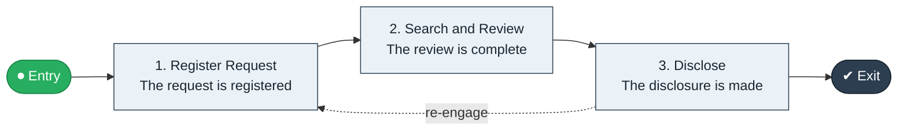

# Request to Disclose

`value-streams:value-stream-request-to-disclose-78w8jb` · **governance** · public-sector · industry-specific

> The information-request stream from records request through review and redaction to disclosure.

**Outcome:** A lawful disclosure to the requester within the statutory deadline.

**Machine-readable:** this page is generated from — and must stay in sync with — the authoritative record [`value-streams-value-stream-request-to-disclose-78w8jb.yaml`](./value-streams-value-stream-request-to-disclose-78w8jb.yaml). The front matter above is YAML-extractable metadata.

## Stage flow

## Value stages

| # | Stage | Entry criterion | Exit criterion | Enabling capabilities (count) | Realizing processes (count) | Visible |
|---|---|---|---|---|---|---|
| 1 | **Register Request** | A request is received. | The request is registered. | 2 | 1 | yes |
| 2 | **Search and Review** | The request is registered. | The review is complete. | 2 | 1 | no |
| 3 | **Disclose** | The review is complete. | The disclosure is made. | 2 | 1 | yes |

### 1. Register Request

Register the request and clarify scope.

| Aspect | Value |
|---|---|
| Entry criterion | A request is received. |
| Exit criterion | The request is registered. |
| Outcome | A registered request. |
| Customer visible | True |
| Enabling capabilities | `capabilities:capability-customer-management-f3n8wb` · `capabilities:capability-information-management-6vjgdh` |
| Realizing processes | `processes:process-pr-operate-bbe384` |

### 2. Search and Review

Search records and review for exemptions.

| Aspect | Value |
|---|---|
| Entry criterion | The request is registered. |
| Exit criterion | The review is complete. |
| Outcome | A completed review. |
| Customer visible | False |
| Enabling capabilities | `capabilities:capability-legal-matter-management-zzbd2u` · `capabilities:capability-information-management-6vjgdh` |
| Realizing processes | `processes:process-ge-operate-zwaes5` |

### 3. Disclose

Redact as required and disclose.

| Aspect | Value |
|---|---|
| Entry criterion | The review is complete. |
| Exit criterion | The disclosure is made. |
| Outcome | A made disclosure. |
| Customer visible | True |
| Enabling capabilities | `capabilities:capability-legal-matter-management-zzbd2u` · `capabilities:capability-customer-management-f3n8wb` |
| Realizing processes | `processes:process-pr-operate-bbe384` |

## Scope boundary

**Entry:** A records/information request is received.

**Exit:** The disclosure is made within deadline.

**In scope**

- Request registration
- Records search and review
- Redaction and disclosure

**Out of scope** (owned by the named neighbour)

- Case handling (Intake to Resolution)
- Archives governance

## Traceability

**Capabilities** (`aggregated_capability_refs`, resolving in [business-capabilities](https://github.com/technehub-labs/dea-catalog-business-capabilities)):

- `capabilities:capability-customer-management-f3n8wb`
- `capabilities:capability-information-management-6vjgdh`
- `capabilities:capability-legal-matter-management-zzbd2u`

**Processes** (`process_refs`, resolving in [business-processes](https://github.com/technehub-labs/dea-catalog-business-processes)):

- `processes:process-pr-operate-bbe384`
- `processes:process-ge-operate-zwaes5`

## Cross-stream links

**Upstream:** none recorded.

**Downstream:** none recorded.

## Measurement

- **Statutory deadline compliance** (stream-level) — Share of disclosures made within deadline.

## Evidence

| Source | Class | Reference |
|---|---|---|
| SRC-014 | industry-reference-model | Public-sector service chains (permits, grants, benefits; public structure) |

**Rationale:** Admitted under CR-VS-12 (population tranche; candidate VSC-075) from the CR-VS-11 industry evidence register extension. Industry-specific chain (public-sector); distinct from cross-industry streams by applicability (CR-VS-11 method note); cross-catalog references resolve against the sibling catalogs per the referential-integrity gate.

See [research/evidence.md](./research/evidence.md) for the source-backed notes.

## Provenance ladder

| Stage | Date | Actor |
|---|---|---|
| candidate | 2026-10-28 | Emmanuel A. Otchere, candidate universe v0.6 (CR-VS-12) |
| admitted | 2026-10-28 | Emmanuel A. Otchere, admission CR-VS-12 |

---

*Generated by [`scripts/generate_entity_docs.py`](../../../scripts/generate_entity_docs.py) (CR-VS-13) from the authoritative record. Do not edit by hand; regenerate.*
