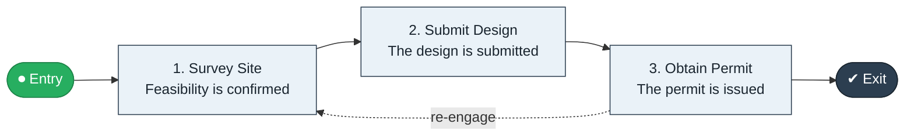

# Site Survey to Permit

`value-streams:value-stream-site-survey-to-permit-umhn4p` · **governance** · construction-real-estate · industry-specific

> The development stream from site survey through design submission to issued planning/building permit.

**Outcome:** An issued development permit.

**Machine-readable:** this page is generated from — and must stay in sync with — the authoritative record [`value-streams-value-stream-site-survey-to-permit-umhn4p.yaml`](./value-streams-value-stream-site-survey-to-permit-umhn4p.yaml). The front matter above is YAML-extractable metadata.

## Stage flow

## Value stages

| # | Stage | Entry criterion | Exit criterion | Enabling capabilities (count) | Realizing processes (count) | Visible |
|---|---|---|---|---|---|---|
| 1 | **Survey Site** | A need is identified. | Feasibility is confirmed. | 2 | 1 | no |
| 2 | **Submit Design** | Feasibility is confirmed. | The design is submitted. | 2 | 1 | no |
| 3 | **Obtain Permit** | The design is submitted. | The permit is issued. | 2 | 1 | yes |

### 1. Survey Site

Survey the site and assess feasibility.

| Aspect | Value |
|---|---|
| Entry criterion | A need is identified. |
| Exit criterion | Feasibility is confirmed. |
| Outcome | A feasible site. |
| Customer visible | False |
| Enabling capabilities | `capabilities:capability-information-management-6vjgdh` · `capabilities:capability-technology-management-maus5n` |
| Realizing processes | `processes:process-sd-operate-ucxpz4` |

### 2. Submit Design

Submit the design for permitting.

| Aspect | Value |
|---|---|
| Entry criterion | Feasibility is confirmed. |
| Exit criterion | The design is submitted. |
| Outcome | A submitted design. |
| Customer visible | False |
| Enabling capabilities | `capabilities:capability-offering-management-6egkc8` · `capabilities:capability-regulation-management-gya4d8` |
| Realizing processes | `processes:process-pv-design-8v4k89` |

### 3. Obtain Permit

Respond to review and obtain the permit.

| Aspect | Value |
|---|---|
| Entry criterion | The design is submitted. |
| Exit criterion | The permit is issued. |
| Outcome | An issued permit. |
| Customer visible | True |
| Enabling capabilities | `capabilities:capability-regulation-management-gya4d8` · `capabilities:capability-legal-matter-management-zzbd2u` |
| Realizing processes | `processes:process-fa-operate-8vqvkk` |

## Scope boundary

**Entry:** A development need is identified.

**Exit:** The permit is issued.

**In scope**

- Site survey and feasibility
- Design submission
- Permit review and issuance

**Out of scope** (owned by the named neighbour)

- Construction (Build to Handover)
- Regulatory inspections (Inspection to Certificate)

## Traceability

**Capabilities** (`aggregated_capability_refs`, resolving in [business-capabilities](https://github.com/technehub-labs/dea-catalog-business-capabilities)):

- `capabilities:capability-information-management-6vjgdh`
- `capabilities:capability-technology-management-maus5n`
- `capabilities:capability-offering-management-6egkc8`
- `capabilities:capability-regulation-management-gya4d8`
- `capabilities:capability-legal-matter-management-zzbd2u`

**Processes** (`process_refs`, resolving in [business-processes](https://github.com/technehub-labs/dea-catalog-business-processes)):

- `processes:process-sd-operate-ucxpz4`
- `processes:process-pv-design-8v4k89`
- `processes:process-fa-operate-8vqvkk`

## Cross-stream links

**Upstream:** none recorded.

**Downstream:** none recorded.

## Measurement

- **Permit approval cycle time** (stream-level) — Elapsed days from submission to issued permit.

## Evidence

| Source | Class | Reference |
|---|---|---|
| SRC-017 | industry-reference-model | Construction and real-estate chains (public structure) |

**Rationale:** Admitted under CR-VS-12 (population tranche; candidate VSC-097) from the CR-VS-11 industry evidence register extension. Industry-specific chain (construction-real-estate); distinct from cross-industry streams by applicability (CR-VS-11 method note); cross-catalog references resolve against the sibling catalogs per the referential-integrity gate.

See [research/evidence.md](./research/evidence.md) for the source-backed notes.

## Provenance ladder

| Stage | Date | Actor |
|---|---|---|
| candidate | 2026-10-28 | Emmanuel A. Otchere, candidate universe v0.6 (CR-VS-12) |
| admitted | 2026-10-28 | Emmanuel A. Otchere, admission CR-VS-12 |

---

*Generated by [`scripts/generate_entity_docs.py`](../../../scripts/generate_entity_docs.py) (CR-VS-13) from the authoritative record. Do not edit by hand; regenerate.*
