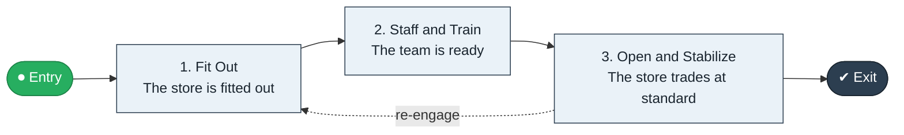

# Store Opening to Trading

`value-streams:value-stream-store-opening-to-trading-58wbw8` · **support** · retail-commerce · industry-specific

> The store-lifecycle stream from site decision through fit-out and staffing to first-day trading.

**Outcome:** A trading store at full operating standard.

**Machine-readable:** this page is generated from — and must stay in sync with — the authoritative record [`value-streams-value-stream-store-opening-to-trading-58wbw8.yaml`](./value-streams-value-stream-store-opening-to-trading-58wbw8.yaml). The front matter above is YAML-extractable metadata.

## Stage flow

## Value stages

| # | Stage | Entry criterion | Exit criterion | Enabling capabilities (count) | Realizing processes (count) | Visible |
|---|---|---|---|---|---|---|
| 1 | **Fit Out** | A site is approved. | The store is fitted out. | 2 | 2 | no |
| 2 | **Staff and Train** | The store is fitted out. | The team is ready. | 2 | 1 | no |
| 3 | **Open and Stabilize** | The team is ready. | The store trades at standard. | 2 | 1 | yes |

### 1. Fit Out

Fit out the site and merchandise it.

| Aspect | Value |
|---|---|
| Entry criterion | A site is approved. |
| Exit criterion | The store is fitted out. |
| Outcome | A fitted store. |
| Customer visible | False |
| Enabling capabilities | `capabilities:capability-operations-management-pm3w8k` · `capabilities:capability-asset-management-judtwr` |
| Realizing processes | `processes:process-eo-build-j9z3q4` · `processes:process-eo-operate-zwzmbd` |

### 2. Staff and Train

Staff and train the store team.

| Aspect | Value |
|---|---|
| Entry criterion | The store is fitted out. |
| Exit criterion | The team is ready. |
| Outcome | A ready team. |
| Customer visible | False |
| Enabling capabilities | `capabilities:capability-workforce-management-9e8d8s` · `capabilities:capability-workforce-planning-b43rhm` |
| Realizing processes | `processes:process-ao-operate-87q5mk` |

### 3. Open and Stabilize

Open for trading and stabilize to standard.

| Aspect | Value |
|---|---|
| Entry criterion | The team is ready. |
| Exit criterion | The store trades at standard. |
| Outcome | A trading store. |
| Customer visible | True |
| Enabling capabilities | `capabilities:capability-operations-management-pm3w8k` · `capabilities:capability-enterprise-performance-management-5fxren` |
| Realizing processes | `processes:process-eo-operate-2jnz85` |

## Scope boundary

**Entry:** A site is selected and approved.

**Exit:** The store trades on day one at standard.

**In scope**

- Fit-out and merchandising
- Staffing and training
- Opening and stabilization

**Out of scope** (owned by the named neighbour)

- Assortment planning
- Real-estate transactions

## Traceability

**Capabilities** (`aggregated_capability_refs`, resolving in [business-capabilities](https://github.com/technehub-labs/dea-catalog-business-capabilities)):

- `capabilities:capability-operations-management-pm3w8k`
- `capabilities:capability-asset-management-judtwr`
- `capabilities:capability-workforce-management-9e8d8s`
- `capabilities:capability-workforce-planning-b43rhm`
- `capabilities:capability-enterprise-performance-management-5fxren`

**Processes** (`process_refs`, resolving in [business-processes](https://github.com/technehub-labs/dea-catalog-business-processes)):

- `processes:process-eo-build-j9z3q4`
- `processes:process-eo-operate-zwzmbd`
- `processes:process-ao-operate-87q5mk`
- `processes:process-eo-operate-2jnz85`

## Cross-stream links

**Upstream:** none recorded.

**Downstream:** none recorded.

## Measurement

- **Opening-to-standard time** (stream-level) — Elapsed weeks from opening to full operating standard.

## Evidence

| Source | Class | Reference |
|---|---|---|
| SRC-013 | industry-reference-model | Retail / consumer-commerce chains (public structure) |

**Rationale:** Admitted under CR-VS-12 (population tranche; candidate VSC-065) from the CR-VS-11 industry evidence register extension. Industry-specific chain (retail-commerce); distinct from cross-industry streams by applicability (CR-VS-11 method note); cross-catalog references resolve against the sibling catalogs per the referential-integrity gate.

See [research/evidence.md](./research/evidence.md) for the source-backed notes.

## Provenance ladder

| Stage | Date | Actor |
|---|---|---|
| candidate | 2026-10-28 | Emmanuel A. Otchere, candidate universe v0.6 (CR-VS-12) |
| admitted | 2026-10-28 | Emmanuel A. Otchere, admission CR-VS-12 |

---

*Generated by [`scripts/generate_entity_docs.py`](../../../scripts/generate_entity_docs.py) (CR-VS-13) from the authoritative record. Do not edit by hand; regenerate.*
