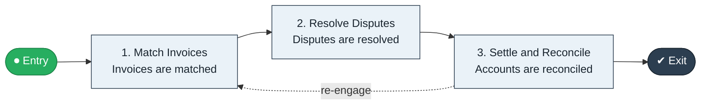

# Supplier Reconciliation

`value-streams:value-stream-supplier-reconciliation-y49qc3` · **support** · retail-commerce · industry-specific

> The trade-payables reconciliation stream from supplier invoice matching through dispute resolution to reconciled settlement.

**Outcome:** Reconciled supplier settlements for the trading period.

**Machine-readable:** this page is generated from — and must stay in sync with — the authoritative record [`value-streams-value-stream-supplier-reconciliation-y49qc3.yaml`](./value-streams-value-stream-supplier-reconciliation-y49qc3.yaml). The front matter above is YAML-extractable metadata.

## Stage flow

## Value stages

| # | Stage | Entry criterion | Exit criterion | Enabling capabilities (count) | Realizing processes (count) | Visible |
|---|---|---|---|---|---|---|
| 1 | **Match Invoices** | Period invoices exist. | Invoices are matched. | 2 | 1 | no |
| 2 | **Resolve Disputes** | Invoices are matched. | Disputes are resolved. | 2 | 1 | no |
| 3 | **Settle and Reconcile** | Disputes are resolved. | Accounts are reconciled. | 1 | 2 | no |

### 1. Match Invoices

Match supplier invoices to receipts and contracts.

| Aspect | Value |
|---|---|
| Entry criterion | Period invoices exist. |
| Exit criterion | Invoices are matched. |
| Outcome | Matched invoices. |
| Customer visible | False |
| Enabling capabilities | `capabilities:capability-financial-resource-management-cd3c7c` · `capabilities:capability-information-management-6vjgdh` |
| Realizing processes | `processes:process-fa-operate-wkqaqp` |

### 2. Resolve Disputes

Resolve matching disputes with suppliers.

| Aspect | Value |
|---|---|
| Entry criterion | Invoices are matched. |
| Exit criterion | Disputes are resolved. |
| Outcome | Resolved disputes. |
| Customer visible | False |
| Enabling capabilities | `capabilities:capability-supplier-management-d6fuj4` · `capabilities:capability-financial-stewardship-c7xtfk` |
| Realizing processes | `processes:process-pr-operate-bbe384` |

### 3. Settle and Reconcile

Settle and reconcile supplier accounts.

| Aspect | Value |
|---|---|
| Entry criterion | Disputes are resolved. |
| Exit criterion | Accounts are reconciled. |
| Outcome | Reconciled accounts. |
| Customer visible | False |
| Enabling capabilities | `capabilities:capability-financial-stewardship-c7xtfk` |
| Realizing processes | `processes:process-fa-operate-wkqaqp` · `processes:process-fa-operate-4xn4d6` |

## Scope boundary

**Entry:** Supplier invoices and delivery records exist for the period.

**Exit:** All supplier accounts are reconciled and settled.

**In scope**

- Invoice matching
- Dispute resolution
- Settlement and reconciliation

**Out of scope** (owned by the named neighbour)

- General procurement (Procure to Pay)
- Retail buying (Assortment to Shelf)

## Traceability

**Capabilities** (`aggregated_capability_refs`, resolving in [business-capabilities](https://github.com/technehub-labs/dea-catalog-business-capabilities)):

- `capabilities:capability-financial-resource-management-cd3c7c`
- `capabilities:capability-information-management-6vjgdh`
- `capabilities:capability-supplier-management-d6fuj4`
- `capabilities:capability-financial-stewardship-c7xtfk`

**Processes** (`process_refs`, resolving in [business-processes](https://github.com/technehub-labs/dea-catalog-business-processes)):

- `processes:process-fa-operate-wkqaqp`
- `processes:process-pr-operate-bbe384`
- `processes:process-fa-operate-4xn4d6`

## Cross-stream links

**Upstream:** none recorded.

**Downstream:** none recorded.

## Measurement

- **First-time match rate** (stage: Match Invoices) — Share of supplier invoices matched without dispute. → [`dea:metric-first-time-match-rate`](https://github.com/technehub-labs/dea-catalog-metrics)

## Evidence

| Source | Class | Reference |
|---|---|---|
| SRC-013 | industry-reference-model | Retail / consumer-commerce chains (public structure) |

**Rationale:** Admitted under CR-VS-12 (population tranche; candidate VSC-060) from the CR-VS-11 industry evidence register extension. Industry-specific chain (retail-commerce); distinct from cross-industry streams by applicability (CR-VS-11 method note); cross-catalog references resolve against the sibling catalogs per the referential-integrity gate.

See [research/evidence.md](./research/evidence.md) for the source-backed notes.

## Provenance ladder

| Stage | Date | Actor |
|---|---|---|
| candidate | 2026-10-28 | Emmanuel A. Otchere, candidate universe v0.6 (CR-VS-12) |
| admitted | 2026-10-28 | Emmanuel A. Otchere, admission CR-VS-12 |

---

*Generated by [`scripts/generate_entity_docs.py`](../../../scripts/generate_entity_docs.py) (CR-VS-13) from the authoritative record. Do not edit by hand; regenerate.*
