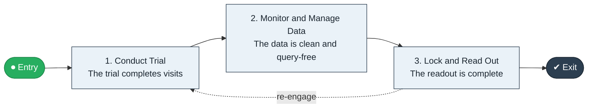

# Trial to Readout

`value-streams:value-stream-trial-to-readout-ztkya5` · **operational** · life-sciences · industry-specific

> The clinical-development stream from trial start through conduct and monitoring to database lock and readout.

**Outcome:** A locked trial database and analyzed readout.

**Machine-readable:** this page is generated from — and must stay in sync with — the authoritative record [`value-streams-value-stream-trial-to-readout-ztkya5.yaml`](./value-streams-value-stream-trial-to-readout-ztkya5.yaml). The front matter above is YAML-extractable metadata.

## Stage flow

## Value stages

| # | Stage | Entry criterion | Exit criterion | Enabling capabilities (count) | Realizing processes (count) | Visible |
|---|---|---|---|---|---|---|
| 1 | **Conduct Trial** | The trial starts. | The trial completes visits. | 2 | 1 | no |
| 2 | **Monitor and Manage Data** | Visits are underway. | The data is clean and query-free. | 2 | 2 | no |
| 3 | **Lock and Read Out** | Data is clean. | The readout is complete. | 2 | 1 | no |

### 1. Conduct Trial

Conduct the trial per protocol.

| Aspect | Value |
|---|---|
| Entry criterion | The trial starts. |
| Exit criterion | The trial completes visits. |
| Outcome | Completed conduct. |
| Customer visible | False |
| Enabling capabilities | `capabilities:capability-operations-management-pm3w8k` · `capabilities:capability-risk-management-h9uxdw` |
| Realizing processes | `processes:process-eo-operate-2jnz85` |

### 2. Monitor and Manage Data

Monitor sites and manage trial data.

| Aspect | Value |
|---|---|
| Entry criterion | Visits are underway. |
| Exit criterion | The data is clean and query-free. |
| Outcome | Clean trial data. |
| Customer visible | False |
| Enabling capabilities | `capabilities:capability-information-management-6vjgdh` · `capabilities:capability-risk-management-h9uxdw` |
| Realizing processes | `processes:process-ge-operate-zwaes5` · `processes:process-eo-operate-44jsrp` |

### 3. Lock and Read Out

Lock the database and complete the readout.

| Aspect | Value |
|---|---|
| Entry criterion | Data is clean. |
| Exit criterion | The readout is complete. |
| Outcome | A completed readout. |
| Customer visible | False |
| Enabling capabilities | `capabilities:capability-insight-management-ms4n9d` · `capabilities:capability-information-management-6vjgdh` |
| Realizing processes | `processes:process-fa-operate-ycba3k` |

## Scope boundary

**Entry:** An approved trial starts enrollment.

**Exit:** The database locks and the readout completes.

**In scope**

- Trial conduct
- Monitoring and data management
- Database lock and analysis

**Out of scope** (owned by the named neighbour)

- Recruitment (Clinical Trial Recruitment)
- Regulatory submission

## Traceability

**Capabilities** (`aggregated_capability_refs`, resolving in [business-capabilities](https://github.com/technehub-labs/dea-catalog-business-capabilities)):

- `capabilities:capability-operations-management-pm3w8k`
- `capabilities:capability-risk-management-h9uxdw`
- `capabilities:capability-information-management-6vjgdh`
- `capabilities:capability-insight-management-ms4n9d`

**Processes** (`process_refs`, resolving in [business-processes](https://github.com/technehub-labs/dea-catalog-business-processes)):

- `processes:process-eo-operate-2jnz85`
- `processes:process-ge-operate-zwaes5`
- `processes:process-eo-operate-44jsrp`
- `processes:process-fa-operate-ycba3k`

## Cross-stream links

**Upstream** (their exit feeds this stream's entry):

- [clinical trial recruitment](../value-stream-clinical-trial-recruitment-zqvzg9/README.md) — Recruitment feeds trial conduct.

**Downstream:** none recorded.

## Measurement

- **Trial database lock cycle time** (stream-level) — Elapsed time from last visit to lock.

## Evidence

| Source | Class | Reference |
|---|---|---|
| SRC-018 | industry-reference-model | Life-sciences reference chains (public GxP/ICH category structure) |

**Rationale:** Admitted under CR-VS-12 (population tranche; candidate VSC-098) from the CR-VS-11 industry evidence register extension. Industry-specific chain (life-sciences); distinct from cross-industry streams by applicability (CR-VS-11 method note); cross-catalog references resolve against the sibling catalogs per the referential-integrity gate.

See [research/evidence.md](./research/evidence.md) for the source-backed notes.

## Provenance ladder

| Stage | Date | Actor |
|---|---|---|
| candidate | 2026-10-28 | Emmanuel A. Otchere, candidate universe v0.6 (CR-VS-12) |
| admitted | 2026-10-28 | Emmanuel A. Otchere, admission CR-VS-12 |

---

*Generated by [`scripts/generate_entity_docs.py`](../../../scripts/generate_entity_docs.py) (CR-VS-13) from the authoritative record. Do not edit by hand; regenerate.*
