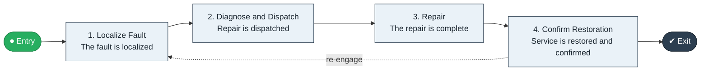

# Trouble to Restore

`value-streams:value-stream-trouble-to-restore-gtrgd8` · **operational** · telecommunications · industry-specific

> The telecom assurance stream from fault report through diagnosis and repair to restored service.

**Outcome:** Restored service confirmed to the customer.

**Machine-readable:** this page is generated from — and must stay in sync with — the authoritative record [`value-streams-value-stream-trouble-to-restore-gtrgd8.yaml`](./value-streams-value-stream-trouble-to-restore-gtrgd8.yaml). The front matter above is YAML-extractable metadata.

## Stage flow

## Value stages

| # | Stage | Entry criterion | Exit criterion | Enabling capabilities (count) | Realizing processes (count) | Visible |
|---|---|---|---|---|---|---|
| 1 | **Localize Fault** | A fault is reported. | The fault is localized. | 2 | 1 | yes |
| 2 | **Diagnose and Dispatch** | The fault is localized. | Repair is dispatched. | 2 | 1 | no |
| 3 | **Repair** | Repair is dispatched. | The repair is complete. | 2 | 1 | no |
| 4 | **Confirm Restoration** | The repair is complete. | Service is restored and confirmed. | 2 | 1 | yes |

### 1. Localize Fault

Localize the reported or detected fault.

| Aspect | Value |
|---|---|
| Entry criterion | A fault is reported. |
| Exit criterion | The fault is localized. |
| Outcome | A localized fault. |
| Customer visible | True |
| Enabling capabilities | `capabilities:capability-technology-management-maus5n` · `capabilities:capability-information-management-6vjgdh` |
| Realizing processes | `processes:process-eo-operate-4njp7b` |

### 2. Diagnose and Dispatch

Diagnose root cause and dispatch repair.

| Aspect | Value |
|---|---|
| Entry criterion | The fault is localized. |
| Exit criterion | Repair is dispatched. |
| Outcome | A dispatched repair. |
| Customer visible | False |
| Enabling capabilities | `capabilities:capability-operations-management-pm3w8k` · `capabilities:capability-workforce-management-9e8d8s` |
| Realizing processes | `processes:process-eo-operate-2jnz85` |

### 3. Repair

Execute the repair.

| Aspect | Value |
|---|---|
| Entry criterion | Repair is dispatched. |
| Exit criterion | The repair is complete. |
| Outcome | A completed repair. |
| Customer visible | False |
| Enabling capabilities | `capabilities:capability-technology-enablement-y6nkws` · `capabilities:capability-operations-management-pm3w8k` |
| Realizing processes | `processes:process-eo-operate-j9cjzz` |

### 4. Confirm Restoration

Confirm service restoration with the customer.

| Aspect | Value |
|---|---|
| Entry criterion | The repair is complete. |
| Exit criterion | Service is restored and confirmed. |
| Outcome | Restored service. |
| Customer visible | True |
| Enabling capabilities | `capabilities:capability-customer-management-f3n8wb` · `capabilities:capability-operations-management-pm3w8k` |
| Realizing processes | `processes:process-pr-operate-bbe384` |

## Scope boundary

**Entry:** A fault is reported or detected.

**Exit:** Service is restored and confirmed.

**In scope**

- Fault localization
- Diagnosis and dispatch
- Repair
- Restoration confirmation

**Out of scope** (owned by the named neighbour)

- Planned maintenance
- Customer complaint handling (Issue to Resolve)

## Traceability

**Capabilities** (`aggregated_capability_refs`, resolving in [business-capabilities](https://github.com/technehub-labs/dea-catalog-business-capabilities)):

- `capabilities:capability-technology-management-maus5n`
- `capabilities:capability-information-management-6vjgdh`
- `capabilities:capability-operations-management-pm3w8k`
- `capabilities:capability-workforce-management-9e8d8s`
- `capabilities:capability-technology-enablement-y6nkws`
- `capabilities:capability-customer-management-f3n8wb`

**Processes** (`process_refs`, resolving in [business-processes](https://github.com/technehub-labs/dea-catalog-business-processes)):

- `processes:process-eo-operate-4njp7b`
- `processes:process-eo-operate-2jnz85`
- `processes:process-eo-operate-j9cjzz`
- `processes:process-pr-operate-bbe384`

## Cross-stream links

**Upstream:** none recorded.

**Downstream:** none recorded.

## Measurement

- **Mean time to restore service** (stage: Confirm Restoration) — Mean elapsed time from fault to restoration. → [`dea:metric-mean-time-to-restore-service`](https://github.com/technehub-labs/dea-catalog-metrics)

## Evidence

| Source | Class | Reference |
|---|---|---|
| SRC-010 | industry-reference-model | Telecommunications industry reference models (eTOM category-level structure) |

**Rationale:** Admitted under CR-VS-12 (population tranche; candidate VSC-037) from the CR-VS-11 industry evidence register extension. Industry-specific chain (telecommunications); distinct from cross-industry streams by applicability (CR-VS-11 method note); cross-catalog references resolve against the sibling catalogs per the referential-integrity gate.

See [research/evidence.md](./research/evidence.md) for the source-backed notes.

## Provenance ladder

| Stage | Date | Actor |
|---|---|---|
| candidate | 2026-10-28 | Emmanuel A. Otchere, candidate universe v0.6 (CR-VS-12) |
| admitted | 2026-10-28 | Emmanuel A. Otchere, admission CR-VS-12 |

---

*Generated by [`scripts/generate_entity_docs.py`](../../../scripts/generate_entity_docs.py) (CR-VS-13) from the authoritative record. Do not edit by hand; regenerate.*
